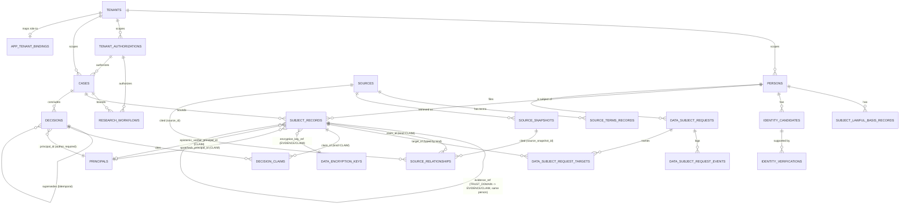

# HCI Domain ERD

P0-01. Every table and FK edge in `database/migrations/0001`-`0011`, as
shipped. Column lists here are abbreviated to what carries the relationship
or a reader needs to disambiguate a polymorphic table — full column detail
is `HCI_ENTITY_DICTIONARY.md`; rules are `HCI_INVARIANTS.md`; lifecycles are
`HCI_STATE_MACHINES.md`. All tables also carry `tenant_id` (omitted below
except where the FK is composite specifically to pin tenant + kind/person)
and are tenant-isolated per `HCI_INVARIANTS.md` §Tenant isolation.

## Notes on reading this diagram

- **`SUBJECT_RECORDS` is one physical table, four logical entities**
  (Evidence / Claim / Assessment / TrustDomain, discriminated by `kind`).
  Every edge touching it in the diagram above is scoped to specific `kind`
  values — see `HCI_ENTITY_DICTIONARY.md` §Subject records for exactly
  which. Treating it as four separate boxes would be more familiar to read
  but would misrepresent the schema: they share one PK space, one RLS
  policy, one append-only trigger, and the typed composite-FK idiom
  (`(tenant_id, id, kind)` / `(tenant_id, person_id, id, kind)`) exists
  specifically so a reference can pin *which* logical entity it targets
  without four separate tables.
- **Self-referencing edges** (`supersedes_id` on both `SUBJECT_RECORDS` and
  `DECISIONS`; `evidence_ref_id` on `SUBJECT_RECORDS`) are bitemporal
  history and TrustDomain evidence-linking respectively — not a hierarchy.
- **`project_ref` on `CASES`** is deliberately opaque free text, not a
  diagram edge: a Case must never structurally depend on the commercial
  Project/billing schema existing or resolving (ADR-0020).
- **Not on this diagram, not yet built**: `Claim` content (the shape a
  Contradiction check would compare — see
  `docs/intelligence/HCI_CONTRADICTION_SPEC.md`), `Permission` as schema,
  `RiskEvent`, `Outcome`, `Control`/`Mitigation`, `Organization`,
  `Relationship`, `PersonMergeLog`/`PersonSplitLog` — see
  `HCI_ENTITY_DICTIONARY.md` §Not yet modelled.
- **Canonical read views** (`evidence_current`, `claims_current`,
  `assessments_current`, `decisions_current`) and their `_as_of(t)`
  function twins are derived, not base tables — omitted from the ERD
  itself, documented in `HCI_ENTITY_DICTIONARY.md` §Canonical read views.

## Table count

21 base tables (verified against the migrations' own cumulative
table-inventory drift check, which fails the migration itself if a new
table is created and not classified — `hci` schema, `pg_class.relkind='r'`,
as of migration 0011): `tenants`, `persons`, `tenant_authorizations`,
`subject_lawful_basis_records`, `sources`, `source_terms_records`,
`research_workflows`, `subject_records`, `data_subject_requests`,
`data_subject_request_events`, `data_subject_request_targets`,
`identity_candidates`, `identity_verifications`, `app_tenant_bindings`,
`cases`, `source_snapshots`, `source_relationships`, `decisions`,
`data_encryption_keys`, `decision_claims`, `principals`.
