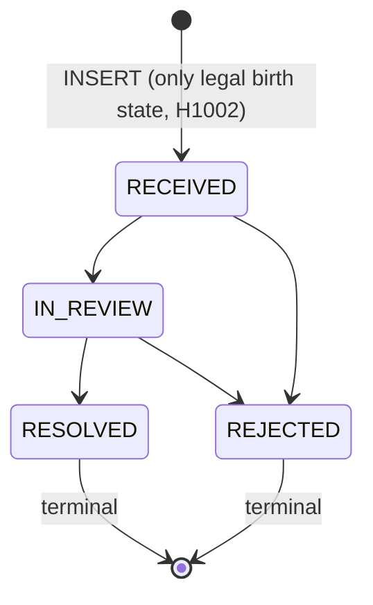
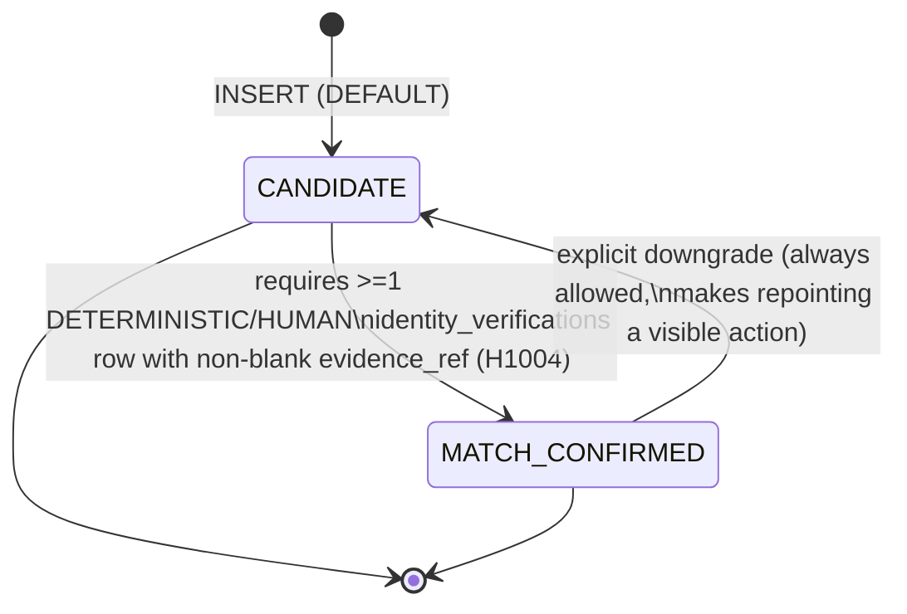
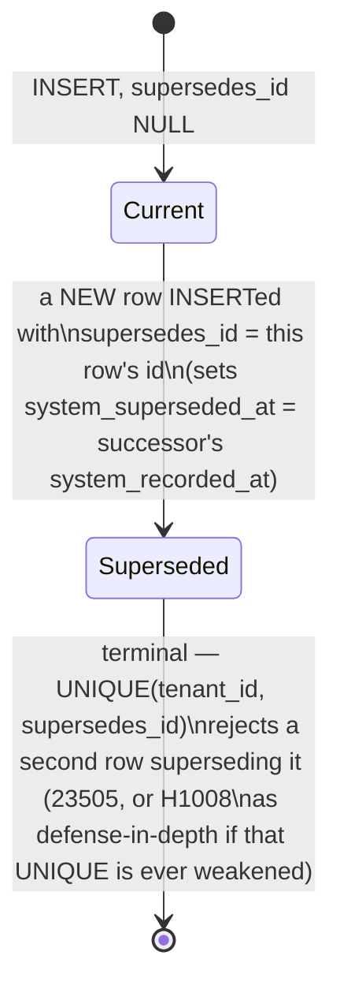
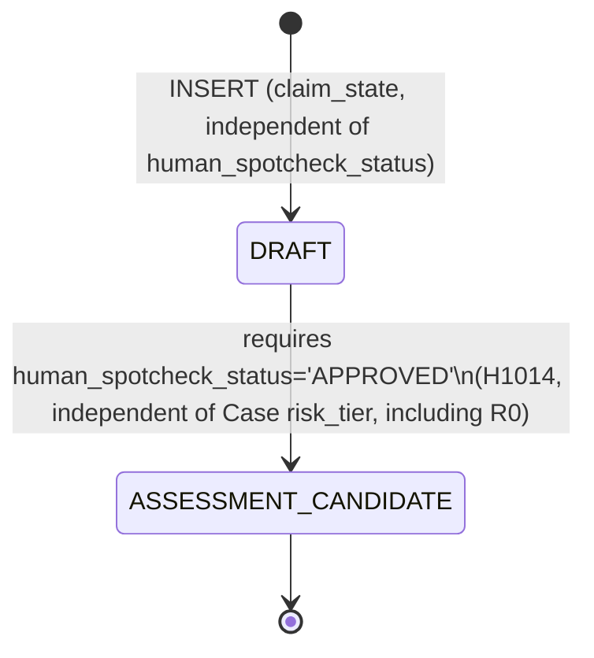

# HCI State Machines

P0-01. Every lifecycle FSM the schema enforces, transcribed from the actual
trigger logic (`database/migrations/`). Diagrams are Mermaid `stateDiagram-v2`.
An FSM here that a future migration changes must be updated in the same
commit (R4) — this file is a mirror of the trigger code, not an independent
design surface.

## Case lifecycle (`hci.cases.status`, ADR-0020)

```mermaid
stateDiagram-v2
    [*] --> OPEN: INSERT (only legal birth state, H1010)
    OPEN --> ACTIVE
    ACTIVE --> CLOSED: sets closed_at (trigger-assigned, not client-writable)
    CLOSED --> [*]: terminal; every other column also frozen (H1007)
```



Illegal: `OPEN → CLOSED` (must pass through ACTIVE), any transition out of
`CLOSED`, INSERT at any status but OPEN. A CLOSED case admits no new
`research_workflows`/`subject_records` (H1011, checked at their own
INSERT). Never deleted or truncated (`cases_no_delete`/`cases_no_truncate`,
defends the table-owner bypass, not just the app-role grant).

## Data-subject-request lifecycle (`hci.data_subject_requests.status`)



`person_id`/`request_type` frozen once review starts (i.e. once status
leaves RECEIVED, H1007) — what the request is *about* is settled before any
outcome is reached. Row itself never deleted (grant withheld + trigger).
Every transition attempt is evaluated on **every** UPDATE (not
`UPDATE OF status`), so an unlisted column is never an unguarded write path.

## Identity match (`hci.identity_candidates.match_state`)



While `MATCH_CONFIRMED`: `person_id` is frozen (H1007, must downgrade first)
and the last qualifying `identity_verifications` row backing it cannot be
removed or edited away from qualifying (H1005) — guarded on *both* the
state-asserting side and the evidence-removal side, since an invariant of
the form "this state is justified by rows over there" is violated exactly
as easily either way.

## Bitemporal supersession (`hci.subject_records`, `hci.decisions` — ADR-0017)



Not a status column — "current" means `system_superseded_at IS NULL`,
read via the `hci.*_current` views; "as of time T" means
`system_recorded_at <= T AND (system_superseded_at IS NULL OR system_superseded_at > T)`,
read via `hci.*_as_of(T)`. The UPDATE that marks a row Superseded is the one
recognized shape of the effect-based escape hatch (`HCI_INVARIANTS.md`
§Effect-based escape hatch) — every other column must be byte-identical to
the pre-image. TRUST_DOMAIN rows on `subject_records` are structurally
excluded from ever entering Superseded (`subject_records_trust_domain_no_supersede`)
— there is no value yet defined for such a row to correct.

## Claim admission (`hci.subject_records` where `kind='CLAIM'`)



`claim_state` has no further states after `ASSESSMENT_CANDIDATE` in Wave 1 —
"transition" on this append-only table is always a new superseding row (see
Bitemporal supersession above), never an UPDATE. `human_spotcheck_status`
(`PENDING`/`APPROVED`/`REJECTED`) is a separate, orthogonal field checked
only at the moment `claim_state` is set to `ASSESSMENT_CANDIDATE`; once a
Claim is admitted, `hci.enforce_decision_reaudit_gate()` is the sole
downstream consumer that re-checks `claim_state='ASSESSMENT_CANDIDATE'` +
`human_spotcheck_status='APPROVED'` before allowing a `decision_claims` link
(H1016) — added specifically because the first version of gate 3 (0008) had
no such consumer, letting an unadmitted Claim be cited by a Decision anyway.

`reaudit_required` (boolean, not a claim_state value) is set `true` only by
`hci.flag_claims_on_risk_elevation()` (Case risk_tier increases) and is
inherited by a superseding row rather than reset — see `HCI_INVARIANTS.md`
§Decision-Claim reaudit gate for the full cross-table gate.

## Epistemic label (`hci.subject_records` where `kind='CLAIM'`, ADR-0019/ADR-0013)

```mermaid
stateDiagram-v2
    [*] --> UNKNOWN: INSERT with no explicit label (least-trusted default)
    UNKNOWN --> HYPOTHESIS
    UNKNOWN --> AI_INFERENCE
    UNKNOWN --> "...(11-value kernel enum)"
    HYPOTHESIS --> SOURCE_FACT: FORBIDDEN without epistemic_verifier_principal_id (H1019)
    UNKNOWN --> SOURCE_FACT: FORBIDDEN without epistemic_verifier_principal_id (H1019)
    "...(11-value kernel enum)" --> SOURCE_FACT: any predecessor label may promote,\nonly UNKNOWN/HYPOTHESIS predecessors are\nnamed by the redline itself
```

Full 11-value set (verbatim from the shared kernel, provisional pending
ADR-0013 gate 3): `SOURCE_FACT, EVIDENCE, ASSUMPTION, HYPOTHESIS,
AI_INFERENCE, AI_SUGGESTION, HUMAN_OPINION, CALCULATED_RESULT,
SIMULATED_RESULT, UNKNOWN, DECISION`. The one named redline (H1019) is
`UNKNOWN`/`HYPOTHESIS` → `SOURCE_FACT` with no verifier — every other
transition between the 11 values is unrestricted at the schema layer. A
superseding row with no explicit label inherits the predecessor's label
*and* verifier together (never silently demotes a `SOURCE_FACT` to
`UNKNOWN`). Independent of the redline: **every** row whose label is
`SOURCE_FACT` requires a verifier regardless of how it got there
(`subject_records_source_fact_verified`) — closes the "born already
SOURCE_FACT" bypass that would otherwise skip the promotion check entirely
(the same bug class ADR-0019 hit twice: a rule stated only for a
*transition* is not automatically true for a row born in the end state).
Not modelled (open, not built): `authorship_state`, `locked`,
`execution_manifest_entry`, any demotion/relabelling rule other than this
one redline.
