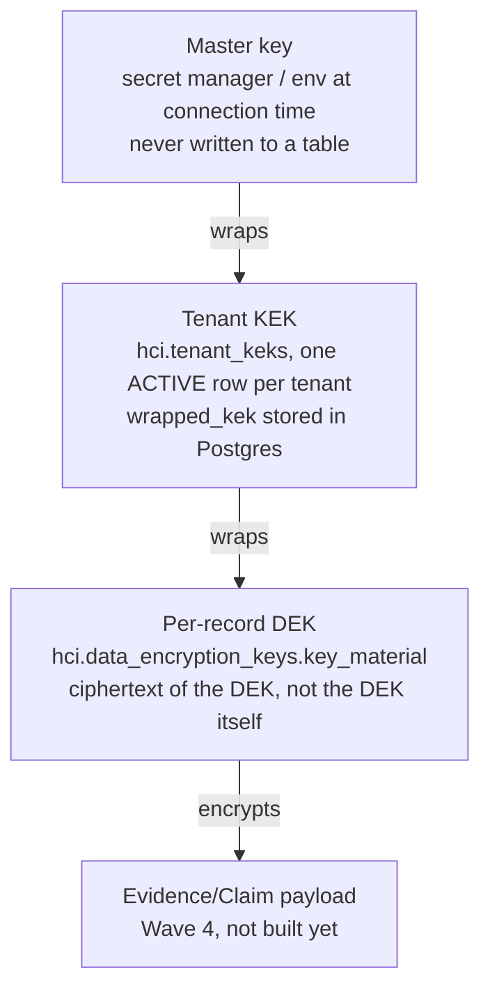

# Key Rotation and Compromise Response

P0-11 / ADR-0022 gate 1. Wave 2 minimal runbook — not the full BYOK/envelope-encryption
architecture (P1-04, stays deferred). Scope: what happens to a per-record
Evidence/Claim encryption key during routine rotation, and what happens if a
Key Encryption Key (KEK) or the master key is compromised, before Wave 4
admits any real Evidence/Claim row.

**Status: documentation only.** ADR-0022 gates 2-5 (schema, rotation test,
compromise-drill test, Wave-4 blocking precondition) are OPEN — this file
alone does not make Wave 2 exit-ready. See §What is not yet built.

## Key hierarchy

Three tiers, DEK wraps payload, KEK wraps DEK, master key wraps KEK:

- **DEK** (Data Encryption Key): one per `hci.subject_records` row
  (EVIDENCE/CLAIM), already exists as `hci.data_encryption_keys.key_material`
  (ADR-0018 gate 2, Wave 1). Amended by ADR-0022 gate 2 (not yet built): the
  column's *meaning* changes from raw key material to a wrapped DEK; the
  column itself, and `subject_records.encryption_key_ref` pointing at it,
  are unchanged.
- **KEK** (Key Encryption Key): one ACTIVE per tenant, versioned
  (`tenant_keks.kek_version`), wraps every DEK for that tenant. Not yet
  built (ADR-0022 gate 2).
- **Master key**: single key, held outside the database (secret manager or
  environment variable supplied at connection time — never in the
  repository, per `11_SECURITY_PRIVACY_GOVERNANCE.md:56`), wraps every
  tenant's KEK. The database process sees it only in-memory, for the
  duration of one unwrap call — this is a statement about where it is
  *generated and stored long-term*, not a claim the database process never
  touches it (`ADR-0022`'s own reconciliation with `CRYPTO-NOEXTERNAL-01`).

## Routine rotation

Rotates a tenant's KEK. Never re-encrypts payload ciphertext — only re-wraps
the DEK layer.

1. **Trigger**: scheduled cadence (interval not yet decided — set when
   ADR-0022 gate 2 lands the schema; a placeholder cadence here would be
   invented, not decided) or a manual operator request.
2. **Issue** a new `tenant_keks` row for the tenant: new `kek_version`,
   `status='ACTIVE'`, freshly wrapped under the master key.
3. **Re-wrap**: for every `hci.data_encryption_keys` row belonging to that
   tenant, unwrap its DEK under the *old* KEK version, re-wrap under the
   *new* one, update `wrapped_by_kek_version`.
4. **Retire** the old `tenant_keks` row: `status='REVOKED'`. Never delete —
   this schema's own convention is append-only ledgers for exactly this
   class of record (`docs/domain/HCI_INVARIANTS.md` §Append-only).
5. **Verify**: `KEY-ROT-01` (ADR-0022 gate 3, not yet built) — payload
   ciphertext bytes identical before/after, old `kek_version` can no longer
   unwrap anything, every row references the new version.

Owner: whoever holds the Postgres owner role in this schema's model (no
separate operator role exists yet — Wave 1/2 has one owner, per
`docs/domain/HCI_INVARIANTS.md`; a named human/team role is a Wave 2
operational decision, not a schema one).

## Compromise response

Triggered by: suspected or confirmed exposure of a KEK version or the
master key (leaked credential, compromised secret-manager access, insider
incident). This is the scenario RT-07 named directly: "encrypting data with
no rotation/compromise plan is security theater" — this procedure is what
makes that claim false for this schema.

1. **Contain**: mark the affected `tenant_keks` row (or every tenant's
   current KEK, if the master key itself is the compromised secret)
   `status='REVOKED'` immediately. A revoked KEK must not be usable to wrap
   a *new* DEK from this point forward, even before re-wrapping finishes.
2. **Re-wrap**: run the same re-wrap procedure as routine rotation (§Routine
   rotation, steps 2-4) against every DEK still wrapped under the revoked
   version — this is not a separate mechanism, it is routine rotation
   triggered by an incident instead of a schedule.
3. **Audit**: emit one `KEY_COMPROMISE_RESPONSE` event
   (`tenant_id`, `kek_version`, `actor`, `timestamp`) — reuses the Wave 2
   audit schema already required for direct-DB-access logging
   (`11_SECURITY_PRIVACY_GOVERNANCE.md:39`), not a new logging mechanism.
4. **If the master key itself is compromised**: rotate the master key in
   the secret manager, then re-wrap *every tenant's* KEK under the new
   master key (one level up from step 2) before any tenant-level re-wrap
   can proceed — the master key sits above every KEK, so its compromise is
   the superset case, not a separate procedure.
5. **Verify**: `KEY-COMPROMISE-DRILL-01` (ADR-0022 gate 4, not yet built) —
   zero DEKs remain wrapped under the revoked version, the audit event
   exists, and a dedicated mutation check proves the drill test itself
   cannot pass with the revoke step, the re-wrap step, or the audit-emit
   step silently removed (same pattern as `scripts/mutation-check-wave1.ps1`).

This procedure must run successfully as a synthetic drill *before* Wave 4
opens (ADR-0022 gate 5) — not after the first real incident.

## Drill record

No drill has been run — `KEY-ROT-01` and `KEY-COMPROMISE-DRILL-01` do not
exist yet (ADR-0022 gates 3-4). This section will record, for each drill
run: date, synthetic tenant/row count, which procedure was exercised
(routine rotation / compromise response / master-key rotation), pass/fail,
and the commit that added the corresponding test. Required, per ADR-0022
gate 5, before `22_HCI_TOP_TIER_IMPLEMENTATION_MASTER_PLAN.md` §Wave 4 may
be declared open.

## What is not yet built (ADR-0022 gates 2-5, honestly open)

This runbook (gate 1) is the only gate closed by this file. Not built:

- **Gate 2 (schema)**: `tenant_keks` table, `wrapped_by_kek_version` column
  on `hci.data_encryption_keys`. No migration exists yet — `key_material`
  today still holds a raw (unwrapped) DEK, exactly as ADR-0018 Wave 1 shipped
  it. Nothing in this runbook is enforced by the database yet.
- **Gate 3 (rotation test)**: `KEY-ROT-01` — does not exist.
- **Gate 4 (compromise drill)**: `KEY-COMPROMISE-DRILL-01` +
  `scripts/mutation-check-key-rotation.ps1` — does not exist.
- **Gate 5 (Wave 4 precondition)**: the master-plan edit blocking Wave 4 on
  gates 3-4 being green — not made.

Deliberately not rushed in the same pass as this document: gates 2-4 are a
real schema change plus real cryptographic rotation/compromise logic
touching encryption-key management specifically — the exact class of change
this schema's own discipline (`docs/domain/HCI_INVARIANTS.md`) treats with
the most care (SECURITY DEFINER functions, RLS fail-closed behavior,
real-Docker verification before shipping). A rushed version of gates 2-4
that merely looks complete is the precise failure mode RT-07 and this ADR
both exist to prevent — see ADR-0022's own §Consequences: "a matching,
testable answer to 'what happens when a key leaks' instead of a documented
gap," not a documented gap wearing a test-shaped costume.
