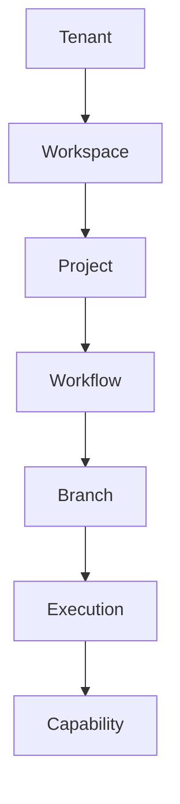

## PROPOSED_CHANGE

Method Atlas §21「最小爆炸半徑」在 mermaid 圖與「強制規則」之間插入一個新的「Branch 定義」小節：一句敘事級最小定義（forked, isolated execution lineage of a Workflow），交代其建立/併回機制（既有 `Branch`/`Merge` action），並明確聲明完整狀態機不在此定義範圍內，指向已建成的 `specs/workflow/branch.schema.yaml`。

## RATIONALE

`docs/adr/ADR-003-tenant-model-and-cas-isolation.md`（ACCEPTED 2026-08-29）Context 段 P1-DUP-3（L19）全文 grep 驗證：`Branch` 作為爆炸半徑節點在全部三份母文件中零定義——Atlas §21 mermaid（L4143）只畫出 `WF --> B[Branch] --> EX`，未附任何文字說明；Branch 一詞的另外兩處出現（MP L967 的人類決策動作清單 `Accept/Reject/Edit/Lock/Branch/Merge`、Atlas L40 的 "Git Branch" 範例）皆與爆炸半徑節點無關。

Sub-decision (c)（L87-94）裁決 Branch「應保留、不應刪除」，並給出「Minimal working definition to attach at Atlas §21」（L94 逐字）：「a Branch is a forked, isolated execution lineage of a Workflow — created by the existing `Branch` action, producing its own Executions, and reconciled back into the parent Workflow's committed history only through the existing `Merge` action. Unmerged Branch executions do not affect Project Knowledge (consistent with Atlas §21 rule 3). A full behavioral spec (state machine, who can Merge, conflict handling) is out of scope for this ADR and is flagged as follow-up work.」本提案是這句裁決文字在 Atlas §21 的逐字落地，屬於「missing_contract」——填補一個此前完全空白（zero definition）的欄位，不是修正既有錯誤文字。

ADR-003 當時（2026-08-29）明確把完整狀態機列為「out of scope... flagged as follow-up work」。該 follow-up 已由後續 `docs/adr/ADR-012-branch-merge-state-machine.md`（ACCEPTED 2026-08-30）完成，機讀正本為 `specs/workflow/branch.schema.yaml`（6 狀態機、merge 授權門檻、衝突處理）。本提案在 Atlas §21 新增的敘事級定義刻意只轉錄 ADR-003 原文的最小定義（一句話 + 建立/併回機制），並在段落結尾明確指向該 schema 供讀者查完整規格——這是忠實反映現況（截至提案撰寫當下，完整規格已存在）的必要更新，不是把 ADR-012 的完整狀態機內容誤植為 ADR-003 的原始裁決；兩者的出處在本提案的 RATIONALE 與 EVIDENCE 中分開標注，不混為一談。

## SOURCE_DOCUMENT

`AI_LEGO_Cognitive_Method_Atlas_Global_Architecture_v1.md`

## AFFECTED_SECTIONS

§21 最小爆炸半徑（L4136-4159）

## DEPENDENCIES

- 依賴 `specs/workflow/branch.schema.yaml` 已存在（已建，`docs/adr/ADR-012-branch-merge-state-machine.md` 的機讀編譯正本）——本提案的「完整行為規格見該檔」指標句直接依賴此檔案存在，否則會變成指向空氣的死連結。
- 依賴 `specs/execution/blast-radius-chain.schema.yaml#/branch_node` 的最小定義（已與本提案文字同源自 ADR-003 L94，兩者互為一致性檢查——若未來任一方修改 Branch 最小定義的措辭，另一方需同步審閱）。
- 與 `012-blast-radius-chain-reconciliation-mp` 無強制依賴（分屬不同目標文件、不同 Sub-decision），但邏輯上互補：`012` 讓 MP §1.5 指向 Atlas §21 作為爆炸半徑鏈唯一正本，本提案則是讓 Atlas §21 本身把其中一個此前无定義的節點（Branch）補齊定義——兩者合力才是完整關閉 P1-DUP-3。建議一併審閱，但修改的是不同檔案的不同行區間，可各自獨立套用。

## COMPATIBILITY

不影響任何既有 schema、policy 或 recipe 檔案——`specs/workflow/branch.schema.yaml` 與 `specs/execution/blast-radius-chain.schema.yaml` 皆已獨立建成且皆明載「未修改任何母文件」。本提案純粹是讓 Atlas §21 的敘事文字補上一個先前缺席的定義段落，不修改 mermaid 圖本身、不修改「強制規則」9 條的任何文字，對現有讀者/工具零破壞性。

## MIGRATION

`Edit` 工具精確字串替換；套用後重新計算 Method Atlas sha256 並更新 `.ai/research/phase-0/document-hashes.yaml`。

## ROLLBACK

`git revert` 對應 commit 即可完整還原成無 Branch 定義的原文。Phase 3 尚無程式碼直接解析 §21 這段敘事文字本身（實際驗證邏輯在 `specs/workflow/branch.schema.yaml`），回滾零下游風險。

## EVIDENCE

- `docs/adr/ADR-003-tenant-model-and-cas-isolation.md:19`（P1-DUP-3 Context，Branch 作為爆炸半徑節點零定義的驗證）
- `docs/adr/ADR-003-tenant-model-and-cas-isolation.md:93-94`（Sub-decision (c)，Branch 應保留的兩點佐證 + 逐字最小定義）
- `docs/adr/ADR-003-tenant-model-and-cas-isolation.md:104`（Recommendation item (c)，「Attach the minimal Branch definition above to Atlas §21」）
- `docs/adr/ADR-003-tenant-model-and-cas-isolation.md:112`（Consequences follow-up item (iii)，完整狀態機列為 out of scope）
- `docs/adr/ADR-003-tenant-model-and-cas-isolation.md:128`（Evidence 段對 Atlas §21 L4136-4159 的行號引用）
- `docs/adr/ADR-012-branch-merge-state-machine.md`（ACCEPTED 2026-08-30，完整狀態機的後續裁決，本提案不轉錄其內容，只指向其機讀正本）
- `specs/workflow/branch.schema.yaml:7-32`（該檔 description 逐字重述 ADR-003 的最小定義與 ADR-012 的完整規格分工）
- `specs/execution/blast-radius-chain.schema.yaml:138-172`（`branch_node` 段，與本提案文字同源、互相佐證的最小定義）
- `AI_LEGO_Cognitive_Method_Atlas_Global_Architecture_v1.md:4136-4159`（本次任務實讀，確認現況為 mermaid 圖 + 9 條強制規則，無 Branch 文字定義）

## Diff

### Original

Method Atlas §21（L4136-4159，逐字）：

````text
# 21. 最小爆炸半徑



## 強制規則

1. AI-generated idea 預設 `DRAFT`。
2. `UNKNOWN` 不得提升為 `FACT`。
3. 一個 Method execution failure 不得污染 Project Knowledge。
4. 高風險新 Method 先 shadow / preview。
5. `publish / deploy / delete / send / irreversible` 需要 authority gate。
6. Rollback 使用 Execution Manifest。
7. 新 Jurisdiction Pack 只能作用在其 scope。
8. Experiment 預設受限於 project / cohort / traffic slice。
9. 任何 destructive migration 必須有 prevalidated recovery path。

````

### Proposed

````text
# 21. 最小爆炸半徑


## Branch 定義

Branch 是 Workflow 的一條分叉、隔離的執行血系（forked, isolated execution lineage of a Workflow）：由既有的 `Branch` action（Master Plan §11.2）建立，產生自己的 Execution；僅能透過既有的 `Merge` action 併回父 Workflow 的已提交歷史。未併入（unmerged）的 Branch Execution 不影響 Project Knowledge，與本節強制規則 3 一致。

完整行為規格（狀態機、Merge 授權門檻、衝突處理）不在此定義範圍內，見 `specs/workflow/branch.schema.yaml`（`docs/adr/ADR-012-branch-merge-state-machine.md` 建立）。

## 強制規則

1. AI-generated idea 預設 `DRAFT`。
2. `UNKNOWN` 不得提升為 `FACT`。
3. 一個 Method execution failure 不得污染 Project Knowledge。
4. 高風險新 Method 先 shadow / preview。
5. `publish / deploy / delete / send / irreversible` 需要 authority gate。
6. Rollback 使用 Execution Manifest。
7. 新 Jurisdiction Pack 只能作用在其 scope。
8. Experiment 預設受限於 project / cohort / traffic slice。
9. 任何 destructive migration 必須有 prevalidated recovery path。

````

### Reason

在 Atlas §21 mermaid 圖與「強制規則」之間插入「Branch 定義」小節，是 `ADR-003` Sub-decision (c) 已批准之「Attach the minimal Branch definition above to Atlas §21」（Recommendation item (c)）的逐字落地，定義文字本身直接轉錄自 ADR-003 L94，不是本提案的新裁決。段落結尾指向 `specs/workflow/branch.schema.yaml` 是誠實反映現況（該完整規格已由後續 ADR-012 建成），避免母文件敘事顯得比實際情況更空白，同時不把 ADR-012 的完整狀態機內容誤植進本提案所轉錄的 ADR-003 最小定義本身。
