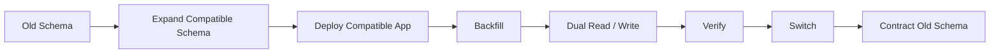

## PROPOSED_CHANGE

Method Atlas 內四個各自重複畫出 DB Migration 步驟序列的地方，全部刪除各自的序列（表格內嵌序列文字或 mermaid 圖），改為一句指向 Execution Contract §28 的指標句：

1. F21 表格列（L900）——「標準使用方式」欄位內嵌的 5 節點序列。
2. F21 mermaid 流程圖（L907-919）——11 節點。
3. §11.50 Expand–Contract Migration mermaid（L2367-2376）——8 節點。
4. §13.10 Database Migration Recipe mermaid（L3486-3500）——13 節點。

四處保留原有「這是什麼 pattern / 適用情境」的說明文字不動（F21 表格其餘欄位、§11.50 的「效益」條列、§13.10 的章節標題），只刪除各自畫出的具體步驟序列本身。

## RATIONALE

`docs/adr/ADR-005-db-migration-recipe-and-method-id-grammar.md` Sub-decision (a) 逐字核對後發現，DB Migration 步驟序列在三母文件裡實際被畫了**五處**（比原始問題陳述的「三處」多一處，Atlas 內部自己就有 F21 mermaid 與 F21 表格列兩份不同序列），其中四處在 Atlas、一處在 EC。順序票數 2 比 2 打平（F21 兩處對、§11.50/§13.10 兩處錯），且經 WebSearch 業界標準查證後確認 Dual Write 必須在 Backfill 之前啟用——選其中任一份 Atlas 版本當正本都等於把一個未修正的錯誤複製成權威，因此 ADR-005 採 **Option B（合併修正）**，並指定 **EC §28 為唯一 SSOT**（理由：EC 是「AI 開機必讀」的強制規範，Atlas 定位是方法/工具型錄，本質是參考資料）。

ADR-005 原文對 Atlas 三處（F21、§11.50、§13.10）的處置是同一句指示：「改寫為：保留各自的『這是什麼 pattern / 適用情境』說明文字，但刪除各自的序列圖，改成一句『精確步驟序列見 Execution Contract §28（唯一正本），本節僅說明概念與適用場景』」。本提案額外把 ADR 原始問題陳述遺漏、但 ADR 自己核對出來的第四處（F21 表格列，L900）納入同一批次處理——因為它與 F21 mermaid 是同一個 pattern 在同一小節內的第二份重複序列，套用同一條指示、同一句指標文字，邏輯上不該拆成獨立提案，且四處目前是「2 對正確、2 對錯誤」並存，統一刪除換指標句可一次性消除票數打平帶來的歧義。

## SOURCE_DOCUMENT

`AI_LEGO_Cognitive_Method_Atlas_Global_Architecture_v1.md`

## AFFECTED_SECTIONS

- F21 — 資料庫／資料套件（DB / Data Pack）表格列（L900）
- F21 — 資料庫／資料套件（DB / Data Pack）mermaid 流程圖（L907-919）
- 11.50 擴張－收縮遷移模式（Expand–Contract Migration）（L2367-2376）
- 13.10 Database Migration Recipe（L3486-3500）

## DEPENDENCIES

與 `023-db-migration-15-step-sequence-ec`（修改 EC §28 本體）修改不同檔案，互不重疊，可獨立套用。ADR-005 Migration 段建議執行順序為「先 023、後 024」——理由是本提案新增的指標句一旦生效，讀者會被導向 EC §28；若 EC §28 尚未套用 023 的修正，讀者跳過去看到的仍是舊的、有資料遺失風險的 11 步版本。兩者互相獨立可套用，但建議依此順序生效以避免指標句短暫指向未修正內容的過渡期。

## COMPATIBILITY

四處皆為純文件內容替換：F21 表格列從「敘述型序列文字」改為「指標句」，欄位結構（4 欄表格）不變；三個 mermaid fenced code block 整段刪除，改為一行純文字指標句，不再是程式碼區塊。不影響任何其他消費 Atlas 這四段內容的既有邏輯（純文件變更，Atlas 本身無 runtime 解析器讀取 mermaid 圖）。

## MIGRATION

四個獨立 `Edit` 操作，各自以現有逐字內容為 `old_string` 做精確字串替換；套用後重算 Atlas sha256。四處互相獨立、可依任意順序在同一次套用內完成（不像 023/024 之間需要考慮先後）。

## ROLLBACK

三母文件在 git 有 hash-anchored baseline，`git revert` 對應 commit 即可完整還原，風險等級 Low（純文件變更，無 runtime 副作用）。

## EVIDENCE

- `docs/adr/ADR-005-db-migration-recipe-and-method-id-grammar.md` Sub-decision (a)（L25-66 五處逐字核對表 + Option B 處置指示原文；Recommendation 第 1 條 L164；Migration 步驟 2，L178）
- `AI_LEGO_Cognitive_Method_Atlas_Global_Architecture_v1.md:900,907-919,2367-2376,3486-3500`（本提案修改對象，現況逐字已於下方 Diff 引用）
- `.ai/research/phase-1/DUPLICATION_REGISTER.yaml` P1-DUP-1（`resolved_by: docs/adr/ADR-005-...md`；原始登記僅記錄三處，ADR-005 補上遺漏的 §11.50 與 F21 表格列，本提案覆蓋 ADR 核對出的全部四個 Atlas 站點）

## Diff

### Site 1 — F21 表格列（L900）

#### Original

```text
| Schema Compatibility Analysis | 檢查 schema migration 相容性 | expand→dual read/write→backfill→verify→contract | 支援零停機 migration |
```

#### Proposed

```text
| Schema Compatibility Analysis | 檢查 schema migration 相容性 | 精確步驟序列見 Execution Contract §28（唯一正本），本節僅說明概念與適用場景。 | 支援零停機 migration |
```

#### Reason

「標準使用方式」欄位原本內嵌一份 5 節點序列（`expand→dual read/write→backfill→verify→contract`），其中 `dual read/write` 未拆分 Dual Write / Dual Read 兩個不同控制點，且與同小節 L907-919 的 11 節點版本不一致（同一小節內部就自相矛盾）。改為指標句後，其餘三欄（Tool / 主要用途 / 主要效益）不動，表格結構完整保留。

---

### Site 2 — F21 mermaid 流程圖（L907-919）

#### Original


#### Proposed

```text
精確步驟序列見 Execution Contract §28（唯一正本），本節僅說明概念與適用場景。
```

#### Reason

此為 ADR-005 五處逐字核對中順序**正確**的兩處之一（Dual Read/Write 在 Backfill 之前），但仍與 EC §28、Atlas §11.50/§13.10 三處不同步、且缺 Data Contract 之外其餘節點名稱與 EC 修正後版本用詞不完全一致（如 `Backup + Restore Test` vs EC 用語 `Backup / Restore Validation`）。刪除整段 mermaid，改為單行指標句，避免正確版本與其餘四處錯誤/不一致版本並存造成讀者無所適從。F21 表格本身其餘 9 列（ERD、Normalization 等其他工具）不受影響。

---

### Site 3 — §11.50 Expand–Contract Migration mermaid（L2367-2376）

#### Original



#### Proposed

```text
精確步驟序列見 Execution Contract §28（唯一正本），本節僅說明概念與適用場景。
```

#### Reason

此為 ADR-005 核對出**順序有問題**的兩處之一——`Dual Read / Write` 排在 `Backfill` 之後，若依此執行會遺失 Backfill 執行期間寫入舊 schema 的新資料（WebSearch 業界標準查證：Dual Write 必須先於 Backfill 啟用）。刪除整段 mermaid 消除此風險版本，改為指標句。緊接在後的「**效益**」條列（L2378-2382：避免破壞性 schema migration／可多版本 app 共存／rollback 空間比一次性 ALTER 大）維持不動，保留該 pattern 本身的概念說明；標題與「台灣常用名稱」行（L2363-2365）亦不動。

---

### Site 4 — §13.10 Database Migration Recipe mermaid（L3486-3500）

#### Original


#### Proposed

```text
精確步驟序列見 Execution Contract §28（唯一正本），本節僅說明概念與適用場景。
```

#### Reason

此為 ADR-005 核對出**順序有問題**的另一處——13 節點版本本身已經是四份 Atlas 序列中最完整（含 Data Contract、Backup Drill、Reconciliation、Canary 皆有），但 `Dual Read / Write` 同樣排在 `Backfill`（甚至 `Reconciliation`）之後，同款資料遺失風險。刪除整段 mermaid，改為指標句。§13.10 章節標題本身（「Database Migration Recipe」）已足夠說明這是什麼 recipe，無其他說明文字需要保留；緊接的 `---` 分隔線與下一節「§13.11 Security Review Recipe」不受影響。
