# AI LEGO Cognitive Engineering OS


## Global Cognitive Method Atlas & Modular Brainstorming / Reasoning Architecture

**版本**：1.0  
**定位**：AI LEGO Cognitive Engineering OS 的 Brainstorming / Reasoning / Decision 方法論與工程化補充規格  
**適用範圍**：全球、跨產業、跨文化、跨政府層級、研究、商業、工程、DevOps、資安、DB/Data、PM、政策、教育與個人學習  
**設計期限**：30 年以上  
**核心原則**：Human-led / Evidence-centered / Model-replaceable / Typed LEGO / Local-first / Global-ready

---

## 中文優先與必要設定英文保留規範

本文件的主要使用者為中文人士，因此採用以下規則：

### 使用者可見內容

- 說明、教學、用途、效益、流程解釋：以繁體中文（台灣用語）為主。
- 詳細工具章節標題：採 **中文常用名稱（English Term / Acronym）**。
- 專有名詞保留英文名稱或縮寫，方便國際搜尋、跨國協作與原始文獻對照。
- **方法總表的工具名稱欄維持英文名稱**，依既定規則保持簡潔與國際索引一致。

### 必要設定維持英文

以下內容一律維持英文，不翻譯：

- `API / CLI / Command / Flag`
- `Code / Function / Class / Module`
- `Schema / Field / Key / Enum`
- `Method ID / Capability ID / Workflow ID`
- `File / Directory / Exact Path`
- `YAML / JSON / TOML / SQL / Shell / PowerShell`
- `Environment Variable`
- `Status / Machine-readable Value`
- `Protocol / Standard Identifier`
- `Database Table / Column`
- `Metric Key / Log Field / Error Code`
- `Git Branch / Tag / Commit`
- 任何需要直接複製執行、解析、比對或跨系統交換的設定值

範例：

```text
Human-facing display:
心智圖（Mind Map）

Machine-facing identifier:
association.mind_map

Human-facing display:
決策反轉條件（Reversal Criteria）

Machine-facing schema:
reversal_conditions:
  - indicator: ...
    threshold: ...
    action: re_review
```

> **中文負責理解，英文負責國際化與機器穩定性。**

翻譯或介面語言變更，不得改變 API、Schema、ID、Path、Enum、Execution Manifest 或歷史 Workflow 的可重播性。

---

# 0. 文件目的

這份文件不是「列出很多 brainstorming 工具」而已。

真正目標是把人類常用的心智圖、魚骨圖、SWOT、PESTEL、SCAMPER、5 Whys、JTBD、Scenario Planning、Red Team、AHP / MCDA、Monte Carlo，以及架構、DevOps、資安、DB、PM、法規與在地化方法，全部工程化成：

> **可分類、可搜尋、可自由組裝、可由 AI 推薦、可由人手動替換、可版本化、可驗證、可稽核、可回滾的 Cognitive LEGO。**

本文件延伸原 Master Plan 已存在的核心：五大工程準則、Typed LEGO、Workflow IR、Prompt → Plan Compiler、Stakeholder Intelligence、Conflict Engine、Intelligence Council、Assumption Registry、Brainstorming Mode、Unknown Unknown、Decision Reversal、Global Jurisdiction / Compliance 與 Global Definition of Done。

---

# 1. 五項工程準則

| 準則 | Cognitive LEGO 的工程解釋 | 強制設計 |
|---|---|---|
| 多角度優先 | 重大結論不得只來自單一方法、單一專家、單一地區或單一模型 | Perspective Packs、Independent Analysis、Minority Opinion、Red Team |
| 30 年工程紀律 | 方法、模型、UI、供應商都可替換 | Primitive 與 typed object 才是穩定核心；Method 版本化 |
| 零重工原則 | 同一來源只高成本理解一次 | Evidence / Knowledge 共用；View 與 Method 不重做 ingestion |
| 完整閉環 | 想法不能停在生成 | Input→Validate→Think→Challenge→Verify→Decide→Monitor→Learn→Rollback |
| 最小爆炸半徑 | 錯誤 idea / AI inference 不能污染正式知識 | Draft branch、typed status、human approval、execution isolation |

---

# 2. 總體架構

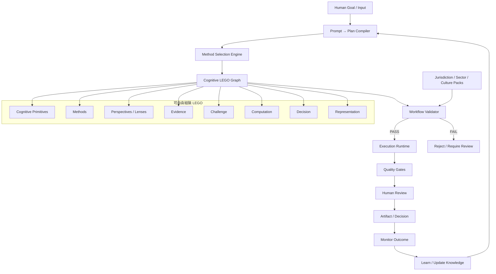

---

# 3. 八個正交 LEGO 維度

每個 LEGO 不是只能放在一個分類，而是同時有多個維度。

| LEGO 維度 | 回答的問題 | 範例 |
|---|---|---|
| A. Cognitive Operation | 大腦正在做什麼？ | FRAME / DECOMPOSE / CAUSE / CHALLENGE / DECIDE |
| B. Method | 用哪個已知方法？ | Mind Map / Fishbone / SWOT / AHP |
| C. Perspective / Lens | 從誰的角度看？ | Customer / Regulator / CTO / Local Resident |
| D. Evidence | 用什麼證據？ | Official source / Dataset / Interview / Experiment |
| E. Challenge | 怎麼證明自己可能錯？ | Red Team / Pre-mortem / Counterevidence |
| F. Computation | 哪些必須真算？ | Python / R / SQL / Stats / Simulation |
| G. Decision | 怎麼比較與決策？ | MCDA / AHP / Constraints / Human Judgment |
| H. Representation | 怎麼呈現給不同腦袋？ | Text / Table / Mind Map / Graph / Audio |

**核心效果**：同一 `KnowledgeSet` 可以被不同人以不同方法與 View 使用，而不重新解析原始資料。

---

# 4. Cognitive Primitive Kernel

方法可以消失；Primitive 應盡量長期穩定。

```text
FRAME
QUESTION
EXPAND
ASSOCIATE
DECOMPOSE
GROUP
MAP
COMPARE
RELATE
CAUSE
INFER
CHALLENGE
IMAGINE
FORECAST
ESTIMATE
CALCULATE
SIMULATE
OPTIMIZE
PRIORITIZE
DECIDE
VALIDATE
EXPLAIN
REFLECT
LEARN
```

例：

```text
Fishbone = DECOMPOSE + GROUP + CAUSE_HYPOTHESIS
SCAMPER = EXPAND + ASSOCIATE + TRANSFORM
SWOT = CLASSIFY + COMPARE + CONTEXTUALIZE
Scenario Planning = IMAGINE + FORECAST + COMPARE + CHALLENGE
AHP = COMPARE + WEIGHT + PRIORITIZE + DECIDE
```

---

# 5. Global Core + Local Packs

## 5.1 Global Invariant Core

```text
Evidence
Claim
Assumption
Inference
Decision
Provenance
Versioning
Audit
Typed Capability
Workflow IR
Human Authority
Reproducibility
Rollback
```

## 5.2 Local / Jurisdiction Packs

```text
Language
Culture
Law
Privacy
AI Regulation
Tax
Trade
Employment
Consumer Protection
Accessibility
Currency
Units
Timezone
Government Structure
Sector Regulation
Official Sources
Data Residency
```

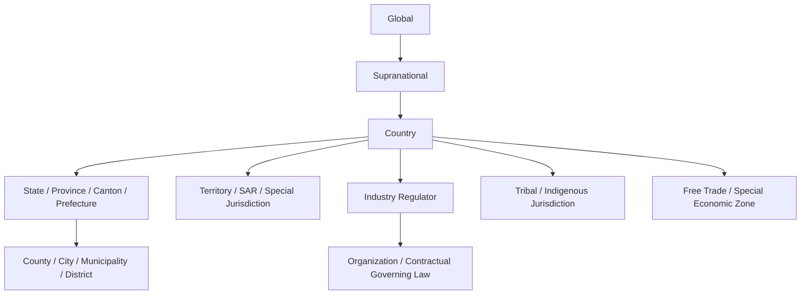

**長期維護規則**

> `NO JURISDICTION-SPECIFIC BUSINESS LOGIC OUTSIDE VERSIONED JURISDICTION / POLICY PACKS.`

---

# 6. 不同人的腦袋：Soft Cognitive Preference

不要把使用者永久標籤為「視覺型」「邏輯型」。使用 **soft preference + task adaptation**：

```yaml
cognitive_preference:
  representation:
    visual: 0.8
    text: 0.5
    table: 0.9
    spatial: 0.7
    audio: 0.2
  interaction:
    guided: 0.4
    exploratory: 0.8
  thinking:
    divergent: 0.8
    analytical: 0.9
    narrative: 0.3
  detail:
    depth: high
  decision:
    evidence_preference: high
```

優先順序：

```text
Explicit user choice
>
Current task need
>
Learned preference
>
Default
```

---

# 7. 方法總覽

| ID | Method Family | 核心問題 |
|---|---|---|
| F01 | 目標與問題框定（Goal & Problem Framing） | 我們真正要解什麼？ |
| F02 | 拆解與結構化（Decomposition & Structuring） | 大問題由哪些部分構成？ |
| F03 | 發散式創意（Divergent Ideation） | 還有哪些可能？ |
| F04 | Associative Mapping | 概念如何關聯與重組？ |
| F05 | Root Cause & Failure | 為什麼發生？ |
| F06 | 人類／顧客洞察（Human / Customer Insight） | 人真正需要什麼？ |
| F07 | Stakeholder / Negotiation | 誰支持、反對、阻擋？ |
| F08 | 外部環境與策略（Context & Strategy） | 我們處於什麼局勢？ |
| F09 | 系統思考（Systems Thinking） | 系統如何互相影響？ |
| F10 | Assumption / Evidence | 我們知道與不知道什麼？ |
| F11 | Causal / Research | 真的是因果嗎？ |
| F12 | 挑戰／紅隊／風險（Challenge / Red Team / Risk） | 我們可能錯在哪？ |
| F13 | Unknown Unknowns / Foresight | 還有什麼盲點與未來？ |
| F14 | Feasibility / Economics | 做得到、值得嗎？ |
| F15 | Experiment / Validation | 怎麼證偽關鍵假設？ |
| F16 | Prioritization / Decision | 選哪個、先做哪個？ |
| F17 | Learning / Reversal | 何時改變決策？ |
| F18 | Software Architecture | 架構如何長期演化？ |
| F19 | DevOps / SRE | 如何穩定部署與恢復？ |
| F20 | Security / Privacy | 攻擊面與資料風險在哪？ |
| F21 | DB / Data | 資料如何可靠、可追溯、可遷移？ |
| F22 | PM / Delivery | 如何把決策穩定交付？ |
| F23 | Global Jurisdiction | 如何全球合法與在地化？ |
| F24 | Representation / Collaboration | 如何適配不同思考方式？ |

---

# 8. 方法工具庫：用途、使用方式、效益與搭配

## F01 — 目標與問題框定（Goal & Problem Framing）

| 工具 | 主要用途 | 何時使用 | 標準使用方式 | 主要效益 | 最佳搭配 |
|---|---|---|---|---|---|
| Goal Statement | 把模糊願望轉明確目標 | 任務起始 | 目標→受益者→時間→成功條件→限制 | 降低 scope 漂移 | Success Criteria、Decision Question |
| SMART | 讓目標可衡量 | 需要執行追蹤 | S/M/A/R/T 逐項補齊 | 提高可驗收性 | OKR、KPI |
| OKR | 方向與可衡量成果分離 | 團隊/季度 | Objective→2–5 KR→owner→review | 避免只追工作量 | Roadmap |
| North Star Metric | 找核心價值指標 | 產品策略 | 核心價值→代理指標→反 gaming 驗證 | 聚焦長期價值 | KPI Tree |
| Success Criteria | 事前定義成功 | 高風險決策 | Must/Should/Guardrail/Stop | 防止事後改標準 | Reversal Criteria |
| Non-goals | 明確說不做什麼 | 大型專案 | excluded scope→理由→重審條件 | 控制範圍與成本 | WBS、ADR |
| 5W1H | 快速建立問題輪廓 | 資訊不足時 | Who/What/When/Where/Why/How | 找資訊缺口 | Problem Statement |
| Problem Statement | 描述現況、差距、影響 | 跨人協作 | Current→Expected→Gap→Impact→Constraints | 建立共同問題定義 | Issue Tree |
| How Might We | 把痛點轉開放問題 | 進入創意階段 | 「我們可以如何…」且不預設方案 | 擴大解法空間 | Crazy 8s、SCAMPER |
| Frame Storming | 先 brainstorm 問題框架 | 可能解錯問題時 | 對同一現象產生多種問法→分群→選框架 | 降低 framing bias | Boundary Critique |
| Boundary Critique | 檢查誰被納入/排除 | 政策、公共、高風險 | decision maker/affected/excluded/resources/values | 揭露權力與價值假設 | Stakeholder Map |

### 圖解：Problem Framing

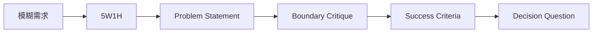

---

## F02 — 拆解與結構化（Decomposition & Structuring）

| 工具 | 用途 | 使用方式 | 效益 | 最佳搭配 |
|---|---|---|---|---|
| Issue Tree | 把大問題拆成可分析分支 | 主問題→第一層→第二層→檢查遺漏 | 建立分析計畫 | MECE、Evidence Matrix |
| Logic Tree | 按單一邏輯分類 | 先定分類規則再展開 | 防止維度混亂 | MECE |
| MECE | 檢查互斥且完整 | 找 overlap / omission | 提高結構完整度 | Issue Tree |
| Problem Tree | 原因→核心問題→後果 | 問題置中、原因向下、效果向上 | 分離症狀與原因 | Objective Tree |
| Objective Tree | 把 Problem Tree 轉目標 | 負面狀態逐項轉正向 | 直接連到方案設計 | Theory of Change |
| Functional Decomposition | 按功能拆系統 | Top function→subfunctions→interfaces | 強化模組與責任邊界 | C4、DDD |
| FAST | 用 Why/How 建功能鏈 | 往左問 Why、往右問 How | 找冗餘功能與替代方案 | Value Engineering |
| Hierarchical Task Analysis | 拆人類工作步驟 | Goal→Task→Subtask→Plan | 找操作負擔與錯誤點 | Journey、Service Blueprint |
| WBS | 把交付拆工作包 | Deliverable→Work package→owner/estimate | 降低遺漏 | Critical Path、RACI |

---

## F03 — 發散式創意（Divergent Ideation）

| 工具 | 主要用途 | 標準使用方式 | 效益 | 注意事項 |
|---|---|---|---|---|
| Classic Brainstorming | 快速產生大量 ideas | 先禁止批判→追數量→延伸→最後評估 | 快速發散 | 不要邊想邊否決 |
| Brainwriting | 降低權威/外向者主導 | 先各自寫→再分享/合併 | 降低 anchoring、groupthink | 適合跨階級團隊 |
| 6-3-5 | 結構化大量 ideation | 6 人×3 idea×5 分鐘，輪傳延伸 | 快速得到大量變體 | 人數可調整 |
| Crazy 8s | 強迫突破第一答案 | 8 格、8 分鐘、8 方案 | 降低 perfectionism | 適合概念/介面 |
| SCAMPER | 改造已有產品/流程 | Substitute/Combine/Adapt/Modify/Put/Eliminate/Reverse | 系統化創新 | 不等於市場驗證 |
| Lotus Blossom | 多層結構發散 | 中心→8 分支→各 8 idea | 大量但有結構 | 後續需 clustering |
| Starbursting | 用問題發散 | Who/What/When/Where/Why/How | 找未知與研究問題 | 很適合需求前期 |
| Random Stimulus | 打破慣性 | 隨機詞/圖→強制找關聯 | 產生遠距聯想 | 需後續可行性篩選 |
| Forced Connections | 強制連兩個不相關概念 | 列特徵→交叉組合 | 新產品/商模創意 | 可配 Morphological |
| Synectics | 用類比/隱喻重構問題 | direct/personal/symbolic analogy | 深度創意突破 | workshop facilitation 要求較高 |

### 圖解：發散與收斂分離

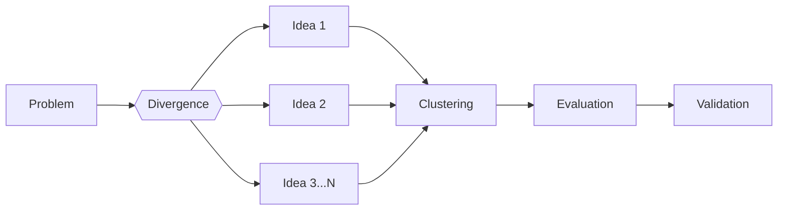

---

## F04 — 關聯映射與組合（Associative Mapping & Combination）

| 工具 | 用途 | 使用方式 | 效益 | 最佳搭配 |
|---|---|---|---|---|
| Mind Map | 自由樹狀聯想 | 中心→主枝→次枝→關鍵詞 | 外化工作記憶 | Affinity、Concept Map |
| Concept Map | 用有語義的邊連概念 | 節點＋typed relations | 適合 Knowledge Graph 與推理 | Causal DAG |
| Affinity Diagram | 大量 idea 自然分群 | 一卡一 idea→靜默分群→命名 | 找 pattern、降低資訊量 | Thematic Analysis |
| Morphological Analysis | 多維 options 組合 | dimensions→options→合法組合→評估 | 系統探索巨大 solution space | MCDA、Prototype |
| Attribute Listing | 拆屬性再逐項變換 | attributes→變換→重組 | 產品改良 | SCAMPER |
| Analogy Mapping | 把外部機制映射到問題 | source domain→抽象機制→target mapping | 跨產業移植 | Historical Analogy |

### Mind Map 與 Concept Map

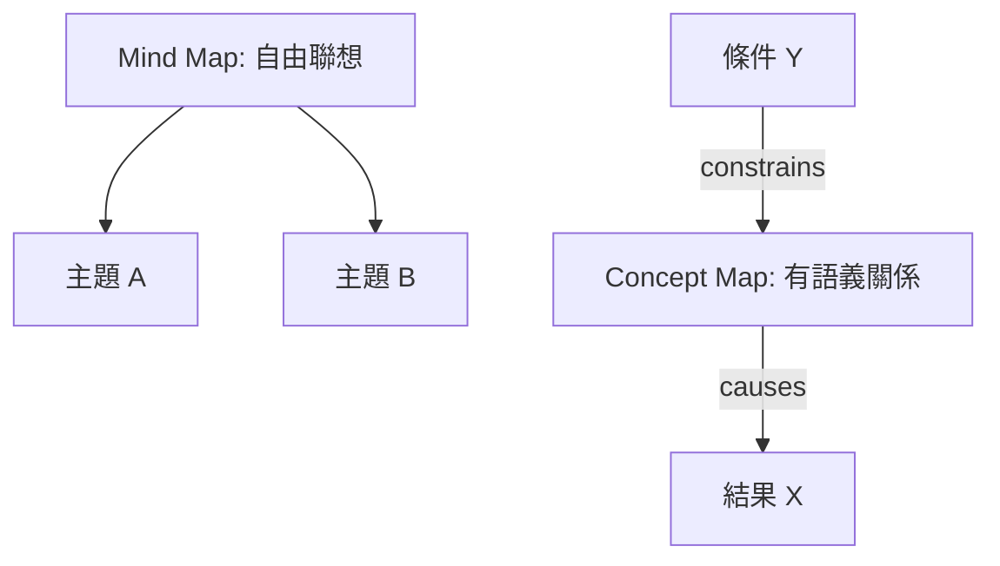

---

## F05 — 根因與失效分析（Root Cause & Failure Analysis）

| 工具 | 用途 | 使用方式 | 效益 | 禁止誤用 |
|---|---|---|---|---|
| Fishbone / Ishikawa | 建立原因假設全集 | effect→categories→candidate causes→標 evidence | 完整探索原因 | 不能直接當根因證明 |
| 5 Whys | 沿原因鏈深入 | 一直問到可控制＋可驗證 | 由症狀到機制 | 不一定剛好五次 |
| Pareto | 找少數高影響原因 | 分類→計數/成本→排序→累積% | 資源聚焦 | 需要真實資料 |
| Fault Tree | AND/OR 邏輯分解 top event | top event→basic events→gates | 高風險可靠性分析 | 需清楚邏輯與假設 |
| Event Tree | 從起始事件推結果 | event→barriers success/fail→outcomes | 評估防護層 | 不同於 Fault Tree |
| Bow-Tie | threats→event→consequences | 左防止、右緩解 | 同時管理 prevention/recovery | 控制措施要有 owner/test |
| Kepner–Tregoe | Is/Is Not 差異分析 | What/Where/When/Extent | 降低憑直覺猜測 | 適合 troubleshooting |
| Change Analysis | 找故障前後變更 | before/after→change list→correlation | 快速縮小範圍 | 變更不等於因果 |
| Barrier Analysis | 找本應阻止事件的控制失效 | Hazard→Target→Barrier→failure | 聚焦系統控制 | 避免責怪個人 |

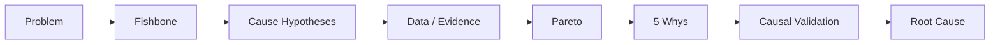

---

## F06 — 人類／顧客洞察（Human / Customer Insight）

| 工具 | 用途 | 使用方式 | 效益 | 注意 |
|---|---|---|---|---|
| JTBD | 理解使用者真正要完成的工作 | Situation→Motivation→Job→Desired outcome→Workaround | 避免 feature-first | 最適合新產品 |
| Persona | 代表性使用者模型 | 用研究資料建 goals/behavior/context | 建立共同 reference | Persona ≠ 真實民意 |
| Empathy Map | Says/Thinks/Does/Feels | 用訪談/觀察填寫且標 fact/inference | 找語言與行為差距 | 不可純 AI 猜 |
| Journey Map | 端到端體驗 | stages→actions→emotion→pain→opportunity | 找斷點與高價值改善點 | 可加 evidence |
| Service Blueprint | 前台＋後台流程 | customer→frontstage→backstage→support/system | 避免只改 UI | 適合服務系統 |
| Contextual Inquiry | 在真實環境觀察 | 使用者做→研究者看→即時追問 | 發現隱性需求 | B2B 特別有效 |
| Interview | 深度質性資料 | 招募→題綱→訪談→coding→themes→countercases | 得到 why/how | 樣本與偏誤要記錄 |
| Survey | 大規模量化 | construct→question→pilot→sample→analysis | 估比例、分群 | 注意 sampling bias |
| Focus Group | 探索群體觀點與互動 | 6–10 人→moderation→discussion→analysis | 看到社會互動 | 不用來估人口比例 |

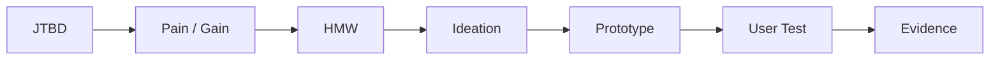

---

## F07 — 利害關係人／權力／協商（Stakeholder / Power / Negotiation）

| 工具 | 用途 | 使用方式 | 效益 |
|---|---|---|---|
| Stakeholder Map | 找所有影響與被影響者 | 直接/間接/受益/承擔風險者→關係圖 | 防止只看決策者 |
| Power–Interest | 權力×關注分類 | 評估→四象限→engagement | 決定溝通策略 |
| Salience Model | Power/Legitimacy/Urgency | 三維評分與分類 | 加入正當性與急迫性 |
| Incentive Mapping | Goals/Incentives/Constraints/Risks | 每 stakeholder 一張 incentive card | 預測真實行為 |
| RACI | 明確 R/A/C/I | 每 task 指定責任 | 降低責任模糊 |
| BATNA | 談判失敗最佳替代 | 列 alternatives→估值→改善 BATNA | 避免接受差交易 |
| ZOPA | 找可成交區間 | reservation points→重疊範圍 | 提高談判效率 |
| Interest-Based Negotiation | 從 position 轉 interests | 人與問題分離→ interests→options→客觀標準 | 創造可接受方案 |
| Game Theory | 建模互相反應 | players→strategies→payoffs→equilibria | 避免假設對手不動 |
| Coalition Mapping | 找可能聯盟 | interests/power/resources→coalition scenarios | 政策與治理特別重要 |

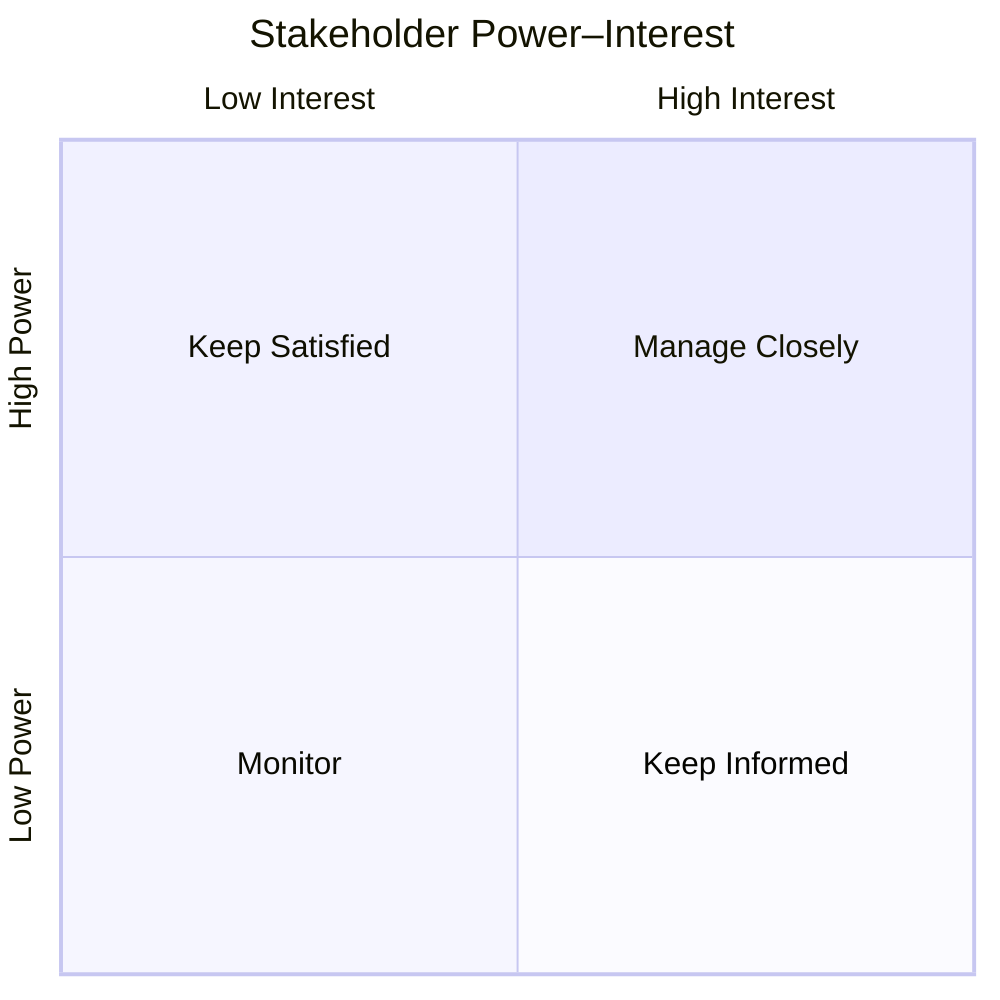

---

## F08 — 外部環境與策略（Context & Strategy）

| 工具 | 用途 | 使用方式 | 效益 | 最佳搭配 |
|---|---|---|---|---|
| PESTEL | 掃描宏觀環境 | P/E/S/T/E/L→facts→trends→implications→uncertainty | 建立外部基線 | Scenario、SWOT |
| STEEPV | 加入 Values 的長期環境掃描 | S/T/E/E/P/V | 適合長期社會變遷 | Scenario |
| 3C | Customer/Competitor/Company | 三面向分析→找 fit | 快速商業定位 | SWOT/TOWS |
| SWOT | 內部 S/W、外部 O/T | evidence-backed 四象限 | 快速局勢摘要 | TOWS |
| TOWS | SWOT 轉策略 | SO/ST/WO/WT 配對 | 避免 SWOT 停在清單 | MCDA |
| Porter Five Forces | 分析產業結構 | rivalry/new entrants/substitutes/supplier/buyer | 長期產業吸引力 | Benchmark |
| VRIO | 判斷資源優勢 | Value/Rarity/Imitability/Organization | 找可防禦優勢 | Value Chain |
| Value Chain | 拆價值活動 | primary/support→cost/value drivers | 找高槓桿點 | Benchmarking |
| STP | 市場分群/選擇/定位 | Segmentation→Targeting→Positioning | 避免一體適用 | JTBD |
| Ansoff | 產品×市場成長策略 | penetration/development/product/diversification | 顯示不同風險 | Risk |
| BCG | Portfolio 資源配置 | growth×relative share | 快速產品組合討論 | GE-McKinsey |
| Blue Ocean | 創造新價值曲線 | Strategy Canvas→ERRC | 擺脫直接競爭 | BMC |
| Business Model Canvas | 九格商模 | 客群/價值/通路/關係/收益/資源/活動/夥伴/成本 | 完整描述商業運作 | Unit Economics |
| Value Proposition Canvas | customer jobs/pains/gains 對齊方案 | Customer profile→Value map→fit hypotheses | 提高 product-market fit | JTBD、Prototype |

### SWOT → TOWS

| 組合 | 核心問題 | 產出 |
|---|---|---|
| SO | 如何用優勢放大機會？ | Growth strategy |
| ST | 如何用優勢抵抗威脅？ | Defensive strategy |
| WO | 如何利用機會補弱點？ | Capability-building |
| WT | 如何降低弱點並避開威脅？ | Risk reduction / exit |

---

## F09 — 系統思考（Systems Thinking）

| 工具 | 用途 | 使用方式 | 效益 |
|---|---|---|---|
| Causal Loop Diagram | 找 feedback loops | 變數→+/- 因果箭頭→reinforcing/balancing→delay | 揭露非線性與反直覺結果 |
| Stock & Flow | 建模累積量與流量 | stocks→in/out flows→rates→equations | 可進入動態模擬 |
| Iceberg Model | Event→Pattern→Structure→Mental Model | 由事件往下挖深層結構 | 避免只修表面 |
| Systems Archetypes | 辨識常見系統陷阱 | 比對 Limits to Growth / Fixes that Fail 等 | 快速找到已知動態 |
| Rich Picture | 自由畫 actors/process/conflict | 問題尚無法形式化時 | 建立複雜問題共同理解 |
| Leverage Point Analysis | 找高槓桿干預點 | parameters→feedback→rules→goals→paradigm | 提升資源效益 |
| Behavior-over-Time | 畫變數隨時間變化 | 歷史/預期曲線→轉折→延遲 | 迫使分析時間維度 |
| Agent-Based Modeling | 由個體規則模擬群體現象 | agents→rules→environment→runs | 處理 heterogeneity 與 emergent effects |

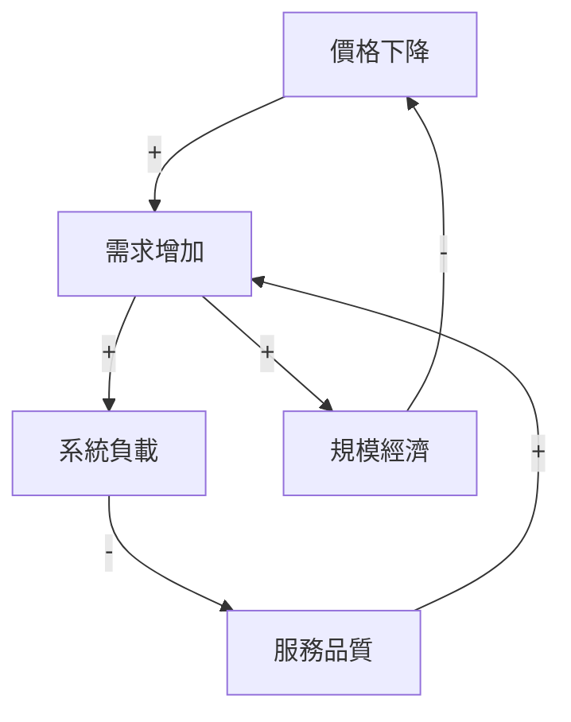

---

## F10 — 假設／證據／認知品質（Assumption / Evidence / Epistemic Quality）

| 工具 | 用途 | 使用方式 | 效益 |
|---|---|---|---|
| Assumption Mapping | 依重要性×不確定性排序 | assumptions→impact if wrong→uncertainty→四象限 | 先驗證最危險假設 |
| Assumption Registry | 正式保存假設 | ID/statement/type/evidence/confidence/validation/status/owner | 假設不再藏在文字中 |
| Ladder of Inference | 追 data→meaning→assumption→conclusion | 把每一步顯式化 | 找認知跳躍 |
| Argument Mapping | Claim/Reason/Objection 結構化 | main claim→support→objection→rebuttal→evidence | 論證可檢查 |
| Toulmin Model | Claim/Grounds/Warrant/Backing/Qualifier/Rebuttal | 逐欄填寫 | 防止缺推理橋梁 |
| Evidence Matrix | Claim × Evidence 對齊 | rows=claims、cols=evidence→quality/diversity/recency | 快速看到薄弱 claim |
| Evidence Hierarchy | 區分證據強度 | domain-specific hierarchy | 避免來源等價化 |
| Bayesian Updating | 新 evidence 更新 belief | prior→likelihood→posterior | 信心可持續更新 |
| Confidence Calibration | 檢查信心是否準確 | predictions→actuals→calibration curve | 降低 overconfidence |
| Contradiction Detection | 找來源/模型互相衝突 | claims matching→support/contradict/context | 暴露不確定性 |

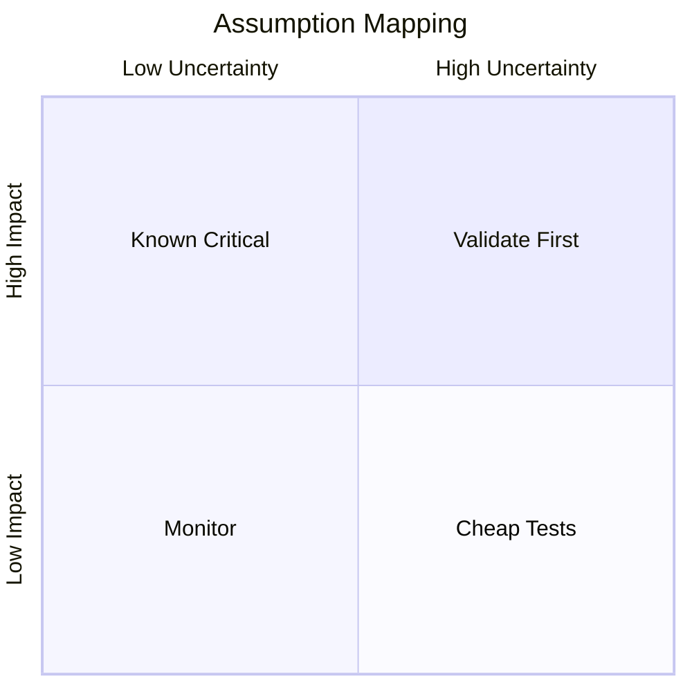

### Epistemic Type 必須分離

canonical enum 定義見 `specs/governance/epistemic-label.schema.yaml#/definitions/epistemic_type`（ADR-004 Sub-decision b）。以下為顯示用途，schema 為唯一正本：

```text
SOURCE_FACT
EVIDENCE
ASSUMPTION
HYPOTHESIS
AI_INFERENCE
AI_SUGGESTION
HUMAN_OPINION
CALCULATED_RESULT
SIMULATED_RESULT
UNKNOWN
DECISION
```

---

## F11 — 因果與研究推理（Causal & Research Reasoning）

| 工具 | 用途 | 使用方式 | 效益 |
|---|---|---|---|
| Causal DAG | 明確因果假設 | variables→edges→confounders/mediators/colliders | 防 correlation=causation |
| Counterfactual Reasoning | 比較 actual vs no-intervention | intervention→actual→counterfactual→assumptions | 明確因果基準 |
| Theory of Change | intervention 如何導致 outcome | inputs→activities→outputs→outcomes→impact＋assumptions | 建可驗證政策邏輯 |
| Logic Model | 結構化 program | inputs→activities→outputs→short/long outcomes | 便於 KPI 與評估 |
| Process Tracing | 用機制證據檢查因果鏈 | mechanism→hoop/smoking-gun evidence | 適合小樣本深度因果 |
| RCT | 隨機分派估計效果 | randomize→power→treatment/control→analysis | 高品質因果證據 |
| Difference-in-Differences | 處置前後 × 對照組 | treated/control→pre/post→parallel trends | 自然實驗常用 |
| Regression Discontinuity | 用 cutoff 附近估效果 | running variable→cutoff→bandwidth→checks | 局部因果效果 |
| Instrumental Variables | 處理 endogeneity | instrument→relevance/exclusion→2SLS | 特定條件下識別因果 |
| Synthetic Control | 建立加權反事實 | donor pool→fit→weights→post gap→placebo | 單一大型政策事件適用 |

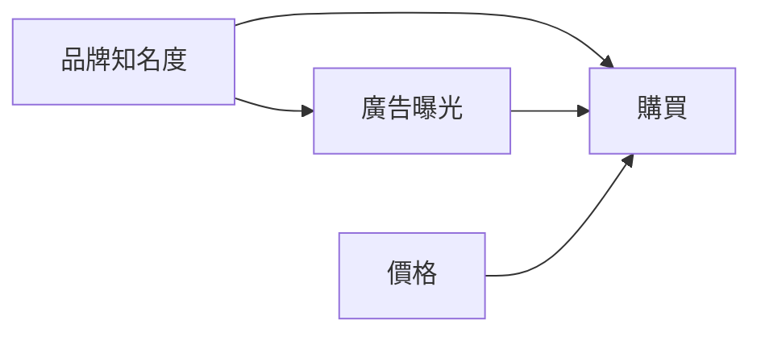

**規則**：DAG 是假設模型；每條 edge 都應綁 `evidence / rationale / confidence`。

---

## F12 — 挑戰／紅隊／風險（Challenge / Red Team / Risk）

| 工具 | 用途 | 使用方式 | 效益 |
|---|---|---|---|
| Devil's Advocate | 假設主流觀點錯 | 建 strongest alternative explanation | 防 groupthink |
| Red Team | 主動摧毀方案 | attack assumptions/logic/evidence/operations/edge cases | 找脆弱點 |
| Blue Team | 建立方案最強版本 | steelman→controls→evidence→monitoring | 避免只破壞不改善 |
| Independent Judge | 依證據與規則裁決 | positions→evidence→criteria→judgment→dissent | 避免多數決真理 |
| Pre-mortem | 假設未來已失敗 | 每人獨立列 failure causes→cluster→controls | 揭露真實擔憂 |
| Counterexample Search | 找規則的反例 | claim→boundary cases→true counterexamples | 測適用邊界 |
| Disconfirming Evidence | 主動找不支持資料 | current belief→falsifier→search | 降 confirmation bias |
| FMEA | Failure Mode/Effect/Severity/Occurrence/Detection | 功能→失效→原因→控制→優先級 | 系統化處理失效 |
| HAZOP | 用 guide words 找流程偏差 | nodes→No/More/Less/Reverse... | 高完整度流程風險分析 |
| Stress Testing | 極端但合理情境 | extreme scenarios→run→breaking points | 測 robustness |

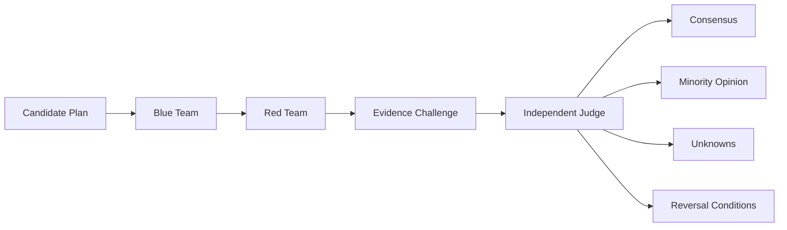

---

## F13 — 未知未知與前瞻（Unknown Unknowns & Foresight）

| 工具 | 用途 | 使用方式 | 效益 |
|---|---|---|---|
| Horizon Scanning | 系統掃描新興變化 | domains/sources→signals→impact→track | 提早發現外部變化 |
| Weak Signal Detection | 找尚未成主流的訊號 | anomalies/niche events→triangulate→monitor | 增加提前量 |
| Historical Analogy | 用歷史機制比較 | 相似/差異→抽機制→限制類比 | 借歷史又避免表面類比 |
| Cross-industry Transfer | 移植其他產業機制 | 找相同 job/constraint→adapt | 降低 reinvent-the-wheel |
| Cross-country Comparison | 比較制度/市場差異 | comparable jurisdictions→normalize→compare | 找 local variation |
| Adjacent Discipline Search | 從鄰近學科找 missing variables | current disciplines→adjacent fields→models | 降低單一專業盲點 |
| Outlier Analysis | 研究異常個案 | identify→排除資料錯誤→深挖機制 | 發現新 segment/機制 |
| Black Swan Exercise | 低機率高衝擊 | tail events→exposure→survivability→hedges | 強化韌性 |
| Wild Cards | 加入劇烈非主流事件 | wild card→重跑 strategy | 測 regime shift |
| Scenario Planning | 建多個合理未來 | critical uncertainties→worlds→implications→signposts | 不依賴單一 forecast |
| Futures Wheel | 展開 1/2/3 階影響 | center event→direct→indirect→structural | 強制 second/third-order |
| Backcasting | 從理想未來倒推 | future state→milestones backward→today actions | 長期 roadmap |
| Delphi | 匿名多輪專家估計 | round1→summary→round2→dispersion | 降權威效應、保留分歧 |
| Cross-impact Analysis | 分析事件互相改變機率 | event pair matrix→scenario consistency | 避免把趨勢當獨立 |

### Scenario 圖解

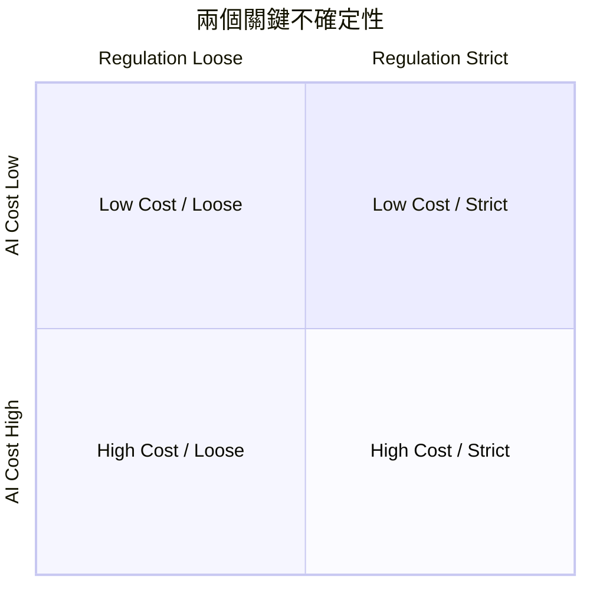

### Futures Wheel

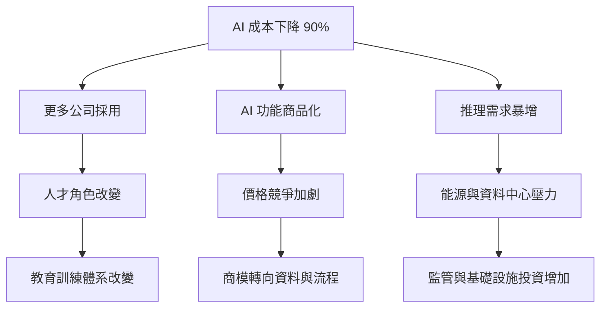

---

## F14 — 可行性與經濟性（Feasibility & Economics）

| 工具 | 用途 | 使用方式 | 效益 |
|---|---|---|---|
| TELOS | 技術/經濟/法律/營運/時程可行性 | 五面向列 assumptions/evidence/gaps/stop conditions | 防止只看技術 |
| Cost–Benefit Analysis | 貨幣化成本與效益 | alternatives→discounted costs/benefits→sensitivity | 比較總體淨效益 |
| Cost–Effectiveness | 同一 outcome 比較成本 | cost per unit outcome | benefit 難貨幣化時適用 |
| TCO | 全生命週期成本 | acquisition+implementation+operation+people+exit+migration | 看出隱性成本與 lock-in |
| Unit Economics | 每客戶/交易是否賺錢 | ARPU/gross margin/CAC/LTV/payback/churn | 判斷商模可擴張性 |
| Break-even | 何時損益平衡 | fixed cost/contribution margin→volume | 找最低可行規模 |
| NPV | 折現未來現金流 | cash flows→discount rate→NPV | 比較不同時間投資 |
| IRR | 投資內部報酬率 | cash flow→IRR→hurdle rate | 直觀回報率 |
| Real Options | 把延後/擴張/退出視為 option | triggers/cost/future states→option value | 避免一次性 yes/no |

---

## F15 — 實驗與驗證（Experiment & Validation）

| 工具 | 用途 | 使用方式 | 效益 |
|---|---|---|---|
| Prototype | 驗證概念/互動 | learning goal→低保真→user test→iterate | 低成本發現問題 |
| MVP | 驗證核心價值 | critical assumption→minimal product→real usage | 縮短 learning cycle |
| Proof of Concept | 驗證技術可行 | technical success→isolated implementation→benchmark | 先去除技術未知 |
| Technical Spike | 限時研究技術未知 | timebox→question→experiment/docs→decision note | 提升估算可信度 |
| Concierge Test | 人工先提供服務 | manual service→measure use/pay | 先驗證價值再自動化 |
| Wizard of Oz | 前台自動、後台人工 | mock automation→human backend | 驗證互動而不先建完整系統 |
| Fake Door | 測 feature demand | CTA→click→告知尚未開放→measure | 低成本量化需求 |
| Smoke Test | 建置前測市場 | landing/ad/offer→signup/preorder threshold | 快速驗證需求 |
| A/B Test | 隨機比較版本 | hypothesis→metric→power→randomize→analyze | 較可靠因果證據 |
| Pilot | 小規模真實試行 | limited scope→criteria→monitor→review | 降 rollout 爆炸半徑 |
| Benchmark | 與 baseline/competitor 比較 | fixed workload/metrics/environment | 避免憑印象選型 |

**核心原則**：

> 找到「最便宜且足以證偽 Critical Assumption 的測試」，而不是讓 AI 主觀打 8.7/10。

---

## F16 — 優先排序與決策（Prioritization & Decision）

| 工具 | 用途 | 使用方式 | 效益 |
|---|---|---|---|
| Impact–Effort | ideas 初篩 | impact×effort 四象限 | 快速找 quick wins |
| ICE | Impact×Confidence×Ease | 統一尺度評分 | 快速粗排 |
| RICE | Reach×Impact×Confidence÷Effort | 產品 roadmap | 納入受影響人數 |
| MoSCoW | Must/Should/Could/Won't | release scope | 建立明確不做清單 |
| WSJF | Cost of Delay ÷ Job Size | portfolio | 突出延遲成本 |
| Kano | Basic/Performance/Delighter | 功能需求分類 | 不只看票數 |
| Weighted Decision Matrix | 多 criteria 加權 | criteria→weights→scores→sensitivity | 透明化 trade-off |
| AHP | 成對比較推權重 | pairwise→weights→consistency→score | 權重更一致 |
| MCDA | 多目標、多 stakeholder | criteria→normalize→weights→score→sensitivity | 複雜決策 |
| TOPSIS | 距理想/最差解排序 | normalize→ideal points→distance | 量化方案比較 |
| Decision Tree | 決策/機率/payoff 分支 | decision nodes→chance→probability→payoff | 呈現 uncertainty |
| Expected Value | 機率×結果 | states→probabilities→outcomes | 概率決策基線 |
| Pareto Frontier | 找非支配方案 | objective vectors→remove dominated | 不過早壓成單一總分 |

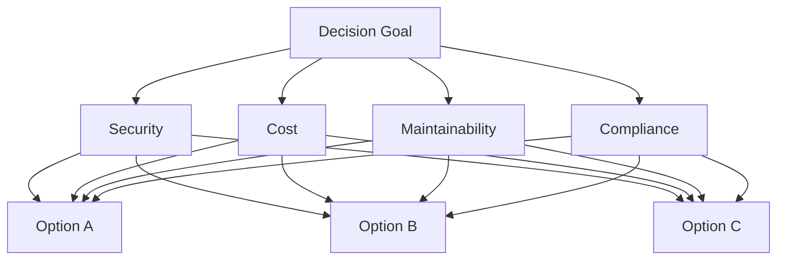

---

## F17 — 學習／監控／反轉（Learning / Monitoring / Reversal）

| 工具 | 用途 | 使用方式 | 效益 |
|---|---|---|---|
| PDCA | 持續改善 | Plan→Do→Check→Act | 穩定流程長期改進 |
| OODA | 快速動態決策 | Observe→Orient→Decide→Act | 高變動環境 |
| Build–Measure–Learn | 產品探索 | build smallest test→measure→learn | 減少先建後驗證 |
| After Action Review | 比較預期與實際 | Expected? Actual? Why? Next? | 快速組織學習 |
| Post-mortem | 事故後學習 | timeline→impact→causes→actions | 防重發、非 blame |
| Decision Journal | 記錄當時資訊與信心 | context/options/evidence/forecast/confidence | 防 hindsight bias |
| Reversal Criteria | 事前定義何時推翻決策 | indicators→thresholds→owner→action | 防 sunk cost |
| Kill Criteria | 事前定義停止條件 | max loss/time/quality threshold | 控制下行風險 |
| Prediction Tracking | 預測 vs 實際 | prediction→horizon→actual→error | 改善 calibration |

---

## F18 — 軟體架構套件（Software Architecture Pack）

| Tool | 主要用途 | 標準使用方式 | 主要效益 |
|---|---|---|---|
| C4 Model | 多層架構溝通 | Context→Container→Component→必要時 Code | 讓不同角色看到適當細節 |
| Domain-Driven Design (DDD) | 用 bounded context 管理複雜 domain | subdomain→bounded context→context map | 降低耦合與語意污染 |
| Event Storming | 用 domain events 探索流程與邊界 | events→commands→actors→policies→aggregates→hotspots | PM/工程/業務快速共模 |
| Architecture Decision Record (ADR) | 保存重大架構決策 | Context→Decision→Alternatives→Impacts→Migration→Rollback→Revisit | 30 年後仍知道為何這樣做 |
| ATAM | 系統化分析架構 trade-off | business drivers→scenarios→approaches→sensitivity/tradeoff points | 平衡 reliability/security/cost/maintainability |
| Quality Attribute Scenario | 把「穩定、安全、快」轉成可測需求 | Source→Stimulus→Artifact→Environment→Response→Measure | 非功能需求可驗收 |
| Architecture Fitness Functions | 持續自動檢查架構 invariant | invariant→test/metric→CI gate | 防止架構隨時間腐化 |
| Strangler Fig Pattern | 分段替換舊系統 | seam→small slice→verify→expand→retire old | 避免 big-bang rewrite |
| Architecture Trade-off Matrix | 比較候選架構 | criteria→weights→options→risk/sensitivity | 透明呈現取捨 |
| Dependency Mapping | 找跨服務/供應商/資料依賴 | nodes→edges→critical dependency→fallback | 降低隱性單點故障 |

### Architecture Change 推薦鏈

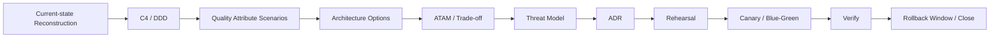

---

## F19 — DevOps／SRE／可靠性套件（DevOps / SRE / Reliability Pack）

| Tool | 主要用途 | 標準使用方式 | 主要效益 |
|---|---|---|---|
| SLI/SLO/SLA | 把可靠性轉成量化服務目標 | user-visible SLI→SLO→error budget→必要時 SLA | 平衡可靠性與 release velocity |
| Error Budget | 管理允許失敗量 | 1-SLO→budget→burn rate→release policy | 避免追求不必要的 100% |
| Capacity Model | 預估容量與安全餘量 | workload→growth→resource coefficients→headroom | 防容量事故與過度採購 |
| Load Test | 驗證預期負載 | baseline→target load→latency/errors/resources | 找性能瓶頸 |
| Stress Test | 找系統破壞點 | 超過預期負載→觀察 cliff/recovery | 了解安全餘量 |
| Soak Test | 驗證長時間穩定 | 持續負載→memory/resource leak→degradation | 找慢性問題 |
| Canary Deployment | 先讓小比例流量使用新版本 | 1–5%→metrics compare→expand/rollback | 最小化錯誤影響 |
| Blue–Green Deployment | 維持新舊環境快速切換 | deploy green→verify→switch→保留 blue | 快速 rollback |
| Game Day | 演練故障與 runbook | scenario→roles→inject→recover→AAR | 驗證人與流程 |
| Chaos Engineering | 受控注入故障驗證韌性 | steady-state hypothesis→limited blast radius→fault→observe | 找隱藏 dependency |
| RTO/RPO | 定義恢復時間/資料損失 | business impact→tiers→architecture→drill | DR 可量化驗證 |
| Runbook / Playbook | 高壓操作程序化 | preconditions→steps→expected output→stop/go→rollback | 降操作錯誤 |
| Release Readiness Review | 上線前統一檢查 | change/data/security/observability/rollback/capacity | 防漏掉跨域風險 |

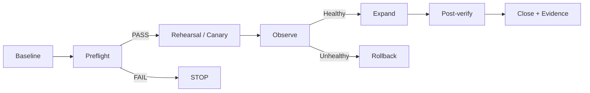

---

## F20 — 資安／隱私套件（Security / Privacy Pack）

| Tool | 主要用途 | 標準使用方式 | 主要效益 |
|---|---|---|---|
| STRIDE | 系統化找常見安全威脅 | DFD→Spoofing/Tampering/Repudiation/Information Disclosure/DoS/Elevation | 威脅覆蓋完整 |
| Attack Tree | 從攻擊目標展開攻擊路徑 | root goal→AND/OR subgoals→cost/skill/detectability | 找最便宜攻擊路徑 |
| PASTA | 風險導向威脅建模 | business→scope→decompose→threat→vulnerability→attack→risk | 業務 impact 與技術威脅連結 |
| LINDDUN | Privacy threat 分類 | DFD→privacy threat categories→controls | 補足只做 security 不做 privacy |
| DPIA / PIA | 個資影響評估 | processing→necessity/proportionality→risk→controls→approval | 降低個資法規風險 |
| Zero Trust Review | 每次存取皆驗證 | subject/workload/resource→authn/authz→short-lived credential→audit | 降 lateral movement |
| Secrets Threat Review | 檢查秘密生命週期 | inventory→storage→access→rotation→exposure→revocation | 防 secrets 進 argv/log/git |
| Supply Chain Threat Model | 軟體供應鏈威脅 | source→dependency→CI→artifact→registry→deploy→sign/verify | 降 dependency/artifact compromise |
| Abuse Case | 從惡意使用者角度描述濫用 | actor→goal→abuse flow→controls→detection | 補足正常 use case |
| Security Control Mapping | Threat→Control→Evidence | 每個威脅對應 preventive/detective/recovery control | 控制可稽核、可測 |

---

## F21 — 資料庫／資料套件（DB / Data Pack）

| Tool | 主要用途 | 標準使用方式 | 主要效益 |
|---|---|---|---|
| ERD | 建模 entity/attribute/relationship | entities→keys→relationships→constraints | 建立資料結構共識 |
| Normalization | 降低重複與更新異常 | 1NF→2NF→3NF/BCNF；必要時有意識 denormalize | 提高一致性 |
| Data Lineage | 追蹤資料流向與轉換 | source→ingest→transform→dataset→model→artifact | 數字可追溯 |
| Data Contract | 定義 producer/consumer 承諾 | schema→semantics→quality/SLO→ownership→compatibility | 防無聲 schema break |
| Schema Compatibility Analysis | 檢查 schema migration 相容性 | 精確步驟序列見 Execution Contract §28（唯一正本），本節僅說明概念與適用場景。 | 支援零停機 migration |
| Data Quality Dimensions | 檢查完整/準確/一致/唯一/時效/有效 | rules→profiling→threshold→quarantine→owner | 防垃圾資料造成高信心結論 |
| Backup/Restore Drill | 驗證備份真的能還原 | backup→isolated restore→integrity→RTO/RPO | 避免「有備份但不能用」 |
| Retention / Deletion Model | 保存、刪除、legal hold | data class→purpose→retention→deletion→exception→proof | 降合規與暴露風險 |
| Expand–Contract Migration | 無破壞演進 schema | expand compatible schema→migrate traffic/data→contract old | 降部署耦合 |
| Reconciliation | 驗證新舊資料一致 | counts/checksums/business invariants→diff→resolve | migration 後可證明完整性 |

精確步驟序列見 Execution Contract §28（唯一正本），本節僅說明概念與適用場景。

---

## F22 — 專案管理／交付／治理套件（PM / Delivery / Governance Pack）

| Tool | 主要用途 | 標準使用方式 | 主要效益 |
|---|---|---|---|
| RAID Log | 管 Risks/Assumptions/Issues/Dependencies | ID→owner→status→impact→next action→review date | 風險不散落聊天 |
| Critical Path Method | 找決定最短工期的任務鏈 | tasks→duration→dependency→forward/backward pass | 找真正不可延誤工作 |
| Dependency Graph | 顯式建模依賴 | nodes→edges→critical edges→owner→fallback | 降隱性 blocker |
| Stage-Gate | 分階段用證據決定是否繼續 | stage evidence→gate criteria→Go/Hold/Kill/Rework | 防 sunk-cost |
| Change Risk Matrix | 分級 production change | scope/reversibility/data/traffic/security→risk tier | 高風險自動增加控制 |
| Definition of Done | 把完成變成多面向 gate | functional/security/privacy/observability/rollback/docs/tests | 防「能跑就算完成」 |
| Decision Log | 保存重要決策 | context→decision→evidence→owner→revisit | 避免重複爭論 |
| Outcome Roadmap | 以 outcomes 而非 feature 排 roadmap | themes→outcomes→bets→evidence→review | 保持策略彈性 |
| Risk Register | 正式管理風險 | probability/impact/exposure/owner/control/trigger | 讓風險可追蹤 |
| RACI | 明確責任 | 每 deliverable 定義 R/A/C/I | 防責任空洞 |

---

## F23 — 全球管轄／合規／在地化（Global Jurisdiction / Compliance / Localization）

| Tool | 主要用途 | 標準使用方式 | 主要效益 |
|---|---|---|---|
| Jurisdiction Resolver | 解析實際適用的多層管轄 | entity/market/user/data/processing/storage/provider/sector→jurisdictions | 防止只用國家名粗判 |
| Applicable Law Graph | 法規來源與適用條件圖譜 | jurisdiction→source→effective date→scope→conflict | 支援版本與衝突法 |
| Obligation-to-Control Mapping | 法律義務轉工程控制 | obligation→control→owner→evidence→test | 法務與工程可對接 |
| Compliance Gap Analysis | 比較現況與要求 | required controls vs implemented→gaps→severity→plan | 快速知道能否上線 |
| Regulatory Horizon Scan | 追蹤 proposed/coming regulation | official source→status/effective date→impact→owner | 降法規突襲 |
| Localization Review | 檢查語言/貨幣/單位/時區/UX | locale→format→content→accessibility→QA | 不把翻譯當在地化 |
| Cultural Context Review | 用 local evidence 評估文化因素 | trust/authority/risk/privacy/education expectations 等 | 降文化誤判 |
| Market Admission Control | 新市場 go/no-go gate | pack→legal freshness→data→provider→security→localization→sign-off | 市場級最小爆炸半徑 |
| Data Residency Assessment | 決定資料能放哪裡 | data classes→subjects→laws/contracts→regions→routing | 支援主權與跨境資料 |
| Conflict-of-Law Review | 多法律衝突時決定適用與人工升級 | governing law→mandatory rules→conflicts→legal review | 防自動化錯用法律 |

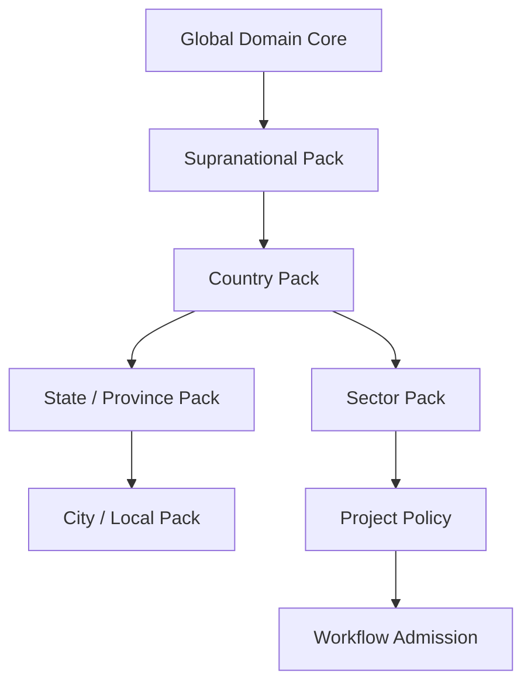

---

## F24 — 呈現／認知偏好／協作（Representation / Cognitive Preference / Collaboration）

| Tool | 主要用途 | 標準使用方式 | 主要效益 |
|---|---|---|---|
| Representation Switching | 同一 underlying model 切換 View | 共用 object IDs/provenance→render different views | 零重工＋適配不同腦袋 |
| Text / Outline View | 線性文字與大綱 | summary→outline→details→evidence links | 適合深度閱讀 |
| Table / Matrix View | 列欄比較資訊 | entities×criteria→filter/sort/score | 高效率比較 |
| Mind Map View | 樹狀自由聯想呈現 | render idea/topic hierarchy | 降工作記憶負荷 |
| Concept Graph View | typed nodes/edges | render relations/provenance | 可視化知識與矛盾 |
| Timeline View | 按時間呈現事件 | events→time→decision/change markers | 找時間關係 |
| Causal View | 專門呈現因果/feedback | DAG/CLD＋assumptions | 避免一般圖誤當因果 |
| Audio / Conversational View | 用語音/對話操作 | speech→structured objects→readback/confirm | 降輸入門檻 |
| Guided Mode | 系統逐步提問 | one question at a time→progressive disclosure | 降工具選擇焦慮 |
| Expert LEGO Mode | 專家自由拖拉方法 | typed blocks→compatibility→compile | 高控制、可重用 |

---

# 9. LEGO Contract：自由組裝，但不能亂接

```yaml
method:
  id: root_cause.fishbone
  version: 1.0.0
  family: root_cause

cognitive_primitives:
  - DECOMPOSE
  - GROUP
  - CAUSE_HYPOTHESIS

purpose:
  - identify_candidate_causes

inputs:
  required:
    - ProblemStatement
  optional:
    - EvidenceSet
    - Dataset
    - StakeholderSet

outputs:
  - CauseHypothesisSet

preconditions:
  - problem_statement.status == validated

quality:
  provenance_required: true
  evidence_labeling_required: true

forbidden_transition:
  - CauseHypothesisSet -> FinalCausalFact

recommended_next:
  - root_cause.pareto
  - root_cause.five_whys
  - causal.dag
  - validation.experiment

rollback:
  side_effect_free: true
```

### Lens Contract

```yaml
lens:
  id: stakeholder.regulator
  version: 1.0.0
  type: perspective
  requires:
    - JurisdictionContext
  output:
    - PerspectiveAssessment
  labels:
    evidence_backed: required
    hypothetical_role_perspective: allowed
    impersonation: forbidden
```

### Representation Contract

```text
Knowledge Object
   ├─ Text View
   ├─ Table View
   ├─ Mind Map View
   ├─ Concept Graph View
   ├─ Timeline View
   ├─ Causal View
   └─ Audio / Guided View
```

View 只保存 `layout / filters / visible_fields / presentation_preferences`，不得複製 Knowledge 本體。

---

# 10. Method Selection Engine

## Selector Inputs

```yaml
selection_context:
  goal_type: ...
  problem_type: diagnostic|exploratory|creative|strategic|causal|decision|operational
  domain: ...
  jurisdiction_context: ...
  stakeholders: [...]
  risk_tier: <specs/execution/risk-tier.schema.yaml#/risk_tier>  # R0|R1|R2|R3|R4；canonical enum，Atlas 不再自訂 low|medium|high|critical（ADR-004 Sub-decision a）
  decision_criticality: ...
  evidence_available: ...
  data_available: ...
  uncertainty: ...
  reversibility: ...
  time_horizon: ...
  budget: ...
  time_budget: ...
  required_rigor: fast|professional|research_grade|board_grade
  cognitive_preferences: ...
  accessibility_needs: ...
```

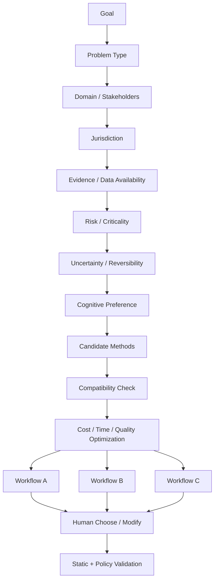

| Problem Type | 起始推薦 | 不應預設 |
|---|---|---|
| Diagnostic | Baseline→Data→Fishbone/Pareto→Causal Validation | SWOT |
| Creative | HMW→Divergence→Clustering→Prototype | 5 Whys |
| Strategy | Context→Stakeholder→3C/Porter→Scenario→Decision | 單純 Mind Map |
| Causal | DAG→Data Quality→Identification→Compute→Sensitivity | Brainstorm 結論 |
| Incident | Timeline→Change Analysis→Fault/Fishbone→Barrier→CAPA | Persona |
| Policy | Stakeholder→Jurisdiction→Evidence→Theory of Change→Scenario | 單一 ROI |
| Architecture | C4/DDD→Quality Attributes→Options→ATAM→ADR→Rehearsal | Patch-first |
| Security | Assets/DFD→STRIDE/LINDDUN→Attack Tree→Controls→Test | Checklist only |
| DB Migration | Data Contract→Compatibility→Expand/Contract→Backfill→Restore/Rollback | Big-bang ALTER |
| Market Entry | Jurisdiction→PESTEL→Customer→Porter→Unit Economics→Admission Gate | Country name only |

---

# 11. 核心工具詳細解說與圖解

> **命名規則**：本文件所有表格的 Tool 欄位只使用英文名稱；本「詳細解說」章節則使用 **English（台灣常用中文名稱）**，方便台灣團隊與全球方法論名稱互相對照。

---

## 11.1 心智圖（Mind Map）

**主要用途**  
把一個主題快速往外展開，適合在資訊尚未結構化時外化思考。

**標準使用方式**

1. 中心只放一個主題或問題。
2. 第一層放主要方向，不急著要求 MECE。
3. 第二、三層放關鍵詞、例子、疑問、素材。
4. 發散完成後切到 Affinity Diagram 做分群。
5. 若開始出現「A 造成 B」等關係，切換 Concept Map / Causal DAG，不要硬用 Mind Map 表達因果。

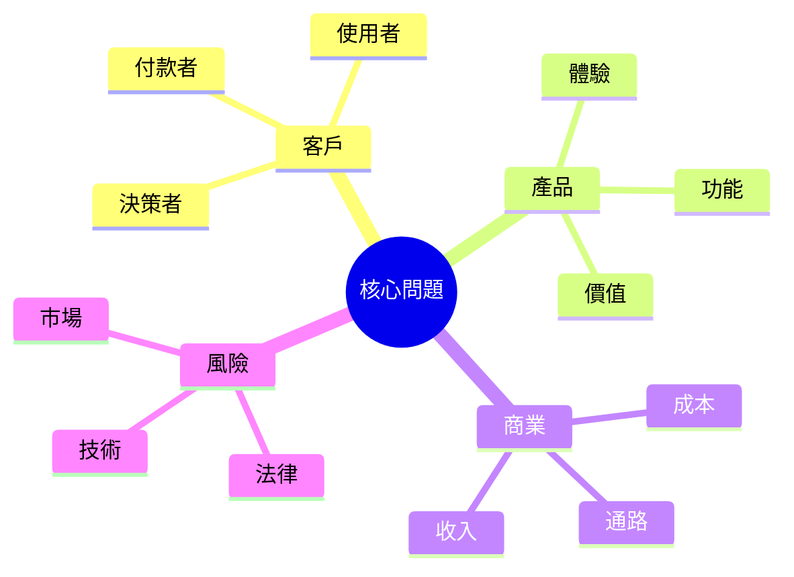

**效益**

- 降低工作記憶負擔。
- 適合視覺與探索型使用者。
- 快速看見遺漏方向。
- 可作為 Brainstorm 的低門檻入口。

**限制**

- 邊沒有正式語意。
- 不能因為兩個東西畫在一起就宣稱存在因果。
- 不適合作為正式證據圖譜。

**推薦搭配**  
`Mind Map → Affinity Diagram → Concept Map / Issue Tree`

---

## 11.2 概念圖／概念構圖（Concept Map）

**主要用途**  
用有語意的關係連接概念，例如「造成」「依賴」「支持」「反駁」「受規範於」。

```mermaid
graph LR
    A[AI 教育平台] -->|服務| B[學生]
    A -->|需符合| C[教育規範]
    A -->|處理| D[個人資料]
    D -->|受規範於| E[隱私法]
    F[教師採用率] -->|影響| G[學校採用]
```

**使用方式**

1. 建立 Concept Nodes。
2. 每條 Edge 必須指定 relationship type。
3. 有來源的關係要連 Evidence。
4. 推論關係必須標 `Inference`。
5. 因果關係若要進一步證明，轉 Causal DAG。

**效益**

- 比心智圖更適合正式知識系統。
- 可直接映射 Knowledge Graph。
- 有利搜尋、重用、矛盾偵測與 provenance。

---

## 11.3 親和圖／KJ 法（Affinity Diagram）

**主要用途**  
把大量無結構的 ideas、訪談片段、問題或需求自然分群。

**使用方式**

1. 一張卡只放一個 idea / observation。
2. 先不預設分類名稱。
3. 讓相似卡片自然聚集。
4. 對群組命名。
5. 再找上層主題與跨群關係。

**效益**

- 把 100–500 個零散項目縮成可理解結構。
- 降低過早套框架造成的偏誤。
- 很適合 Brainwriting、訪談 coding、retrospective。

---

## 11.4 魚骨圖／石川圖／因果圖（Fishbone Diagram / Ishikawa Diagram）

**主要用途**  
系統列出「可能原因」，特別適合品質、營運、事件與故障問題。

```mermaid
flowchart LR
    A[People] --> X[Problem]
    B[Process] --> X
    C[Technology] --> X
    D[Data] --> X
    E[Environment] --> X
    F[Policy] --> X
```

**使用方式**

1. 右側明確定義 Effect / Problem。
2. 建原因大類；不要硬套製造業 6M，可依 domain 調整。
3. 每大類展開 candidate causes。
4. 對每個原因標 `Evidence-backed / Hypothesis / Unknown`。
5. 用 Data / Pareto / 5 Whys / DAG 驗證。

**效益**

- 防止團隊只盯第一個原因。
- 適合多人共同建立原因空間。
- 容易視覺化。

**重要限制**

> Fishbone 只能產生 `CauseHypothesisSet`，不能直接產生 `RootCauseFact`。

---

## 11.5 五個為什麼／五問法（5 Whys）

**主要用途**  
沿著原因鏈由症狀一路往可控制、可驗證的原因深入。

```text
訂單取消率上升
↓ Why
出貨延遲
↓ Why
訂單等待人工確認
↓ Why
庫存不同步
↓ Why
ERP 與電商沒有可靠事件整合
↓
可驗證的根因候選
```

**不是一定問五次。**  
正確停止條件：

- 原因可由組織控制。
- 有明確證據可以驗證。
- 已找到 system/process mechanism。
- 再問只會進入過度抽象問題。

**失敗模式**

- 單一路徑過度簡化多因問題。
- 把「人員不小心」當最終根因。
- 沒有數據仍自信宣告原因。

**推薦搭配**  
`Fishbone → Pareto → 5 Whys → Causal Validation`

---

## 11.6 柏拉圖分析／80/20 分析（Pareto Analysis）

**用途**  
找出少數造成大部分損失、事故、成本或抱怨的類別。

**步驟**

1. 定義 metric：次數、金額、停機分鐘、Severity-adjusted impact。
2. 分類。
3. 由大到小排序。
4. 計算累積占比。
5. 對前幾項做 RCA。

**效益**

- 避免平均用力。
- 把有限資源集中在高影響區。
- 適合和 Fishbone 搭配。

**注意**  
80/20 不是自然法則；真正比例由資料決定。

---

## 11.7 SWOT 分析／優劣勢機會威脅分析（SWOT Analysis）

**用途**  
把局勢分成內部 Strength/Weakness 與外部 Opportunity/Threat。

**使用方式**

1. 先取得證據，不要直接腦補。
2. 每個 factor 要有 geography、time、source。
3. 把內部與外部分開。
4. 把事實與策略分開。
5. SWOT 完成後進 TOWS。

**效益**

- 高階溝通很直觀。
- 能快速建立共同局勢認知。

**常見誤用**

- SWOT 做完就停止。
- 把「推出新產品」這種 action 當 Opportunity。
- 對所有國家使用同一 SWOT。
- 沒有 Evidence 就寫「品牌強」「市場大」。

---

## 11.8 TOWS 矩陣／SWOT 策略矩陣（TOWS Matrix）

| 組合 | 問題 | 產出 |
|---|---|---|
| SO | 如何用優勢放大機會？ | Growth strategy |
| ST | 如何用優勢抵抗威脅？ | Defensive strategy |
| WO | 如何利用機會補弱點？ | Capability-building |
| WT | 如何降低弱點並避開威脅？ | Risk reduction / exit |

**效益**  
把「分析清單」真正轉成 Strategy Options。

---

## 11.9 PESTEL 分析／總體環境分析（PESTEL Analysis）

**用途**  
從 Political、Economic、Social、Technological、Environmental、Legal 掃描外部環境。

```mermaid
flowchart TB
    P[Political] --> X[Context Model]
    E[Economic] --> X
    S[Social] --> X
    T[Technological] --> X
    ENV[Environmental] --> X
    L[Legal] --> X
    X --> I[Implications]
    I --> U[Uncertainties]
    U --> SC[Scenarios]
```

**全球系統的必要欄位**

```yaml
factor:
  statement: ...
  geography: ...
  source: ...
  source_type: official|research|market|other
  effective_from: ...
  effective_to: ...
  trend: ...
  implication: ...
  confidence: ...
```

**效益**

- 特別適合 Market Entry、政策與長期策略。
- 能自然接 Scenario Planning。
- 有 geography/time/source 後才真正可全球重用。

---

## 11.10 SCAMPER 創意法／奔馳法（SCAMPER）

**七個問題**

```text
S Substitute   替代什麼？
C Combine      可以組合什麼？
A Adapt        可以借用什麼？
M Modify       可以放大、縮小、改形態什麼？
P Put to use   還能拿來做什麼？
E Eliminate    可以刪掉什麼？
R Reverse      可以反轉、重排什麼？
```

**用途**  
已有概念、產品、流程時做系統化創新。

**效益**

- 很容易教學與產品化。
- 可產生大量具方向性的 variant。

**限制**  
它能產生 ideas，不能證明 customer demand 或 business viability。

**推薦搭配**  
`JTBD → HMW → SCAMPER → Prototype → Validation`

---

## 11.11 形態分析法／型態分析法（Morphological Analysis）

**用途**  
把一個系統拆成多個設計維度，再排列合法組合。

| Dimension | Option A | Option B | Option C |
|---|---|---|---|
| Deployment | Cloud | Local | Hybrid |
| AI | Bundled | BYOAI | Local |
| User | Personal | Team | Enterprise |
| Storage | Local Disk | Object | Private Cloud |

**使用方式**

1. 定義 mutually meaningful dimensions。
2. 每個維度列 options。
3. 建 compatibility constraints。
4. 產生合法 combinations。
5. 用 feasibility / MCDA / prototype 收斂。

**效益**

- 不依賴靈感，可系統探索很大的 solution space。
- 非常適合 LEGO 產品架構本身。

---

## 11.12 待辦工作理論／工作任務理論（Jobs To Be Done / JTBD）

**用途**  
不是問「使用者想買什麼」，而是問：

> 使用者在某個情境下，想取得什麼進展？

**標準格式**

```text
When [situation],
I want to [motivation/job],
so I can [desired outcome].
```

**效益**

- 降低 feature-first 思考。
- 可跨產品形式保留真正需求。
- 很適合全球化，因為「解法」可能因文化不同，而 job 可能相對穩定。

**必須搭配 Local Evidence**  
不能假設不同文化的 motivation 相同。

---

## 11.13 顧客旅程地圖／使用者旅程地圖（Customer Journey Map）

```mermaid
flowchart LR
    A[認知] --> B[研究]
    B --> C[選擇]
    C --> D[購買]
    D --> E[使用]
    E --> F[售後]
    F --> G[續約 / 推薦]
```

每個 Stage 分析：

- Actions
- Questions
- Emotion
- Pain
- Evidence
- Opportunity
- Responsible system/team

**效益**  
可找到 funnel 斷點與跨部門問題，而不是只看某一畫面。

---

## 11.14 利害關係人地圖（Stakeholder Map）

**用途**  
完整列出誰影響決策、誰被影響、誰付錢、誰執行、誰承擔風險。

對大型全球計畫至少要考慮：

```text
User
Buyer
Payer
Employee
Frontline Executor
Partner
Vendor
Investor
Competitor
Regulator
Policy Maker
Local Government
Auditor
Community
Minority Group
Media
```

**效益**  
防止「只看客戶」或「只看老闆」。

---

## 11.15 權力－關注矩陣／權力－利益矩陣（Power–Interest Matrix）

```mermaid
quadrantChart
    title Stakeholder Power–Interest
    x-axis Low Interest --> High Interest
    y-axis Low Power --> High Power
    quadrant-1 Manage Closely
    quadrant-2 Keep Satisfied
    quadrant-3 Monitor
    quadrant-4 Keep Informed
```

**用途**  
決定 stakeholder engagement strategy，不是判斷誰比較「重要的人」。

---

## 11.16 談判最佳替代方案（BATNA）

**英文全名**：Best Alternative to a Negotiated Agreement  
**台灣常用名稱**：談判破局時的最佳替代方案／最佳替代方案

**使用方式**

1. 列出談不成時可做的 alternatives。
2. 估算每個 alternative 的價值與成本。
3. 選最佳 BATNA。
4. 先改善 BATNA，再進談判。
5. 依 BATNA 推 reservation point。

**效益**  
讓談判不是靠情緒或 sunk cost。

---

## 11.17 可能達成協議區間／可協議區間（ZOPA）

**英文全名**：Zone of Possible Agreement

```text
Seller minimum ---------[ ZOPA ]--------- Buyer maximum
```

**用途**  
找雙方 reservation point 是否有重疊。

**搭配**  
`BATNA + ZOPA + Interest-Based Negotiation`

---

## 11.18 因果迴路圖／因果回饋圖（Causal Loop Diagram）

**用途**  
表達 Reinforcing Loop、Balancing Loop、Delay。

```mermaid
graph TD
    A[使用者增加] -->|+| B[資料增加]
    B -->|+| C[產品改善]
    C -->|+| A
    A -->|+| D[系統負載]
    D -->|-| E[使用體驗]
    E -->|+| A
```

**效益**

- 很適合政策、市場、平台與組織問題。
- 強迫分析「對方會反應」「系統有延遲」「今天的解法可能造成明天的新問題」。

---

## 11.19 假設矩陣／假設地圖（Assumption Mapping）

```mermaid
quadrantChart
    title Assumption Mapping
    x-axis Low Uncertainty --> High Uncertainty
    y-axis Low Impact --> High Impact
    quadrant-1 Validate First
    quadrant-2 Known Critical
    quadrant-3 Monitor
    quadrant-4 Cheap Tests
```

**用途**  
選出 Critical Assumptions。

**最重要規則**

> High Impact × High Uncertainty 必須產生 Validation Plan。

**效益**

- 把討論從「誰覺得比較對」變成「先測哪個最危險假設」。
- 大幅降低做錯方向的沉沒成本。

---

## 11.20 證據矩陣（Evidence Matrix）

**用途**  
將每個 Claim 與支持、反對、缺失證據對齊。

| Claim ID | Supporting | Contradicting | Quality | Coverage | Confidence |
|---|---|---|---|---|---|
| C-01 | E-1, E-2 | E-8 | High | 3 regions | 0.78 |

**效益**

- 很快看到「結論很大、證據很少」。
- 支援多國、多時間版本比較。
- 適合 Research、Strategy、Compliance。

---

## 11.21 因果有向無環圖（Causal DAG）

**英文全名**：Causal Directed Acyclic Graph  
**台灣常用名稱**：因果 DAG／因果有向無環圖

```mermaid
graph LR
    C[品牌知名度] --> A[廣告曝光]
    C --> B[購買]
    A --> B
    D[價格] --> B
```

**用途**  
明確表示因果假設、混淆因子、中介變數與 collider。

**效益**

- 避免直接把相關性寫成因果。
- 指導資料分析要控制哪些變數、不該控制哪些變數。
- 可連到實驗與 Causal Inference Engine。

---

## 11.22 變革理論（Theory of Change）

**用途**  
描述一個 intervention 如何經過機制產生 outcome 與 impact。

```mermaid
flowchart LR
    I[Inputs] --> A[Activities]
    A --> O[Outputs]
    O --> S[Short-term Outcomes]
    S --> L[Long-term Outcomes]
    L --> IMP[Impact]
```

每條箭頭都應有：

- Assumption
- Evidence
- Indicator
- Risk

**效益**  
非常適合政策、教育、社會方案與大型 change program。

---

## 11.23 紅隊／紅隊檢驗（Red Team）

**用途**  
以攻擊者、競爭者、批判者或最悲觀失敗情境主動攻擊方案。

檢查：

- Assumptions
- Logic
- Missing variables
- Counterexamples
- Security
- Privacy
- Legal
- Culture
- Operations
- Statistical validity
- Overconfidence

**規則**  
Red Team 沒有 final authority，只能輸出 challenge artifact。

---

## 11.24 藍隊／藍隊防禦（Blue Team）

**用途**  
不是盲目支持原方案，而是把方案 steelman 到最強版本：

- 補 controls
- 補 evidence
- 補 fallback
- 補 monitoring
- 補 recovery

**搭配**  
`Blue Team → Red Team → Independent Judge`

---

## 11.25 事前驗屍／事前失敗分析（Pre-mortem）

**用途**  
在事情還沒做之前假設：

> 一年後這個專案徹底失敗了，為什麼？

**步驟**

1. 指定失敗時間點與情境。
2. 每人先獨立寫原因。
3. 分群。
4. 依 likelihood × impact 排序。
5. 建 prevention / detection / recovery control。

**效益**  
通常比直接問「有哪些風險？」更容易得到真正擔憂。

---

## 11.26 失效模式與效應分析（FMEA）

**英文全名**：Failure Mode and Effects Analysis  
**台灣常用名稱**：失效模式與效應分析

**使用方式**

```text
Function
→ Failure Mode
→ Effect
→ Cause
→ Existing Control
→ Severity
→ Occurrence
→ Detection
→ Action Priority
```

**效益**

- 工程、製造、醫療、流程安全非常成熟。
- 可把「可能出錯」變成可管理的 Failure Register。

**注意**  
不要只依賴 RPN；高 Severity 即使機率低仍可能需強制控制。

---

## 11.27 情境規劃／情境分析（Scenario Planning）

**用途**  
不是預測一個未來，而是建立多個 plausible futures。

```mermaid
quadrantChart
    title Scenario Planning
    x-axis Regulation Loose --> Regulation Strict
    y-axis AI Cost High --> AI Cost Low
    quadrant-1 Low Cost / Strict
    quadrant-2 Low Cost / Loose
    quadrant-3 High Cost / Loose
    quadrant-4 High Cost / Strict
```

每個 Scenario 要有：

- Drivers
- Assumptions
- Narrative
- Stakeholder responses
- Competitor responses
- 2nd/3rd-order effects
- Signposts
- Strategy performance
- Reversal condition

**效益**  
讓策略在不確定世界中追求 robustness，而不是只對一個 forecast 最佳化。

---

## 11.28 未來輪／未來影響輪（Futures Wheel）

**用途**  
把一個變化往外展開一階、二階、三階效果。

```mermaid
graph TD
    A[AI 成本下降]
    A --> B1[採用增加]
    A --> B2[功能商品化]
    A --> B3[算力需求增加]
    B1 --> C1[工作角色改變]
    B2 --> C2[價格競爭]
    B3 --> C3[能源壓力]
```

**效益**  
強制避免只看「直接好處」。

---

## 11.29 蒙地卡羅模擬（Monte Carlo Simulation）

**用途**  
當關鍵輸入都不是固定值時，用 probability distributions 模擬大量可能結果。

```mermaid
flowchart LR
    I[Input Distributions] --> M[Monte Carlo N Runs]
    M --> O[Outcome Distribution]
    O --> P[Success Probability]
    O --> S[Sensitivity]
    O --> T[Tail Risk]
```

**使用方式**

1. 定義輸入 distributions。
2. 檢查 correlation / dependency。
3. 設定 random seed。
4. 跑足夠 simulation。
5. 輸出 distribution，而不是只輸出平均。
6. 做 sensitivity / tail analysis。

**效益**

- 把「Best/Base/Worst」升級成概率分布。
- 可回答 P(success)、P95 cost、loss tail。
- 支援 Decision Engine。

---

## 11.30 影響－投入矩陣／效益－難度矩陣（Impact–Effort Matrix）

**用途**  
大量 ideas 的第一輪快速篩選。

```mermaid
quadrantChart
    title Impact–Effort
    x-axis Low Effort --> High Effort
    y-axis Low Impact --> High Impact
    quadrant-1 Major Projects
    quadrant-2 Quick Wins
    quadrant-3 Fill-ins
    quadrant-4 Avoid / Reconsider
```

**注意**  
它只適合初篩；高風險方案不能只靠這張圖決策。

---

## 11.31 層級分析法（AHP）

**英文全名**：Analytic Hierarchy Process  
**台灣常用名稱**：層級分析法／分析層級程序法

**用途**  
當 criteria 權重難以直接設定時，用 pairwise comparison 推導權重。

**流程**

```text
Goal
→ Criteria hierarchy
→ Pairwise comparisons
→ Weight calculation
→ Consistency Ratio
→ Option scoring
→ Sensitivity
```

**效益**

- 權重來源較可解釋。
- 適合多準則、高階決策。

**限制**

- Criteria 太多時 pairwise 數量爆炸。
- 權重仍然是 judgment，不是客觀真理。

---

## 11.32 多準則決策分析（MCDA）

**英文全名**：Multi-Criteria Decision Analysis  
**台灣常用名稱**：多準則決策分析

**用途**  
同時考慮安全、成本、維護性、法規、使用者價值等互相衝突的目標。

**流程**

```mermaid
flowchart LR
    A[Options] --> B[Criteria]
    B --> C[Weights]
    C --> D[Normalize]
    D --> E[Score]
    E --> F[Sensitivity]
    F --> G[Stakeholder Views]
    G --> H[Human Decision]
```

**效益**

- 比單純 ROI 或「大家投票」更完整。
- 可以保留不同 stakeholder weights。
- 可加 Scenario sensitivity。

---

## 11.33 決策反轉條件／決策翻轉條件（Reversal Criteria）

**用途**  
事前定義：

> 哪些新資訊或指標達到什麼程度時，我們必須重新評估甚至撤銷目前決策？

範例：

```yaml
reversal:
  indicator: CAC
  condition: "> 300 USD for 3 consecutive months"
  action: re_review
  owner: growth_lead
```

**效益**

- 防 sunk cost。
- 防組織因面子拒絕改方向。
- 讓 Decision 成為動態 object。

---

## 11.34 C4 架構模型（C4 Model）

**台灣常用名稱**：C4 架構圖／C4 架構模型

四層：

```text
System Context
→ Container
→ Component
→ Code (必要時)
```

**用途**

- 快速理解既有系統。
- 同一架構依受眾提供不同深度。
- 很適合作為「修改前完整理解現況」的第一層。

**效益**  
避免一開始就跳進 class/file patch 而失去 system context。

---

## 11.35 領域驅動設計（Domain-Driven Design / DDD）

**用途**  
把複雜 domain 的語意與邊界正式化。

核心概念：

- Ubiquitous Language
- Subdomain
- Bounded Context
- Context Map
- Aggregate
- Domain Event

**效益**

- 降低跨模組語意互相污染。
- 適合 10–30 年持續擴張系統。
- 支援逐步拆服務，而非一開始 microservice explosion。

---

## 11.36 事件風暴法（Event Storming）

**台灣常用名稱**：事件風暴／事件風暴工作坊

**用途**  
以 Domain Event 為中心，讓 PM、工程、業務、營運快速建立共同 domain model。

```text
Domain Event
← Command
← Actor
← Policy
← External System
→ Aggregate / Read Model
```

**效益**

- 發現 hidden workflow。
- 找 bounded context。
- 找例外、等待、人工步驟與 ownership gap。

---

## 11.37 架構決策紀錄（Architecture Decision Record / ADR）

**用途**  
保存「為什麼這樣設計」，而不只是保存 code 結果。

建議模板：

```markdown
# ADR-XXXX

## Context
## Decision
## Alternatives Considered
## Security / Privacy
## Data Impact
## Operational Impact
## Compatibility
## Migration
## Rollback
## Validation
## Revisit / Reversal Conditions
```

**效益**

- 30 年後仍能理解歷史。
- 防止相同問題每幾年重新爭論。
- 支援變更可回滾與 audit。

---

## 11.38 架構權衡分析法（ATAM）

**英文全名**：Architecture Tradeoff Analysis Method  
**台灣常用名稱**：架構權衡分析法／架構取捨分析法

**用途**  
系統化找架構的：

- Sensitivity Point
- Tradeoff Point
- Risk
- Non-risk

例如：

> 加密強度提升安全，但提高 latency。  
> Cache 提高 performance，但增加一致性複雜度。

**效益**  
特別適合「最穩定、安全、可維護」這種多目標同時存在的架構決策。

---

## 11.39 服務指標／服務目標／服務等級協議（SLI / SLO / SLA）

**台灣常用名稱**

- SLI：服務等級指標
- SLO：服務等級目標
- SLA：服務等級協議

**用途**

把「系統要穩定」轉成：

```text
Availability
Latency
Correctness
Durability
Freshness
```

等 user-visible metrics。

**原則**

> 先 SLI，再 SLO；只有商務需要才 SLA。

---

## 11.40 錯誤預算（Error Budget）

**用途**  
若 SLO 是 99.9%，代表系統允許 0.1% failure budget。

**效益**

- 可靠性與開發速度有共同語言。
- Error budget burn 太快時自動降低 release risk。
- 防止「永遠不能改」與「隨便改」兩個極端。

---

## 11.41 金絲雀部署／小流量漸進部署（Canary Deployment）

**用途**  
新版本先只接受少量真實流量。

```text
1%
→ compare metrics
→ 5%
→ 25%
→ 50%
→ 100%
```

任何階段 unhealthy：

```text
ROLLBACK
```

**效益**

- 直接實現最小爆炸半徑。
- 比「一次全切」更適合高風險服務。

---

## 11.42 藍綠部署（Blue–Green Deployment）

**用途**

```text
Blue = Current Production
Green = New Version
```

Green 完整部署與驗證後才切流量；Blue 保留作快速 fallback。

**效益**

- rollback 快。
- deployment 與 traffic cutover 分離。
- 適合重要 release / migration。

---

## 11.43 混沌工程（Chaos Engineering）

**用途**  
不是隨便破壞 Production，而是：

1. 建立 steady-state hypothesis。
2. 限定 blast radius。
3. 注入特定 failure。
4. 驗證系統是否自動恢復。
5. 不符合預期立即停止。

**效益**

- 找只有真實 failure 才會暴露的 dependency。
- 驗證 DR、retry、timeout、circuit breaker 與 operator runbook。

---

## 11.44 STRIDE 威脅建模（STRIDE）

**台灣常用名稱**：STRIDE 威脅模型／STRIDE 威脅建模

六類：

```text
Spoofing
Tampering
Repudiation
Information Disclosure
Denial of Service
Elevation of Privilege
```

**使用方式**

`Data Flow Diagram → element-by-element threat enumeration → controls → residual risk`

**效益**  
建立一致、可重複的威脅分析。

---

## 11.45 LINDDUN 隱私威脅建模（LINDDUN）

**用途**  
補 STRIDE 主要偏 security 的不足，專門看 privacy threats。

常見維度：

- Linkability
- Identifiability
- Non-repudiation
- Detectability
- Disclosure
- Unawareness
- Non-compliance

**效益**  
避免「系統沒被駭，所以隱私就安全」的錯誤假設。

---

## 11.46 資料保護影響評估／隱私影響評估（DPIA / PIA）

**英文**

- DPIA: Data Protection Impact Assessment
- PIA: Privacy Impact Assessment

**用途**

```text
Processing
→ Purpose
→ Necessity / Proportionality
→ Data Subjects
→ Risks
→ Controls
→ Residual Risk
→ Approval
```

**全球化要求**  
由 Jurisdiction Pack 決定何時 mandatory、誰有 authority、適用哪個版本法規。

---

## 11.47 實體關係圖（ERD）

**英文全名**：Entity Relationship Diagram  
**台灣常用名稱**：實體關係圖／ER 圖

**用途**  
建模 entity、attribute、primary/foreign key、cardinality。

**效益**

- 建立 DB schema 的共同語言。
- 可作為 migration 與 data contract 的起點。

---

## 11.48 資料血緣／資料血統追蹤（Data Lineage）

**用途**

```mermaid
flowchart LR
    S[Source] --> I[Ingest]
    I --> T[Transform]
    T --> D[Dataset]
    D --> A[AnalysisRun]
    A --> R[Result]
    R --> C[Claim]
    C --> P[Paper / Decision]
```

**效益**

- 一個錯誤 source 可以反查影響哪些結果。
- 一個數字可以回到原始來源。
- 支援 legal deletion / correction impact analysis。

---

## 11.49 資料契約（Data Contract）

**用途**  
正式定義 producer 與 consumer 對資料的承諾：

```text
Schema
Semantics
Owner
Freshness
Quality
Compatibility
Deprecation
```

**效益**

- 防止 schema change 無聲破壞 downstream。
- 適合 event-driven、analytics、AI pipeline。

---

## 11.50 擴張－收縮遷移模式（Expand–Contract Migration）

**台灣常用名稱**：擴張－收縮資料庫遷移／相容性資料庫遷移

精確步驟序列見 Execution Contract §28（唯一正本），本節僅說明概念與適用場景。

**效益**

- 避免破壞性 schema migration。
- 可多版本 app 共存。
- rollback 空間比一次性 ALTER 大。

---

## 11.51 RAID 專案紀錄表（RAID Log）

**英文全名**：Risks, Assumptions, Issues, Dependencies Log  
**台灣常用名稱**：RAID 紀錄表／風險假設議題依賴清單

**用途**

每個項目至少：

```text
ID
Type
Statement
Owner
Impact
Status
Next Action
Due / Review Date
Evidence
```

**效益**  
把散落在 Slack、聊天、會議中的 critical knowledge 正式化。

---

## 11.52 階段關卡／階段審查制（Stage-Gate）

**用途**

```text
Stage
→ Evidence
→ Gate
→ Go / Hold / Rework / Kill
```

**效益**

- 防止高成本專案一路做到底才發現方向錯。
- 與 Pilot、Kill Criteria、Reversal Criteria 非常適合搭配。

---

## 11.53 管轄權解析器／適用管轄解析（Jurisdiction Resolver）

**用途**  
回答的不是「使用者在哪個國家」，而是：

> 此次資料處理、產品功能、契約、付款、AI 使用、研究或發布到底受哪些法律與管轄共同約束？

輸入至少可能包括：

```text
Legal Entity
User Location
Data Subject Location
Processing Location
Storage Location
Provider Location
Market
Contract Governing Law
Sector
Government Level
Special Territory / Indigenous Jurisdiction
```

**效益**  
讓全球產品避免簡化成 `country == XX`。

---

## 11.54 市場准入控制／市場上線關卡（Market Admission Control）

**用途**  
任何新國家/地區/sector 啟用前必須 PASS：

```mermaid
flowchart TB
    A[Jurisdiction Pack] --> B[Legal Freshness]
    B --> C[Data Residency]
    C --> D[AI Provider / Model]
    D --> E[Security / Privacy]
    E --> F[Localization / Accessibility]
    F --> G[Sector Controls]
    G --> H[Human Sign-off]
    H --> I[ENABLE]
```

任一 critical unknown：

```text
FAIL CLOSED
```

**效益**  
把「全球支援」變成可驗證 admission process，而不是行銷宣稱。

---

## 11.55 多視圖切換／認知呈現切換（Representation Switching）

**用途**  
同一 Knowledge Object 不重新生成內容，只改 view：

```text
Text
Table
Mind Map
Concept Graph
Timeline
Causal Diagram
Canvas
Audio
```

**效益**

- 不同人的腦袋都可以使用自己適合的方式。
- 零重工。
- Provenance 保持一致。
- 不會因 UI 變化複製出多份互相衝突內容。

---

## 11.56 引導模式／逐步引導模式（Guided Mode）

**用途**  
讓不懂 SWOT、AHP、DAG 名稱的普通人仍能使用完整方法。

例如系統不要問：

> 要不要使用 Fishbone？

而問：

> 你目前是在找「可能原因」，還是已經有數據想驗證原因？

依回答自動選 Method。

**效益**  
Method complexity 留在 engine，不丟給使用者。

---

## 11.57 專家 LEGO 模式／進階積木模式（Expert LEGO Mode）

**用途**  
讓研究者、顧問、架構師自行拖拉：

```text
JTBD
→ Interview
→ Assumption Mapping
→ Scenario
→ Monte Carlo
→ Red Team
→ MCDA
```

Compiler 仍必須：

- Type check
- Precondition check
- Policy check
- Jurisdiction check
- Cost estimate
- Risk estimate
- Required gate injection

**因此是「自由組裝」，不是「自由破壞」。**

---

# 12. 其他高頻工具詳細解說

## 12.1 六何法／六何分析法（5W1H）

**組成**：Who / What / When / Where / Why / How。  
**用途**：第一輪快速盤點問題輪廓與資訊缺口。  
**效益**：低門檻、跨文化容易理解。  
**限制**：只負責探索，不代表已完成根因分析。  
**推薦搭配**：`5W1H → Problem Statement → Issue Tree`

---

## 12.2 問題陳述／問題定義（Problem Statement）

**用途**：把「覺得哪裡怪怪的」變成正式、可測、可多人共享的問題。

建議格式：

```text
Current State
Expected State
Gap
Affected Stakeholders
Impact
Evidence
Constraints
Scope / Non-goals
```

**效益**：防止工程團隊直接跳到 solution。

---

## 12.3 我們可以如何……／機會問題句（How Might We / HMW）

**用途**：把 pain point 轉成不預設方案的開放式問題。  
**例**：不要寫「做一個 chatbot」，改成「我們可以如何讓第一次使用者在 3 分鐘內找到正確資訊？」  
**效益**：保持 solution space 開放。  
**搭配**：`JTBD → HMW → Crazy 8s / SCAMPER`

---

## 12.4 SMART 目標法（SMART）

**台灣常用名稱**：SMART 目標設定法。  
**用途**：讓目標 Specific、Measurable、Achievable、Relevant、Time-bound。  
**效益**：將抽象願景轉成可驗收目標。  
**限制**：不應用 SMART 把錯誤目標「量化得很漂亮」；Goal Framing 必須先完成。

---

## 12.5 目標與關鍵成果（OKR）

**英文全名**：Objectives and Key Results  
**台灣常用名稱**：目標與關鍵成果／OKR

**用途**：將方向性的 Objective 與可量化 Key Results 分開。  
**效益**：跨團隊對齊 outcome。  
**限制**：KR 不應只是 task list。

---

## 12.6 議題樹／問題樹狀拆解（Issue Tree）

**用途**：把主問題拆成可分析子問題。

```mermaid
graph TD
    A[是否進入新市場?]
    A --> B[市場吸引力]
    A --> C[公司能力]
    A --> D[財務可行性]
    A --> E[法規可行性]
    A --> F[執行風險]
```

**效益**：研究範圍、責任與 Evidence Collection 都可以直接沿樹展開。

---

## 12.7 相互獨立、完全窮盡（MECE）

**英文全名**：Mutually Exclusive, Collectively Exhaustive  
**台灣常用名稱**：互斥且完整／相互獨立、完全窮盡

**用途**：檢查分類是否重疊或漏掉。  
**效益**：提高 Issue Tree、報告、資料分類的結構品質。  
**限制**：不是所有現實系統都能完美 MECE；不要為形式強切世界。

---

## 12.8 問題樹（Problem Tree）

**用途**：把核心問題、原因與後果分開。  
**台灣常用名稱**：問題樹／問題分析樹。  
**效益**：政策、NGO、教育、公共問題非常實用。  
**搭配**：`Problem Tree → Objective Tree → Theory of Change`

---

## 12.9 書面腦力激盪／書寫式腦力激盪（Brainwriting）

**用途**：每人先獨立產 idea，避免權威、聲量、性格主導。  
**效益**：對跨文化、多層級團隊比純口頭 Brainstorm 更公平。  
**搭配**：`Brainwriting → Affinity → Nominal Group / MCDA`

---

## 12.10 瘋狂八格法／八格快速發想（Crazy 8s）

**用途**：八分鐘畫八個不同 concept。  
**效益**：打破第一答案、降低 perfectionism。  
**適用**：UI、服務流程、產品概念。  
**限制**：不適合作為最後方案評選。

---

## 12.11 波特五力分析（Porter Five Forces）

**台灣常用名稱**：波特五力／五力分析

五力：

```text
Industry Rivalry
New Entrants
Substitutes
Supplier Power
Buyer Power
```

**用途**：分析產業結構，而不是單一競爭者。  
**效益**：Market Entry、投資與長期策略。  
**限制**：數位平台、network effects、ecosystem 常需補 Platform Strategy。

---

## 12.12 3C 分析（3C Analysis）

**台灣常用名稱**：3C 分析  
**三面向**：Customer / Competitor / Company。  
**用途**：快速建立商業策略基本框架。  
**效益**：比大而全的分析更適合早期方向判斷。  
**搭配**：`3C → SWOT/TOWS → Strategy`

---

## 12.13 VRIO 資源分析（VRIO）

**台灣常用名稱**：VRIO 分析／資源基礎競爭優勢分析

```text
Value
Rarity
Imitability
Organization
```

**用途**：判斷某項資源是否真的能成為持久競爭優勢。  
**效益**：防止把「我們有這個能力」直接等同「我們有 moat」。

---

## 12.14 市場區隔、目標市場與定位（STP）

**英文全名**：Segmentation, Targeting, Positioning  
**台灣常用名稱**：STP 行銷策略／市場區隔、目標市場、定位

**用途**：決定不是「賣給所有人」，而是先選 segment 再定位。  
**搭配**：`JTBD / Survey → STP → Value Proposition`

---

## 12.15 商業模式圖／商業模式畫布（Business Model Canvas）

**台灣常用名稱**：商業模式圖／商業模式畫布／BMC

九格：

```text
Customer Segments
Value Propositions
Channels
Customer Relationships
Revenue Streams
Key Resources
Key Activities
Key Partners
Cost Structure
```

**效益**：把產品、客戶、營運與財務放在一張共同語言上。  
**限制**：它是 business model hypothesis，不是經驗證的 business。

---

## 12.16 服務藍圖（Service Blueprint）

**台灣常用名稱**：服務藍圖

```text
Customer Actions
----------------
Frontstage
----------------
Backstage
----------------
Support Processes
----------------
Systems / Data
```

**用途**：找「畫面看起來簡單，但後端流程很痛」的問題。  
**效益**：產品、客服、營運、系統工程可以共用。

---

## 12.17 深度訪談／訪談法（Interview）

**用途**：取得 why/how 的質性資料。  
**標準流程**：Research question→Sampling→Guide→Consent→Interview→Transcribe→Code→Themes→Negative cases。  
**效益**：非常適合探索需求與機制。  
**限制**：不能用少量訪談直接推估人口比例。

---

## 12.18 問卷調查／調查研究（Survey）

**用途**：量化態度、行為、需求或 prevalence。  
**重點**：construct validity、sampling、question wording、non-response bias。  
**效益**：可跨 segment / geography 比較。  
**全球要求**：翻譯後必須做語義等值與 local pilot，不是直譯即可。

---

## 12.19 賽局理論（Game Theory）

**台灣常用名稱**：賽局理論

**用途**：對手也會思考與回應時的策略分析。  
**流程**：Players→Strategies→Payoffs→Information→Sequence→Equilibrium / sensitivity。  
**效益**：競爭、談判、地緣政治、平台治理。  
**限制**：Payoff 設錯，模型再漂亮也無用。

---

## 12.20 貝氏更新／貝葉斯更新（Bayesian Updating）

**台灣常用名稱**：貝氏更新／貝葉斯更新

```text
Prior Belief
+ New Evidence
→ Posterior Belief
```

**用途**：持續收到新資料時更新信心，而不是每次重做結論。  
**效益**：特別適合 30 年 Decision Memory、Forecasting、Risk Monitoring。

---

## 12.21 魔鬼代言人／反方論證（Devil's Advocate）

**用途**：刻意建立「如果主流觀點是錯的」的最強版本。  
**效益**：防 groupthink。  
**與 Red Team 差別**：Devil's Advocate 側重觀點與論證；Red Team 可以攻擊整個系統、流程、控制與實作。

---

## 12.22 地平線掃描／前瞻掃描（Horizon Scanning）

**台灣常用名稱**：前瞻掃描／趨勢掃描

**用途**：定期掃描科技、法規、社會、經濟、環境等新興訊號。  
**效益**：使系統不是只有被動反應。  
**工程化**：每個 signal 必須有 source、date、geography、status、impact、confidence。

---

## 12.23 德菲法／德爾菲法（Delphi Method）

**台灣常用名稱**：德菲法／德爾菲法

**用途**：匿名多輪取得專家 judgment。  
**效益**：降低權威人物主導、保留 dispersion。  
**限制**：Consensus 不是 truth；應保存 minority range。

---

## 12.24 TELOS 可行性分析（TELOS Feasibility）

**台灣常用名稱**：TELOS 可行性分析

```text
Technical
Economic
Legal
Operational
Schedule
```

**效益**：避免工程師只證明「技術做得到」就認為專案可行。

---

## 12.25 成本效益分析（Cost–Benefit Analysis）

**台灣常用名稱**：成本效益分析／成本效益評估

**用途**：把方案生命週期成本與效益比較。  
**重要**：需 discounting、sensitivity、distributional effects。  
**限制**：難貨幣化的人權、倫理、安全不可硬塞成假精準價格。

---

## 12.26 總持有成本（Total Cost of Ownership / TCO）

**台灣常用名稱**：總持有成本／總體擁有成本

包含：

```text
Purchase
Implementation
Migration
People
Operation
Support
Security
Compliance
Downtime
Exit
Data Egress
Decommission
```

**效益**：對 Cloud、SaaS、DB、Vendor lock-in 決策特別重要。

---

## 12.27 單位經濟模型／單位經濟效益（Unit Economics）

**用途**：判斷每一個客戶、訂單、座位或 transaction 是否創造正向經濟價值。

常見：

```text
CAC
LTV
Gross Margin
Payback
Churn
ARPU
Contribution Margin
```

**效益**：避免「營收成長但越賣越虧」。

---

## 12.28 淨現值（NPV）

**英文全名**：Net Present Value  
**台灣常用名稱**：淨現值

**用途**：把不同時間的 cash flow 折成可比較的今天價值。  
**效益**：大型投資、平台遷移、基礎設施、30 年成本比較。  
**搭配**：`NPV + Sensitivity + Scenario + Monte Carlo`

---

## 12.29 最小可行產品（MVP）

**英文全名**：Minimum Viable Product  
**台灣常用名稱**：最小可行產品

**用途**：驗證最重要的 value assumption。  
**不是**：把正式產品做爛一點。  
**正確問題**：最少做什麼，才能得到足以改變決策的 evidence？

---

## 12.30 A/B 測試／分流實驗（A/B Test）

**台灣常用名稱**：A/B 測試／A/B 實驗

**流程**

```text
Hypothesis
→ Primary Metric
→ Guardrails
→ Sample / Power
→ Randomization
→ Run
→ Analyze
→ Decision
```

**注意**：避免 peeking、multiple testing、sample ratio mismatch。

---

## 12.31 試辦／試點計畫（Pilot）

**台灣常用名稱**：試辦／試點／先導計畫

**用途**：在真實環境的小範圍內驗證技術＋流程＋人＋政策。  
**效益**：非常符合最小爆炸半徑。  
**強制**：Pilot 開始前定義 Success / Stop / Rollback criteria。

---

## 12.32 RICE 優先級模型（RICE）

**台灣常用名稱**：RICE 優先排序／RICE 評分法

```text
Reach × Impact × Confidence ÷ Effort
```

**用途**：Product roadmap。  
**效益**：比只看 impact 多考慮 reach 與 confidence。  
**限制**：分數是 decision aid，不是 authority。

---

## 12.33 加權決策矩陣／加權評分矩陣（Weighted Decision Matrix）

**用途**：多個方案、criteria 有不同重要度時比較。

**流程**

```text
Options
× Criteria
× Weights
→ Scores
→ Sensitivity
→ Decision
```

**效益**：簡單、透明、容易 audit。  
**限制**：高風險決策要補 hard constraints、scenario 與 stakeholder weights。

---

## 12.34 戴明循環／PDCA 循環（PDCA）

**台灣常用名稱**：PDCA 循環／戴明循環

```text
Plan → Do → Check → Act → ...
```

**用途**：穩定流程的持續改善。  
**效益**：適合 operations、quality、process improvement。

---

## 12.35 OODA 循環／觀察導向決策循環（OODA Loop）

**台灣常用名稱**：OODA 循環

```text
Observe → Orient → Decide → Act
```

**用途**：快速變化與競爭情境。  
**和 PDCA 差異**：OODA 更強調情勢更新與 decision tempo。

---

## 12.36 決策日誌／決策紀錄（Decision Journal）

**用途**：在「結果還不知道」時保存當時的 evidence、assumptions、options、confidence。

**效益**

- 防 hindsight bias。
- 可比較 Prediction vs Reality。
- 能訓練組織的 decision calibration。

---

## 12.37 零信任架構／零信任安全模型（Zero Trust）

**核心思想**：

> Never trust implicitly; continuously verify based on identity, device/workload, context and policy.

**工程重點**

- Strong identity
- Workload identity
- Short-lived credentials
- Least privilege
- Explicit policy decision
- Continuous logging / audit

**效益**：降低 lateral movement 與 long-lived secret 風險。

---

## 12.38 攻擊樹（Attack Tree）

**台灣常用名稱**：攻擊樹／攻擊路徑樹

```mermaid
graph TD
    G[取得敏感資料] --> A[竊取帳密]
    G --> B[利用漏洞]
    G --> C[取得備份]
    A --> A1[Phishing]
    A --> A2[Credential Stuffing]
    B --> B1[RCE]
    C --> C1[Misconfigured Storage]
```

**用途**：從 attacker goal 反推所有可行路徑。  
**效益**：可找最便宜、最可能、最難偵測的攻擊鏈。

---

## 12.39 資料品質維度（Data Quality Dimensions）

**台灣常用名稱**：資料品質維度／資料品質檢核

核心通常包括：

```text
Completeness
Accuracy
Consistency
Uniqueness
Timeliness
Validity
```

**用途**：任何統計、ML、策略分析前的 mandatory gate。  
**效益**：防止 garbage in → confident garbage out。

---

## 12.40 備份還原演練（Backup / Restore Drill）

**台灣常用名稱**：備份還原演練／災難復原還原測試

**用途**：證明備份不是「檔案存在」，而是「可以在 RTO/RPO 內恢復成可用系統」。

**步驟**

1. 選真實 backup。
2. Restore 到隔離環境。
3. Integrity / application checks。
4. 計時。
5. 記錄問題。
6. 產 Evidence。

---

## 12.41 要徑法／關鍵路徑法（Critical Path Method / CPM）

**台灣常用名稱**：要徑法／關鍵路徑法

**用途**：找出決定最短完成時間的 dependent task chain。  
**效益**：知道哪個 task 延一天真的會讓整個專案延一天。  
**限制**：資源限制另需 resource leveling / capacity model。

---

## 12.42 完成定義（Definition of Done / DoD）

**台灣常用名稱**：完成定義

對 30 年系統不能只包含「功能完成」，至少：

```text
Functional
Tests
Security
Privacy
Data
Observability
Capacity
Documentation
Migration
Rollback
Recovery
Evidence
```

**效益**：防止 patch-style 的「修到能跑就關單」。

---

## 12.43 在地化檢查／本地化審查（Localization Review）

**用途**  
不只是翻譯，而是檢查：

```text
Language
Date / Time
Timezone
Currency
Number Format
Units
Address
Name
Phone
Tax
UI Layout
Accessibility
Content Expectations
```

**效益**：讓 Global Core 真正可被 local market 使用。

---

## 12.44 文化情境審查／文化脈絡分析（Cultural Context Review）

**用途**  
用 local evidence 檢查：

- Trust
- Authority
- Communication style
- Privacy perception
- Risk preference
- Technology acceptance
- Education expectation
- Historical context

**關鍵規則**  
文化模型是 hypothesis/context，不是刻板印象；高風險決策要有 Local Data / Interview / Survey / Expert Review。

---

# 13. Recipe Library：方法像 LEGO 一樣自由搭配

Recipe 不是永久 hard-code 的固定步驟，而是：

```text
Validated reference workflow
+
Typed Contracts
+
Optional branches
+
Mandatory risk gates
+
Jurisdiction rules
```

使用者可以：

- 完全使用 Recipe。
- 刪除 optional block。
- 替換相容 Method。
- 新增 Perspective。
- 改 Representation。
- 由 AI 依 Goal 自動組裝。
- 在 Human Approval 前檢查差異。

---

## 13.1 Simple Brainstorm Recipe

適合：低風險、個人、早期探索。

```mermaid
flowchart LR
    A[Problem Framing] --> B[Mind Map]
    B --> C[Brainstorm]
    C --> D[Affinity Diagram]
    D --> E[Impact–Effort]
```

**預期輸出**

- ProblemStatement
- IdeaSet
- ClusterSet
- PreliminaryPriority

**不可用於**  
高風險正式決策、醫療/法律/安全建議、重大投資。

---

## 13.2 Professional Brainstorm Recipe

```text
Goal
→ Problem Framing
→ Boundary
→ Context
→ Stakeholder
→ Existing Evidence
→ Divergence
→ Clustering
→ Local / Persona Challenge
→ Counterargument
→ Feasibility
→ Pre-mortem
→ Ranking
→ Human Decision
```

**適合**

- Business proposal
- Product roadmap
- Operational improvement
- Cross-functional workshop

---

## 13.3 Research-grade Ideation Recipe

```text
Research Question
→ Existing Knowledge
→ Literature Search
→ Evidence Matrix
→ Assumption Registry
→ Divergence
→ Concept Map
→ Multi-Expert Lens
→ Counterevidence
→ Causal Model
→ Methodology Review
→ Validation Design
→ Analysis Plan
→ Human Review
```

**強制**

- Provenance
- Citation verification
- Methodology gate
- Statistical guardrails
- Research integrity

---

## 13.4 Board-grade Strategy Recipe

```text
Decision Question
→ Jurisdiction Context
→ Stakeholder Intelligence
→ PESTEL / Market Structure
→ Customer / Competitor / Company
→ Internal Capability
→ Strategy Options
→ Scenario Planning
→ Financial Model
→ Monte Carlo / Sensitivity
→ Risk / Security / Legal
→ Red Team
→ Independent Judge
→ MCDA
→ Minority Opinion
→ Human Decision
→ Reversal Criteria
→ Monitoring
```

**輸出**

```text
BoardDecisionPack
├─ Executive Summary
├─ Options
├─ Evidence
├─ Financial Model
├─ Scenarios
├─ Risk
├─ Dissent
├─ Recommendation
├─ Reversal Criteria
└─ Decision Record
```

---

## 13.5 New Product / Startup Recipe

```mermaid
flowchart LR
    J[JTBD] --> I[Interview]
    I --> JM[Journey Map]
    JM --> H[HMW]
    H --> C[Crazy 8s]
    C --> S[SCAMPER]
    S --> M[Morphological Analysis]
    M --> A[Assumption Mapping]
    A --> P[Prototype]
    P --> T[Smoke / Fake Door / MVP]
    T --> U[Unit Economics]
    U --> R[Pre-mortem]
    R --> D[Decision]
```

---

## 13.6 Global Market Entry Recipe

```text
Market Goal
→ Jurisdiction Resolver
→ Applicable Law Graph
→ Local Language / Culture Pack
→ PESTEL
→ JTBD / Local Customer Evidence
→ Local Competitor Analysis
→ Porter / 3C
→ Data / Privacy / AI Regulation
→ Tax / Trade / Labor
→ Unit Economics
→ Scenario
→ Red Team
→ Market Admission Control
→ Human Go / Hold / No-Go
```

**關鍵**  
同一 `MarketEntryRecipe` 不 fork 日本版、德國版、巴西版。  
差異由 versioned packs 注入。

---

## 13.7 Public Policy Recipe

```text
Policy Goal
→ Boundary Critique
→ Stakeholder Map
→ Local Evidence
→ Problem Tree
→ Jurisdiction / Authority
→ Theory of Change
→ Distributional Impact
→ Budget / Capacity
→ Conflict / Negotiation
→ Scenario / Futures Wheel
→ Legal / Rights / Privacy
→ Pilot
→ Evaluation
→ Human Decision
```

**高風險時強制**

- Public Consultation / Local Evidence
- Minority Opinion
- Human specialist review
- Reversal criteria

---

## 13.8 Production Incident Recipe

```mermaid
flowchart LR
    A[Freeze Evidence] --> T[Timeline]
    T --> C[Change Analysis]
    C --> F[Fishbone / Fault Tree]
    F --> O[Logs / Metrics / Traces]
    O --> P[Pareto]
    P --> W[5 Whys]
    W --> B[Barrier Analysis]
    B --> X[Fix Options]
    X --> R[Risk Review]
    R --> RH[Rehearsal]
    RH --> CA[Canary]
    CA --> V[Verify]
    V --> PM[Post-mortem]
```

**禁止**

- 未重建 current state 就直接 patch。
- incident 中修改多個不相關系統。
- 只修症狀，不建立 regression test。
- 沒有 rollback 就進 production。

---

## 13.9 High-risk Architecture Change Recipe

```text
Current-state Reconstruction
→ C4 Model
→ DDD / Dependency Map
→ Constraints
→ Quality Attribute Scenarios
→ Options
→ ATAM / MCDA
→ Threat Model
→ Data / Migration Review
→ ADR
→ Implementation Plan
→ Rehearsal
→ Canary / Blue-Green
→ Validation
→ Rollback Window
→ Close
```

**核心問題**

- 這個改動是不是 patch？
- 是否其實有共同 root cause？
- 是否能用 contract / abstraction 消除整類問題？
- 10 年後新工程師能理解嗎？
- provider/database/framework 消失時能否替換？

---

## 13.10 Database Migration Recipe

精確步驟序列見 Execution Contract §28（唯一正本），本節僅說明概念與適用場景。

---

## 13.11 Security Review Recipe

```text
Asset Inventory
→ Data Flow Diagram
→ Trust Boundaries
→ STRIDE
→ LINDDUN
→ Attack Tree
→ Secret / Identity Review
→ Supply Chain Review
→ Control Mapping
→ Adversarial Test
→ Residual Risk
→ Human Security Approval
```

---

## 13.12 Decision Under Deep Uncertainty Recipe

```text
Decision Question
→ Assumption Registry
→ Critical Uncertainties
→ Scenario Planning
→ Cross-impact
→ Monte Carlo / Simulation
→ Robust Options
→ Pareto Frontier
→ Red Team
→ MCDA by Scenario
→ Reversal Criteria
→ Signpost Monitoring
```

---

# 14. 自由 LEGO 組裝規則

## 14.1 LEGO 可以自由換，但需保持 Type 相容

合法：

```text
ProblemStatement
→ Fishbone
→ CauseHypothesisSet
→ Evidence Search
→ Causal DAG
→ Validation
→ RootCauseAssessment
```

非法：

```text
ProblemStatement
→ Fishbone
→ FinalCausalFact
```

合法：

```text
KnowledgeSet
→ SWOT
→ SWOTAnalysis
→ TOWS
→ StrategyOptions
→ MCDA
→ DecisionCandidate
→ HumanDecision
```

非法：

```text
SWOT
→ AutomaticProductionDeployment
```

---

## 14.2 Mandatory Gate Injection

Compiler 可以自動插入 mandatory block。

例如：

```text
User workflow:
Idea → MCDA → Decision
```

如果 `risk_tier IN {R3, R4}`：

```text
Compiler result:
Idea
→ Evidence Matrix
→ Counterevidence
→ Red Team
→ Scenario
→ MCDA
→ Human Specialist Review
→ Decision
→ Reversal Criteria
```

使用者可以看見：

- 哪些 block 是自己選的。
- 哪些 block 是 AI 推薦。
- 哪些 block 是 Policy 強制。
- 為什麼不能移除。

---

## 14.3 Optional / Required / Forbidden

每個 block edge 可標：

```text
RECOMMENDED
OPTIONAL
REQUIRED_BY_RISK
REQUIRED_BY_JURISDICTION
REQUIRED_BY_SECTOR
FORBIDDEN
```

---

# 15. Representation：不同人的腦袋可以用不同視圖

## 15.1 同一 Knowledge，不重新理解

```mermaid
flowchart TB
    K[Knowledge Object] --> T[Text View]
    K --> TB[Table View]
    K --> MM[Mind Map View]
    K --> CG[Concept Graph View]
    K --> TL[Timeline View]
    K --> CV[Causal View]
    K --> AU[Audio View]
```

## 15.2 典型偏好搭配

### 視覺探索

```text
Problem
→ Mind Map
→ Affinity
→ Fishbone
→ Causal View
→ Matrix
```

### 線性文字

```text
Problem Statement
→ 5W1H
→ Issue Tree
→ Argument Map
→ Decision Matrix
```

### 分析導向

```text
Question
→ Dataset
→ Data Quality
→ DAG
→ Statistics
→ Sensitivity
→ MCDA
```

### 創意導向

```text
HMW
→ Brainwriting
→ Crazy 8s
→ SCAMPER
→ Forced Connections
→ Prototype
```

### 高階主管

```text
Decision Question
→ Executive Context
→ Options
→ Scenario
→ Financial Model
→ Risk
→ Decision
→ Reversal
```

**重要**：這些不是人格分類，只是可切換的 workflow preference。

---

# 16. Typed Object Model

## 16.1 Idea Object

```yaml
idea:
  id: IDEA-...
  version: ...

  statement: ...
  origin:
    type: human|ai|mixed
    contributor: ...

  problem_addressed: ...
  stakeholders: [...]
  jurisdictions: [...]

  assumptions: [...]
  evidence: [...]
  counterevidence: [...]
  dependencies: [...]

  novelty: ...
  expected_benefit: ...

  feasibility:
    technical: ...
    operational: ...
    economic: ...
    legal: ...
    schedule: ...

  risk:
    security: ...
    privacy: ...
    safety: ...
    regulatory: ...
    execution: ...

  effects:
    first_order: [...]
    second_order: [...]
    third_order: [...]

  uncertainty: ...
  confidence: ...

  validation:
    cheapest_falsification_test: ...
    method: ...
    status: ...

  decision:
    score: ...
    minority_objection: ...
    kill_criteria: ...
    reversal_conditions: ...

  provenance: ...
```

---

## 16.2 Decision Object

```yaml
decision:
  id: DEC-...
  version: ...

  question: ...
  options: [...]
  criteria: [...]
  hard_constraints: [...]

  evidence_snapshot: ...
  assumptions: [...]
  unknowns: [...]

  analyses:
    - ...
  simulations:
    - ...

  stakeholder_positions: [...]
  minority_opinions: [...]

  recommendation: ...
  confidence: ...

  human_judgment:
    decision_maker: ...
    decision: ...
    rationale: ...

  reversal_conditions: [...]
  monitoring_plan: ...

  outcome:
    status: pending
```

---

## 16.3 Method Execution

```yaml
method_execution:
  execution_id: EX-...
  method_id: ...
  method_version: ...
  workflow_id: ...
  block_id: ...

  inputs:
    hashes: [...]
  outputs:
    hashes: [...]

  knowledge_snapshot: ...
  evidence_snapshot: ...
  policy_version: ...
  jurisdiction_snapshot: ...

  model_profile: ...
  prompt_version: ...
  compute_runtime: ...

  validation:
    status: ...
    score: ...

  human_review: ...

  started_at: ...
  completed_at: ...
  latency: ...
  cost: ...

  rollback_ref: ...
```

---

# 17. 確切工程路徑

```text
/cognitive/
    /kernel/
        /primitives/
        /types/
        /contracts/
        /invariants/

    /methods/
        /framing/
        /decomposition/
        /ideation/
        /association/
        /root_cause/
        /human_insight/
        /stakeholders/
        /strategy/
        /systems/
        /epistemic/
        /causal/
        /challenge/
        /foresight/
        /feasibility/
        /validation/
        /decision/
        /learning/

    /domain-packs/
        /architecture/
        /devops-sre/
        /security/
        /database-data/
        /pm-governance/
        /research/
        /business/
        /policy/
        /education/
        /healthcare/
        /finance/
        /supply-chain/

    /lenses/
        /stakeholder/
        /profession/
        /government/
        /local/
        /culture/
        /legal/
        /security/
        /privacy/
        /ethics/
        /accessibility/

    /representations/
        /text/
        /outline/
        /table/
        /matrix/
        /mindmap/
        /conceptmap/
        /timeline/
        /causal/
        /graph/
        /canvas/
        /audio/

    /evidence/
        /retrieval/
        /claims/
        /counterevidence/
        /quality/
        /provenance/

    /profiles/
        /cognitive/
        /representation/
        /rigor/
        /accessibility/

    /recipes/
        /generic/
        /research/
        /business/
        /policy/
        /engineering/
        /education/
        /decision/

    /compiler/
        /intent/
        /problem-classifier/
        /method-selector/
        /graph/
        /compatibility/
        /optimizer/
        /validator/
        /mandatory-gates/

    /runtime/
        /execution/
        /branch/
        /checkpoint/
        /replay/
        /rollback/

    /evaluation/
        /golden/
        /regression/
        /adversarial/
        /safety/
        /privacy/
        /jurisdiction/

/packs/
    /jurisdiction/
        /supranational/
        /country/
        /state-province/
        /local/
        /special/
    /sector/
    /culture/
    /language/
    /standards/

/specs/
    /cognitive/
        primitive.schema.yaml
        method.schema.yaml
        lens.schema.yaml
        representation.schema.yaml
        recipe.schema.yaml
        profile.schema.yaml

    /evidence/
        evidence.schema.yaml
        claim.schema.yaml
        assumption.schema.yaml

    /decision/
        decision.schema.yaml
        reversal.schema.yaml

    /jurisdiction/
        context.schema.yaml
        availability.schema.yaml

    /execution/
        manifest.schema.yaml

/docs/
    /architecture/
    /adr/
    /methods/
    /recipes/
    /runbooks/
```

---

# 18. Global Jurisdiction Architecture

## 18.1 Resolver 不能只靠 IP

輸入可能包含：

```text
Legal Entity
User Location
Data Subject Location
Processing Location
Storage Location
AI Provider Location
Payment Entity
Market
Sector
Contract Governing Law
Government Level
Special Territory
Indigenous / Tribal Jurisdiction
Cross-border Transfer
```

## 18.2 Capability Availability

每個 capability × jurisdiction：

```text
Allowed
Restricted
Human Review
Local-only
Government-only
Prohibited
Unknown
```

對 `high / critical risk`：

```text
Unknown = Fail Closed
```

## 18.3 Market Admission Gate

```mermaid
flowchart TB
    A[Market / Jurisdiction Request] --> B{Pack Exists?}
    B -->|No| X[DO NOT ENABLE]
    B -->|Yes| C{Official Legal Sources Fresh?}
    C -->|No| X
    C -->|Yes| D{Data Region / Transfer Valid?}
    D -->|No| X
    D -->|Yes| E{Provider / Model Allowed?}
    E -->|No| X
    E -->|Yes| F{Security / Privacy Controls PASS?}
    F -->|No| X
    F -->|Yes| G{Localization / Accessibility PASS?}
    G -->|No| X
    G -->|Yes| H{Sector / Human Sign-off PASS?}
    H -->|No| X
    H -->|Yes| I[ENABLE]
```

---

# 19. Execution Lifecycle：完整閉環

```mermaid
flowchart LR
    I[Input] --> V[Validation]
    V --> P[Planning]
    P --> X[Processing]
    X --> Q[Quality Check]
    Q --> H[Human Review]
    H --> VER[Versioning]
    VER --> A[Audit]
    A --> PUB[Publish / Execute]
    PUB --> M[Monitor]
    M --> L[Learn]
    L --> R{Rollback / Revise?}
    R -->|Rollback| RB[Rollback]
    R -->|Revise| P
    R -->|Stable| K[Knowledge Update]
```

---

# 20. 零重工架構

```mermaid
flowchart TB
    S[Raw Source] --> N[Normalize Once]
    N --> E[Evidence / Claims / Entities]
    E --> K[Knowledge Graph]
    K --> B[Brainstorm]
    K --> R[Research]
    K --> BS[Business Strategy]
    K --> D[Decision]
    K --> P[Presentation]
    K --> L[Learning Notes]
```

**禁止**

- 每個 Recipe 重新 OCR。
- 每個 Method 重新讀完整 PDF。
- 改 View 就重新生成一份「新的事實」。
- 換 LLM 就重新建立永久 Knowledge。
- 不同 Artifact 各自存一份互相不一致的 facts。

---

# 21. 最小爆炸半徑

```mermaid
flowchart TB
    T[Tenant] --> W[Workspace]
    W --> P[Project]
    P --> WF[Workflow]
    WF --> B[Branch]
    B --> EX[Execution]
    EX --> C[Capability]
```

## Branch 定義

Branch 是 Workflow 的一條分叉、隔離的執行血系（forked, isolated execution lineage of a Workflow）：由既有的 `Branch` action（Master Plan §11.2）建立，產生自己的 Execution；僅能透過既有的 `Merge` action 併回父 Workflow 的已提交歷史。未併入（unmerged）的 Branch Execution 不影響 Project Knowledge，與本節強制規則 3 一致。

完整行為規格（狀態機、Merge 授權門檻、衝突處理）不在此定義範圍內，見 `specs/workflow/branch.schema.yaml`（`docs/adr/ADR-012-branch-merge-state-machine.md` 建立）。

## 強制規則

1. AI-generated idea 預設 `DRAFT`。
2. `UNKNOWN` 不得直接提升為 `SOURCE_FACT`；合法路徑僅有：經 Compute 產生證據 → `EVIDENCE`，或經 Human Validation 確認 → `SOURCE_FACT`，兩者皆須寫入 authorship_state 與 execution manifest。
3. 一個 Method execution failure 不得污染 Project Knowledge。
4. 高風險新 Method 先 shadow / preview。
5. `publish / deploy / delete / send / irreversible` 需要 authority gate。
6. Rollback 使用 Execution Manifest。
7. 新 Jurisdiction Pack 只能作用在其 scope。
8. Experiment 預設受限於 project / cohort / traffic slice。
9. 任何 destructive migration 必須有 prevalidated recovery path。

---

# 22. Quality Gates

## 22.1 Global Gate / 22.2 High-risk Gate

Global/High-risk Gate 清單的唯一正本見 Master Plan §158 — SSOT（see Master Plan §158 — SSOT），禁止在本文件重複列舉。本文件僅保留 §22.3 Method-specific Gate（per-method 契約，屬 Atlas 自身已獲授權的範圍，見 MP §0.0.1 Scoped Authority 表）。

## 22.3 Method-specific Gate

| Method | 禁止直接輸出 | 必須補的驗證 |
|---|---|---|
| Fishbone | Root Cause Fact | Evidence + Causal Validation |
| Persona | Real Public Opinion | Survey / Interview / Local Data |
| Scenario Planning | Single Future Fact | Multiple Scenarios + Signposts |
| SWOT | Final Strategy Decision | TOWS + Evidence + Decision Criteria |
| AI Expert Lens | Real Expert Opinion | Hypothetical label; high-risk requires human expert |
| LLM Arithmetic | Calculated Result | Trusted Compute |
| Red Team | Final Decision | Independent Judge / Human |
| Monte Carlo | Guaranteed Outcome | Input Distribution + Sensitivity |
| MCDA | Automatic Authority | Human Judgment + Sensitivity |
| Jurisdiction Inference | Legal Advice / Enablement | Official source + rule freshness + human legal review where required |

---

# 23. Test / Eval Strategy

每個 Method / Capability 需建立：

```text
Golden Dataset
Regression Dataset
Adversarial Dataset
Privacy Dataset
Safety Dataset
Jurisdiction Dataset
Accessibility Dataset
Localization Dataset
```

## 必測項目

- Input type compatibility
- Output type correctness
- Provenance completeness
- Evidence / inference labeling
- Unsupported claim rate
- Method selection accuracy
- Model/provider portability
- Locale / timezone / currency / unit handling
- Jurisdiction fail-closed
- Policy version reproducibility
- Rollback
- Replay
- Partial failure isolation
- Cost ceiling
- Latency
- Human override
- Accessibility
- Cross-version compatibility

---

# 24. 30 年演進策略

## 24.1 Method 不可就地覆寫

```text
id: strategy.swot
family: strategy
version: 1.0.0

id: strategy.swot
family: strategy
version: 2.0.0

id: strategy.swot
family: strategy
version: 3.0.0
```

舊 Workflow 仍能 replay。

## 24.2 Champion / Challenger

```text
Champion Method / Model / Recipe
+
Challenger
→ Shadow
→ Eval
→ Compare
→ Promote or Reject
```

## 24.3 Deprecation

每個 method retirement：

```text
Deprecation Notice
→ Replacement
→ Compatibility Matrix
→ Migration Tool
→ Usage Scan
→ Archive
```

禁止直接刪除造成舊 project 無法重播。

---

# 25. 開發優先順序

## Phase 0 — Constitution / Schema First

先做：

1. Primitive schema
2. Method Contract
3. Evidence / Claim / Assumption types
4. Workflow IR
5. Representation Contract
6. Execution Manifest
7. Decision / Reversal schema
8. Jurisdiction Context
9. Capability Availability
10. ADR / Definition of Done

**預期結果**  
核心語意穩定，後面加 100 種 Method 都不用重構 Domain。

---

## Phase 1 — Core Cognitive Methods

優先實作：

```text
Problem Statement
5W1H
Mind Map
Concept Map
Affinity Diagram
Brainwriting
SCAMPER
Fishbone
5 Whys
Pareto
JTBD
Journey Map
Stakeholder Map
PESTEL
SWOT / TOWS
Assumption Mapping
Evidence Matrix
Causal DAG
Pre-mortem
Red Team
Scenario Planning
Impact–Effort
Weighted Decision Matrix
```

---

## Phase 2 — Evidence / Challenge

```text
Evidence Graph
Counterevidence Search
Contradiction Detection
Claim Strength
Blue / Red / Judge
Human Review
```

---

## Phase 3 — Compute / Simulation / Decision

```text
Statistics
Causal Inference
Monte Carlo
Sensitivity
Optimization
AHP
MCDA
Decision Record
Reversal Criteria
```

---

## Phase 4 — Engineering Domain Packs

```text
Architecture
DevOps / SRE
Security / Privacy
DB / Data
PM / Delivery
Research
Business
Policy
```

---

## Phase 5 — Global Packs

```text
Jurisdiction Hierarchy
Legal Source Registry
Obligation-to-Control
Capability Availability
Localization
Culture
Sector
Market Admission
```

---

# 26. 預期結果與驗收標準

| 目標 | 預期結果 | 驗收方式 |
|---|---|---|
| 全球通用 | 新國家不 fork product core | 新增/version Jurisdiction Pack 即可進 admission test |
| 不同腦袋可用 | 同 Knowledge 支援不同 Workflow/View | Text/Table/Mind Map/Graph 切換不重算 Knowledge |
| LEGO 自由組合 | Method/Lens/Evidence/Representation 可替換 | Workflow compiler 接受合法組合 |
| 不亂接 | 不合法 type 在執行前拒絕 | Static Validation |
| 零重工 | Source 高成本理解一次 | 多 Recipe 共用同 Evidence IDs |
| 可驗證 | Fact/Inference/Assumption 完全分離 | Artifact provenance test |
| 可重現 | 同 Execution Manifest 可 replay | Replay test |
| 可回滾 | Workflow/Method/Policy/Knowledge snapshot 可恢復 | Rollback integration test |
| 最小爆炸半徑 | 單一 block 失敗不污染 Project | Failure injection test |
| 30 年可演化 | 新 Method 不改 Kernel | Contract compatibility test |
| 多角度 | 高風險 Decision 有多 Lens + Dissent | Quality Gate |
| Human-led | AI 無法自行發布高風險輸出 | Authority test |
| 全球合規 | Unknown jurisdiction 高風險 fail-closed | Admission test |
| 工程可維護 | 無 country-specific special-case business logic | Static architecture check |
| 穩定性 | SLO/Capacity/Rollback/Restore 有 evidence | SRE Gate |
| 安全 | Identity/Secrets/Supply Chain 有控制與測試 | Security Gate |
| Data 正確 | Schema/Data Quality/Lineage/Restore 可驗證 | Data Gate |
| PM 完整 | Risk/Assumption/Dependency/Decision 有 owner 與歷史 | Governance Gate |

---

# 27. UI / Product Entry Modes

## Mode A — Goal-first

普通人只輸入：

> 我要判斷這個創業想法值不值得做。

系統回傳 2–3 個候選 Workflow：

- 為什麼選這些方法
- 時間 / 成本
- 必要 Evidence
- Optional steps
- Mandatory risk gates
- 預期輸出

---

## Mode B — Guided Thinking

逐步問問題，普通人不需知道「Fishbone」「AHP」「DAG」名稱。

---

## Mode C — Cognitive Canvas

使用者自由：

```text
寫
畫
貼圖
拖節點
分群
連線
問問題
標證據
```

系統底層轉成 typed objects。

---

## Mode D — Expert LEGO Builder

進階使用者拖：

```text
JTBD
→ Interview
→ SCAMPER
→ Assumption Mapping
→ Scenario
→ Red Team
→ MCDA
```

Compiler 自動檢查 legality。

---

## Mode E — Validated Recipe

直接使用：

```text
Market Entry
Research
Policy Design
Incident RCA
Architecture Change
DB Migration
Security Review
Board Decision
```

---

# 28. 快速選工具表

| Situation | First Tool | Then | Avoid Starting With |
|---|---|---|---|
| 腦袋很亂、不知從哪開始 | Mind Map | Affinity Diagram | AHP |
| 不確定真正問題 | Frame Storming | Problem Statement | SWOT |
| 問題太大 | Issue Tree | MECE | 100 Ideas |
| 想大量創意 | Brainwriting / Crazy 8s | SCAMPER | Risk Matrix |
| 已有產品想改良 | SCAMPER | Morphological Analysis | Porter |
| 想找根因 | Fishbone | Pareto + 5 Whys | SWOT |
| Incident 突然發生 | Change Analysis | Fault Tree / Fishbone | Persona |
| 想理解客戶 | JTBD | Interview / Journey Map | PESTEL only |
| 多方利益衝突 | Stakeholder Map | Incentive / BATNA / ZOPA | ROI only |
| 進新市場 | Jurisdiction Resolver | PESTEL / 3C / Porter | Generic Global SWOT |
| 策略要撐未來 | Scenario Planning | Futures Wheel / Stress Test | Single Forecast |
| 大家都同意 | Devil's Advocate | Counterevidence | More Voting |
| 不知道盲點 | Horizon Scanning | Cross-domain / Outlier | Existing Experts Only |
| 比較架構 | Quality Attribute Scenario | ATAM / MCDA | Price Only |
| Production 上線 | Change Risk Matrix | Rehearsal + Canary | Big Bang |
| DB Migration | Schema Compatibility | Expand–Contract | Breaking ALTER |
| Security Review | STRIDE | Attack Tree / Red Team | Checklist Only |
| 全球 rollout | Jurisdiction Resolver | Market Admission Control | Country If/Else |
| 很多方案不知選哪個 | Impact–Effort | MCDA / AHP | Vote Only |
| 高風險決策 | Evidence Matrix | Red Team + MCDA + Reversal | AI Auto-Decide |

---

# 29. 方法搭配基本規則

1. **Divergence 與 Evaluation 分離**：發散時不要同步淘汰。
2. **Hypothesis 與 Fact 分離**：Fishbone、Scenario、Persona 都不產生 Fact。
3. **Evidence 先重用，再新增搜尋**：先查既有 Knowledge。
4. **高風險提高 rigor**：不是所有任務都跑最昂貴流程。
5. **重大決策至少保存一條 dissent path**。
6. **數學與統計必須由 Trusted Compute 執行**。
7. **Jurisdiction Unknown 的高風險 capability 預設 fail-closed**。
8. **Method 可以換，Object Type 與 Provenance 不可消失**。
9. **Representation 可換，但 Knowledge 不複製**。
10. **重要 Recommendation 必須有 Reversal / Kill Criteria**。
11. **Production 變更先設 Rollback，再執行 Forward Plan**。
12. **Workaround / Exception 必須有 owner、expiry、test、migration plan、ADR**。
13. **Culture / Local Lens 必須標 evidence；不可把 stereotype 當 fact**。
14. **AI role perspective 不等於真人專家或民意**。
15. **高風險問題不得靠單一模型或單一方法形成 final authority**。

---

# 30. 最終定義

這套系統的競爭力不應是：

> 「我們支援 100 種 Brainstorming 工具。」

而是：

> **任何人、任何地方、任何專業、任何認知偏好，都能使用同一套可追溯 Knowledge / Evidence，自由組裝適合自己的思考流程；系統會阻止非法組合，在必要處加入證據、計算、紅隊、法規與人工覆核，並讓每個重要決策可重播、可驗證、可反轉、可學習。**

正式模組定位建議：

# Cognitive Exploration, Deliberation & Decision Engine

Brainstorming 是 Method Family，而不是整套系統的邊界。

---

# Appendix A — 建議拆出的下一批正式規格

```text
/specs/cognitive/primitive.schema.yaml
/specs/cognitive/method.schema.yaml
/specs/cognitive/lens.schema.yaml
/specs/cognitive/representation.schema.yaml
/specs/cognitive/recipe.schema.yaml
/specs/cognitive/profile.schema.yaml

/specs/evidence/evidence.schema.yaml
/specs/evidence/claim.schema.yaml
/specs/evidence/assumption.schema.yaml

/specs/decision/decision.schema.yaml
/specs/decision/reversal.schema.yaml

/specs/jurisdiction/context.schema.yaml
/specs/jurisdiction/availability.schema.yaml

/specs/execution/manifest.schema.yaml

/docs/architecture/cognitive-method-selection.md
/docs/architecture/global-pack-resolution.md
/docs/architecture/cognitive-provenance.md
/docs/architecture/representation-switching.md

/docs/adr/ADR-xxxx-cognitive-kernel.md
/docs/adr/ADR-xxxx-jurisdiction-pack.md
/docs/adr/ADR-xxxx-method-contract.md
```

---

# Appendix B — 文件維護規則

本文件本身也應遵循 30 年工程紀律：

- Method name 與 Taiwan common name 可更新，但 Method ID 不任意重用。
- 每次新增 Method 必須有 Contract、用途、輸入、輸出、限制、風險、推薦搭配。
- 每次刪除 Method 必須有 deprecation / migration。
- 每個 Mermaid 圖只表達 model，不當作 evidence。
- 所有法律、法規與標準內容不得硬寫成永遠有效；必須交由 Legal Source Registry / Jurisdiction Pack。
- 任何新 AI model 不得改變核心 object semantics。
- 所有高風險 workflow 必須保留 Human final authority。
