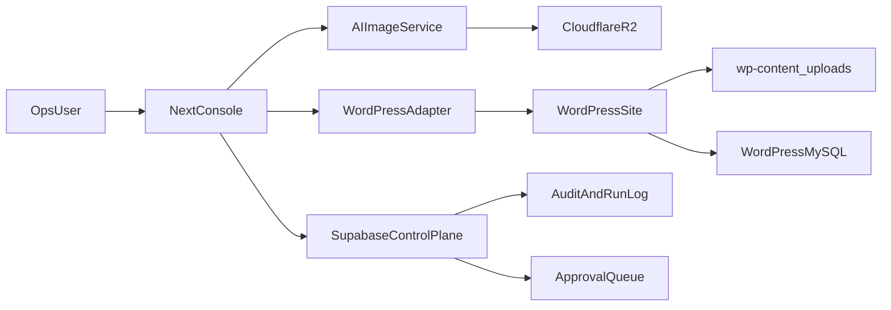

> **狀態**：歷史規劃副本；Cursor 已退場，現行執行以 repo SSOT 與現行 runbook 為準。
> **出處（歷史）**：本檔原為 Cursor 本機計畫 `~/.cursor/plans/nextjs_console_30y_2eed035d.plan.md`。
> Cursor 於 2026-08-26 退場，`~/.cursor/` 於 2026-08-28 整個刪除；此檔是該目錄中
> **唯一沒有 repo 鏡像**的內容，故原樣收進 git 保存。
>
> **與規格書的分工**：控制台的**規格正本**是
> [`../operations/NEXTJS_INTERNAL_OPS_CONSOLE_V1.md`](../operations/NEXTJS_INTERNAL_OPS_CONSOLE_V1.md)。
> 本檔保留的是**執行計畫與當時的 todo 狀態**（7 條：2 completed / 1 in_progress / 4 pending），
> 那份狀態在 repo 任何地方都沒有第二份。兩者不是重複長文。
>
> 下方 frontmatter 的 `status:` 欄位是 **2026-04-25 當時**的快照，非現況。

---

---
name: Nextjs Console 30y
overview: 打造可長期穩定運行的 Next.js Internal Ops 控制台：AI 生圖走 R2、WP 媒體維持預設庫、控制平面統一 Supabase，並一次納入治理、觀測、安全、回滾與營運機制。
todos:
  - id: audit-current-console
    content: 盤點現有 Next.js 控制台、Supabase、WP、R2 現況與缺口
    status: completed
  - id: define-control-plane-schema
    content: 定義並落地 Supabase 控制平面 schema 與 migration
    status: completed
  - id: build-ai-r2-pipeline
    content: 實作 AI 生圖流程（任務狀態機、R2 上傳、版本追蹤）
    status: pending
  - id: build-wp-flow-adapter
    content: 實作 WordPress 流程適配器（維持 WP 預設媒體庫）
    status: pending
  - id: implement-console-modules
    content: 完成控制台核心模組（任務台、審批台、觀測台）
    status: pending
  - id: harden-reliability-security
    content: 補齊 RBAC、審計、重試補償、回滾機制
    status: in_progress
  - id: verify-and-sync-docs
    content: 完成測試與閘道，並同步文件與 TASKS DoD
    status: pending
isProject: false
---

# Next.js 控制台 v1（30 年穩定版）完整方案

## 目標與邊界
- 建立可長期維運的 Internal Ops 控制台，作為跨系統操作入口與治理面。
- 媒體策略固定：
  - AI 生圖資產：Cloudflare R2（物件儲存）。
  - WordPress 商品圖/部落格圖：維持 WordPress 預設媒體庫（`wp-content/uploads` + MySQL metadata）。
  - 控制台主資料（流程、任務、版本、審批、路徑、狀態）：Supabase 單一 SoR。
- 維持現有 AO/Lobster 規則與閘道，不破壞既有開收工流程。

## 目標檔案（先讀再改）
- [../operations/NEXTJS_INTERNAL_OPS_CONSOLE_V1.md](../operations/NEXTJS_INTERNAL_OPS_CONSOLE_V1.md)
- [../operations/TOOLS_DELIVERY_TRACEABILITY.md](../operations/TOOLS_DELIVERY_TRACEABILITY.md)
- [../../TASKS.md](../../TASKS.md)
- [../../../lobster-factory/docs/MCP_TOOL_ROUTING_SPEC.md](../../../lobster-factory/docs/MCP_TOOL_ROUTING_SPEC.md)
- [../../../lobster-factory/packages/db/migrations/](../../../lobster-factory/packages/db/migrations/)
- [../../../lobster-factory/apps/](../../../lobster-factory/apps/)

## 架構設計（最終態）

## 一次做到位的實作範圍
- 控制台核心模組
  - 客戶/站點/專案操作台（租戶視角）
  - AI 生圖任務台（提交、佇列、版本、重試、發布）
  - WordPress 內容操作台（商品/文章流程控制，不改其媒體儲存策略）
  - 審批與回滾中心（人工核准 + 可追溯）
  - 觀測儀表（成功率、錯誤率、延遲、成本）
- 資料與契約
  - Supabase 新增控制平面 schema（jobs/runs/assets/approvals/incidents）
  - R2 物件 key 命名與版本規範
  - WordPress adapter 契約（只管流程與 metadata，不動其既有媒體生命週期）
- 安全與治理
  - 角色權限（owner/admin/operator/viewer）
  - 稽核追蹤（誰在何時改了什麼）
  - Secrets 與環境變數分層管理
- 可靠性
  - 重試/補償/冪等鍵
  - 失敗隔離與死信處理
  - 可回滾（流程回滾 + 資料層回滾策略）
- 交付標準
  - 自動化測試、契約測試、E2E smoke
  - 閘道接入（沿用 verify-build-gates 流程）

## 執行順序（完整但可控）
1. 現況盤點與差距圖
   - 盤點現有 Next.js 控制台相關程式、Supabase schema、WP 接口、R2 使用現況。
2. 控制平面 Schema 定稿
   - 先定事件模型、任務狀態機、審批模型，再實作 migration。
3. 服務層與適配器
   - 建 AI 生成服務（R2 寫入）與 WP 適配器（流程控制）。
4. 前端控制台
   - 先做可操作流程，再補齊可觀測與治理介面。
5. 安全/觀測/回滾
   - RBAC、審計、告警、回滾命令與 Runbook。
6. 文件與任務板同步
   - 更新 V1 規格、追溯總表、TASKS DoD，確保 AO-RESUME 可正確讀取。

## 驗收門檻（DoD）
- 可以建立一筆 AI 生圖任務，產物確實落在 R2，並在控制台可追蹤版本與狀態。
- 可以驅動 WordPress 商品/文章流程，且媒體仍走 WP 預設媒體庫。
- 所有控制平面資料都能在 Supabase 查得一致記錄（含審批、異常、重試）。
- 故障演練可驗證：單點失敗不會污染整體狀態，且可回滾。
- 閘道與測試通過，文件與 TASKS 同步完成。

## 風險與對策
- 風險：一次做到位範圍大、耦合高。
  - 對策：先鎖資料契約與狀態機，再寫 UI；所有模組走契約測試。
- 風險：WordPress 與控制台邏輯邊界混淆。
  - 對策：固定「WP 管內容與媒體、Supabase 管控制平面」分層。
- 風險：長期維運靠人記憶。
  - 對策：所有關鍵流程都必須有 runbook + 自動驗證腳本。

## 產出物
- 控制台功能與程式碼（前後端）
- Supabase migrations 與型別
- R2 key 命名與 lifecycle 規範
- WP adapter 契約文件
- 測試與驗收腳本
- 更新後的操作文件與 TASKS 對齊紀錄
