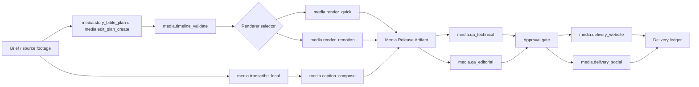

# Media Production LEGO Platform — architecture and delivery plan

**Status:** DRAFT — design baseline; no platform implementation is authorised by this document

**Owner:** AwareWave Media Platform

**Last reconciled:** 2026-09-05
**Decision scope:** evolve the existing video-production paths into composable, versioned capabilities. This document does not authorize a package installation, paid provider, database migration, deployment, or external publication.

## Baseline correction

The prior revision of this document incorrectly stated that a Timeline v1 validator, a fail-closed media catalog, a media-ledger migration, deletion protection, and Remotion authentication changes had been implemented locally. Those changes were not present at the original baseline. On 2026-09-06, a bounded Timeline v1 validator was added only in the isolated worktree and is not deployed or wired to a renderer; see [PHASE_3A_TIMELINE_V1_CONTRACT_RECEIPT.md](PHASE_3A_TIMELINE_V1_CONTRACT_RECEIPT.md). The media catalog, media-ledger migration and deletion protection remain requirements for later phases.

On 2026-09-06, a bounded renderer-authentication correction was implemented and tested only in the isolated worktree `D:\\Worktrees\\media-video-phase0`, commits `542e75a8e` and `5b19f0885`. It is not deployed, merged into the main workspace, or evidence that the wider Timeline, ledger, deletion-protection or Director capabilities are complete. See [PHASE_1A_IMPLEMENTATION_RECEIPT.md](PHASE_1A_IMPLEMENTATION_RECEIPT.md).

The verified current baseline is:

- Quick Engine supports script/article to native-format assets, TTS and FFmpeg render through `apps/next-admin/lib/content/blocks/video-pipeline.ts`.
- VideoStudio supports draft editing, asset regeneration/upload and render submission through `app/api/video/draft` and `app/api/video/render-draft`.
- `video_jobs` persists Quick Engine progress and `media_assets` records outputs; neither is replaced by this plan.
- Remotion provides selectable templates and `dynamic-slideshow`, but not a validated AI Director Timeline path.
- Local `faster-whisper large-v3` exists in meeting-service but is not connected to video subtitles or review.
- WordPress embedding and Postiz publishing adapters exist, but release/reference protection and outcome feedback are absent.

The target platform supports personal local/offline use, personal hosted use, multi-tenant free/subscription/credit SaaS, and enterprise tenants using their own provider APIs. Each mode uses the same public capability contracts with distinct entitlement, provider-profile, data-residency and credential policies.

## 1. Problem, outcome, and non-negotiable constraints

The platform already has a Quick Engine (script → assets → TTS/FFmpeg), a separate Remotion service, a local faster-whisper installation, and a Postiz API adapter. Those paths do not yet share one durable job/artifact model, one media timeline contract, a capability catalog, or a delivery ledger. In particular, Remotion output is outside the normal `media_assets` reconciliation path, and social distribution is operated from Content Studio rather than from a completed video artifact.

The target outcome is a **single media production platform** whose workflows are assembled from independently deployable capabilities. A workflow may make an AI short drama, a narrated marketing video, or a real-footage edit, then create a WordPress draft and platform-specific Postiz drafts from the same approved release artifact.

The following constraints are mandatory:

1. A capability has a stable semantic ID, semantic version, typed input/output, preconditions, quality gates, security policy, rollback action, owner, implementation and test evidence. It is unavailable until registered and active.
2. A capability must not import a page component, a provider SDK, or another capability's private storage schema. It depends on typed ports and public artifact references only.
3. Source projects are reference material or quarantined adapters. No whole GitHub repository is installed into production merely because it has a useful feature.
4. A provider is deny-by-default. China, Russia, North Korea, and any provider whose ownership, jurisdiction, license, software integrity, or commercial terms cannot be verified are excluded from the approved catalog.
5. External side effects are draft-first. WordPress publish, scheduled or immediate social publication, deletion, and provider spend require an explicit approval record at the appropriate boundary.
6. A produced release is immutable. A replacement makes a new release with lineage; it does not silently overwrite the public artifact.

## 2. Existing facts and architectural decision

| Existing capability | Verified state | Decision |
|---|---|---|
| Quick Engine | The registered `video/prepare`, `video/render`, and composite `video/pipeline` blocks already use script, assets, TTS and FFmpeg. | Keep as the `media.render_quick` adapter; move its inputs/outputs onto the new artifact contract. |
| Remotion | A data-driven `dynamic-slideshow` composition accepts an array of scenes, but its service uses an in-memory two-hour job map and uploads directly to a separate `remotion/` path. | Keep the renderer; put a durable `media.render_remotion` orchestration adapter in front of it and record its outputs as normal release artifacts. |
| Whisper | Meeting service uses local faster-whisper `large-v3`, GPU float16 with CPU int8 fallback, VAD, and word timestamps. | Reuse through a local transcription port; do not duplicate or cloud-upload source footage. |
| Postiz | The social route already maps video formats by platform, uploads media and creates `draft` or explicit-confirmation `now` posts. | Keep it as the `media.delivery_social` adapter mapping, add durable delivery records, retry classification and release linkage. |
| WordPress | Video embedding currently writes a bare R2 URL; deletion can remove an object used by a published article. | Block destructive release deletion until reference tracking and a safe detach/rollback flow exist. |

The platform will use an **artifact-centered pipeline**. UI tools submit a versioned media recipe; the durable orchestrator resolves only active capabilities; every execution reads input artifact IDs and produces output artifact IDs. Renderers, editors, subtitle generators, QA, WordPress and Postiz become adapters, not peer systems with hidden state.

### 2.1 Four platform domains and their LEGO boundaries

The platform has **four domains**. A domain is an organising boundary for people, screens, contracts and operational ownership. It is **not** one deployable LEGO and it must not become one indivisible service. The deployable/replacable units are the registered capabilities inside each domain, using the `media.<verb>_<noun>` IDs in section 3.

| Domain | Responsibility | Capabilities and records that belong here | Boundary rule |
|---|---|---|---|
| **Media workbench** | Gives producers a human-facing place to start, inspect and approve work. | Brief/article/footage intake; story/character work; storyboard and Timeline editing; source rights entry; subtitle correction; candidate/release review. | It submits recipes and approvals through public contracts. It does not call a renderer, provider SDK, WordPress or Postiz directly. |
| **Media Core** | Provides the shared control plane for every production mode. | Capability registry and AI LEGO IDs; versioned contracts; Timeline validation; tenancy/entitlements; provider profiles; durable workflow, retries, approvals and audit trail. | It coordinates registered capabilities through typed ports. It owns no renderer-specific scene format and no delivery-channel-specific post format. |
| **Production, QA and artifact/version library** | Turns validated decisions into candidates, evidence and approved releases. | `media.asset_*`, `media.transcribe_local`, `media.caption_compose`, `media.edit_plan_create`, `media.edit_plan_validate`, `media.render_*`, technical/editorial QA; source/candidate/subtitle/report artifacts; immutable releases and lineage. | A candidate cannot reach delivery before mandatory QA and a Release record exist. Renderers and QA tools exchange artifact references, never private tables. |
| **Delivery and outcomes** | Creates, verifies, replaces or retracts outward-facing delivery from a Release. | `media.delivery_website`, `media.delivery_social`, delivery verification; WordPress/Postiz receipts; external identifiers, retry state, rollback/detach records and outcome events. | It accepts only approved Release IDs. It cannot delete or replace a referenced source/candidate artifact outside the Release/reference rules. |

The lifecycle is **Workbench → Core → Production/QA/Release → Delivery/Outcomes → Core feedback**. The arrows represent typed, versioned records, not synchronous component imports. This permits an individual capability such as `media.render_quick`, `media.render_remotion`, `media.transcribe_local` or `media.delivery_social` to be replaced without moving the other three domains.



## 3. LEGO ID and registration model

The existing Content Block registry is a useful runtime implementation pattern, but it is insufficient as the media system's public contract: it currently resolves loose `ctx` values and a block ID in process. The AI LEGO capability system already supplies the required ID model: a record has `id`, `kind`, owner, status, evidence maturity, version, typed inputs/outputs, contract path, implementation path, test path and risk notes. Media will use that model rather than inventing a second numbering system.

The ID namespace proposed for this bounded context is `media.<verb>_<noun>`; the slash-form block ID is an implementation mapping, not a second public identity.

| Capability ID | Runtime adapter / block | Input → output | Minimum gate |
|---|---|---|---|
| `media.story_bible_plan` | `media/story/bible-plan` | brief → story bible / episode plan | provenance + brand policy |
| `media.timeline_plan` | `media/timeline/plan` | story or edit brief → Timeline v1 | schema validation |
| `media.timeline_validate` | `media/timeline/validate` | Timeline v1 → validated timeline report | fail closed on invalid references, overlaps, duration or policy violation |
| `media.asset_generate` | `media/asset/generate` | approved prompt / model policy → asset artifacts | provider allowlist + spend policy |
| `media.asset_ingest` | `media/asset/ingest` | uploaded footage → normalized asset + technical probe | hash, MIME, duration, rights metadata |
| `media.transcribe_local` | `media/transcribe/local` | media asset → timed transcript | local-only and confidence report |
| `media.caption_compose` | `media/caption/compose` | transcript + timeline → SRT/VTT/ASS + caption overlay plan | timing, safe-area and reading-speed rules |
| `media.edit_plan_create` | `media/edit/plan/create` | real footage + brief → edit decision plan | source clip ranges must exist |
| `media.edit_plan_validate` | `media/edit/plan/validate` | edit decision plan → validation report | source ranges and frame alignment |
| `media.render_quick` | `media/render/quick` | validated timeline → render candidates | native format artifacts only |
| `media.render_remotion` | `media/render/remotion` | validated timeline → render candidates | template/prop allowlist and durable job record |
| `media.qa_technical` | `media/qa/technical` | candidate → technical QA report | `ffprobe`, duration, streams, dimensions, loudness, black/freeze frame checks |
| `media.qa_editorial` | `media/qa/editorial` | candidate + brief → review report | human approval when score or policy is uncertain |
| `media.release_create` | `media/release/create` | approved candidate set → immutable release | all mandatory QA PASS |
| `media.delivery_website` | `media/delivery/wordpress` | release → WordPress draft/embed record | reference ledger before write |
| `media.delivery_social` | `media/delivery/social-postiz` | release + platform copy → Postiz draft / schedule / now record | channel allowlist, per-platform format and approval |
| `media.delivery_verify` | `media/delivery/verify` | delivery record → verified outcome | external URL / platform status captured |

Every capability must have one contract file, one registry record, schema fixtures, a contract test, and a rollback entry before it becomes `ACTIVE`. A workflow recipe can only reference registered `ACTIVE` IDs. Unknown, retired, disabled, ambiguous, or policy-ineligible IDs are rejected before any provider call. The exact media adoption mapping and alias quarantine are maintained in [MEDIA_CAPABILITY_ADOPTION_AND_PROMOTION_CATALOG.md](MEDIA_CAPABILITY_ADOPTION_AND_PROMOTION_CATALOG.md).

## 4. Timeline v1: the cross-engine data contract

Timeline v1 is the boundary between director/editor decisions and render implementations. It is our canonical JSON document. OpenTimelineIO is an optional **import/export adapter** for professional editorial interchange; it is not the core contract because it does not represent provider policy, generated-asset provenance, narration, caption constraints, approval or release lineage.

```json
{
  "schemaVersion": "1.0.0",
  "timelineId": "tl_<uuid>",
  "organizationId": "<uuid>",
  "purpose": "short_drama | marketing | tutorial | footage_edit",
  "frameRate": 30,
  "outputProfiles": ["vertical_9_16", "square_4_5", "landscape_16_9"],
  "tracks": [
    {"id":"video-main","kind":"video","items":[
      {"id":"shot-001","startMs":0,"durationMs":4200,"sourceArtifactId":"asset_<uuid>","crop":"cover","transitionOut":"cut","provenance":"generated | footage"}
    ]},
    {"id":"narration","kind":"audio","items":[
      {"id":"voice-001","startMs":0,"durationMs":4200,"sourceArtifactId":"audio_<uuid>","transcriptRef":"transcript_<uuid>"}
    ]},
    {"id":"captions","kind":"caption","items":[
      {"id":"caption-001","startMs":0,"endMs":2100,"text":"...","sourceTranscriptSegmentIds":["seg-001"]}
    ]}
  ],
  "styleRef": "style_<uuid>",
  "provenance": {"recipeId":"...","capabilityVersions":{},"sourceArtifacts":[]}
}
```

Validation is deterministic and produces a machine-readable report. It checks JSON Schema, ID ownership, permitted source kinds, non-negative time, track overlap rules, every reference, frame alignment, source bounds, caption ordering and reading speed, output safe areas, provider/right constraints, total duration, and renderer-specific feasibility. It has no LLM fallback. A renderer receives only the validated, canonicalized document and creates a derived render plan.

## 5. How the four requested source projects are used

| Source project | Useful idea to extract | What is rejected | Platform action |
|---|---|---|---|
| `ai-short-drama` | story bible, character continuity, season/episode planning and linting concepts | unverified workflow packaging; using its JSON shape as an implicit permanent contract | Implement `media.story_bible_plan` and Timeline v1 under our contract. |
| `video-autopilot-kit` | footage-first editorial workflow, human QA checkpoints, retryable export handoff | dependency on its editing runtime and any whole-repo orchestration | Implement `media.asset_ingest`, `media.edit_plan_create`, `media.edit_plan_validate`, `media.qa_technical` and `media.qa_editorial` using FFmpeg/ffprobe and durable jobs. |
| `ai-media-generator` | provider capability matrix, prompt normalization and per-provider adapters | browser-first production execution and any China-linked models/providers | Implement a deny-by-default provider registry; approved adapters have one provider per port. |
| `claude-skill-social-post` | style fingerprint, platform variants, outcome-feedback model | a second publisher or automatic direct social writes | Implement social copy as a preparation capability; delivery remains Postiz only. |

No source project is installed as a production dependency in this phase. Any copied algorithm, prompt template or code is reviewed for license, maintained with an origin record and test coverage, and then incorporated into an owned module. This removes abandonment and supply-chain coupling from the execution path.

## 6. Provider and supply-chain controls

An approved provider record must include: vendor legal entity and jurisdiction, model identifier/version, license and commercial terms, data retention/training posture, allowed regions, data classification, direct API or supervised-browser mode, cost unit, egress destination, credential reference, SBOM/dependency lock evidence, vulnerability scan, security review date, owner, kill switch and fallback.

Provider selection is separate from a timeline and from a renderer. `media.asset_generate` asks the policy resolver for a provider that matches the requested capability, data classification and format. The request fails with an explainable policy code if none qualifies. No raw model name submitted by a browser or UI is executable.

The initial approved path reuses already-operated services only: local faster-whisper, existing Quick Engine providers that pass the policy record, Remotion, FFmpeg/ffprobe, WordPress and self-hosted Postiz. New video/image/audio providers remain `CANDIDATE` until source, jurisdiction, package integrity, terms, data flow and staging canary are reviewed. Browser automation can assist an operator, but never becomes an unattended production renderer.

## 7. Data, durability, approval and rollback

New durable records are required before wiring new UI flows:

| Record | Responsibility |
|---|---|
| `media_artifacts` | content-addressed source, derived and release assets; owner, SHA-256, storage key, media probe, rights/provenance and retention class |
| `media_timelines` + versions | immutable Timeline v1 revisions and validation reports |
| `media_runs` + steps | durable orchestration state, idempotency key, capability/version, input/output artifacts, retries and structured error |
| `media_reviews` | technical/editorial results, reviewer identity, decision and evidence |
| `media_releases` | immutable approved bundle of output formats, captions, poster, transcript and lineage |
| `media_delivery_attempts` | WordPress/Postiz request, external IDs, destination, status, retryability, verification and rollback reference |
| `media_references` | reverse references from website/social delivery to release/artifact; required for deletion safety |
| `media_reference_coverage` | whether an asset has been scanned, with versioned evidence; absence or failed scan blocks deletion |

The migration is additive. Existing `video_jobs` and `media_assets` remain readable during backfill; adapters bridge legacy objects into artifacts without changing their public URLs. No old video is deleted during migration. A delete request becomes a two-stage operation: locate live references, refuse when any are active, or first create a replacement/detach plan that is reviewed and reversible.

The durable workflow engine owns long-running execution, retries, waits and approvals. n8n is limited to notification/webhook glue. The database is the system of record. The Next application remains an API/UI boundary and must not use response-lifetime background work for finalization.

## 8. Delivery phases and acceptance gates

The authoritative phase order, acceptance gates and rollback boundaries are in [MEDIA_PRODUCTION_LEGO_PHASED_DELIVERY_PLAN.md](MEDIA_PRODUCTION_LEGO_PHASED_DELIVERY_PLAN.md). This section retains the capability grouping only; no line below records completed implementation.

### Foundation safety requirements — not implemented

1. Design `media_references` and a safe WordPress embed/replacement model.
2. Design deletion preflight that fails closed when a release or website reference exists.
3. Bring Remotion finalization into the same artifact/reconcile path as Quick Engine.
4. Verify renderer authentication configuration and design durable job persistence outside the Remotion process.

**Accept only when:** an attempt to delete a referenced release is refused with reference IDs; a Remotion render survives service restart/polling handoff; reconcile sees every output; rollback restores the previous WordPress embed.

**Deployment order:** not yet designed. It will be written only after the release/reference schema, legacy-data mapping, migration rehearsal and deployment configuration audit are complete.

### Phase 1 — foundation and Timeline v1 (P0)

1. Add the media capability registry, contracts and fail-closed resolver.
2. Add artifact, run, timeline, review, release, delivery and reference migrations with RLS and idempotency keys.
3. Implement Timeline v1 JSON Schema, canonicalizer, validator, fixtures and mutation tests.
4. Register existing Quick Engine and Remotion only as adapters behind the contract.

**Accept only when:** invalid timelines cannot reach a renderer; every run can be reconstructed from artifacts and contract versions; a compatibility fixture renders through both adapters where supported.

### Phase 2 — subtitles and AI director (P1)

1. Build `media.transcribe_local` around the existing meeting-service library through a local worker port.
2. Produce timed transcript, SRT, VTT, ASS and caption overlay plan; preserve confidence and source-segment provenance.
3. Build story bible, episode plan and continuity validators that emit Timeline v1, not renderer-specific JSON.
4. Expose `dynamic-slideshow` as the official Director/Remotion mode with a preview, timeline validation and release path.

**Accept only when:** a local video produces captions that can be reviewed against timecode; a short-drama timeline renders in all selected profiles; a reviewer can correct a caption or shot and create a new traceable revision.

### Phase 3 — real footage editing and QA (P1)

1. Ingest uploaded footage with SHA-256, ffprobe metadata, proxy generation and rights metadata.
2. Build edit decision plans from explicit source in/out ranges; support OTIO import/export as a non-core adapter after fixture validation.
3. Add technical QA: container, codec, dimensions, duration, A/V streams, loudness, silent audio, black/freeze frames, caption timing and output-profile checks.
4. Add editorial QA: brief coverage, scene continuity, transcription/caption match, safe-area and manual approval queue.

**Accept only when:** a source-footage edit is reproducible from artifacts and Timeline v1; technical failure prevents release; every override names an accountable reviewer and reason.

### Phase 4 — website and social release train (P1)

1. Add `media.release_create` after both QA gates pass.
2. Convert website delivery into WordPress draft/embed/replacement records with verification and rollback.
3. Connect platform-specific video/profile selection and social copy to Postiz `draft`, schedule and explicit `now` modes.
4. Record returned Postiz IDs, upload media IDs, per-channel status and verification results; retry only classified transient failures.

**Accept only when:** the same release can create a WordPress draft plus Postiz drafts for connected test channels, each with correct aspect ratio; no actual post is created without its approval record; one delivery can be rolled back without deleting the release itself.

### Phase 5 — provider expansion and operations (P2)

1. Evaluate each new provider via a locked candidate record, dependency scan, staging canary and spend ceiling.
2. Add provider health, quota, cost and fallback observability.
3. Define retention, archive, legal-hold and customer export workflows.
4. Run disaster recovery and renderer/provider outage game days.

**Accept only when:** an unavailable provider fails over only to a separately approved provider; all egress and spend decisions are auditable; recovery produces the same release from stored inputs.

## 9. Required verification matrix

| Layer | Required proof |
|---|---|
| Contract | JSON Schema fixtures, ID collision/retirement tests, unresolved/disabled capability rejection |
| Data | migration up/down rehearsal, organization RLS tests, idempotency and concurrent-submit tests |
| Security | SSRF test on every remote asset fetch, allowlist tests, auth-at-startup test, secrets never logged, dependency/SBOM scan |
| Renderer | deterministic Timeline canonicalization, Quick/Remotion golden smoke renders, service-restart resume test |
| Subtitle | known audio fixture timing tolerance, SRT/VTT/ASS validation, visual safe-area and reading-speed tests |
| Footage | ffprobe fixtures, bad container/audio-freeze/black-frame fixtures, OTIO import/export round-trip fixture |
| Delivery | WordPress draft/replace/rollback staging test; Postiz draft upload/channel mapping test; no `now` without approval test |
| Operations | reconciliation, orphan detection, retry classification, metrics/alerts, restore drill evidence |

## 10. Evidence base

- Existing backend blocks self-register and use `id`, `kind`, `enabled`, `run(ctx)`: `lobster-factory/infra/hetzner-phase1-core/apps/next-admin/lib/content/blocks/registry.ts:18-77`; the media blocks are loaded in `register-all.ts:13-15`.
- The current prepare/render seam is explicit and is the right starting adapter boundary: `video-prepare.ts:2-49`, `video-render.ts:2-56`.
- Current scene data only validates an ID, narration, prompts, B-roll and visual choice; it is not a timeline: `video-script-core.ts:120-149`.
- Quick Engine finalization exists because Next response lifetime is not a durable worker: `video-pipeline.ts:2-10`.
- Remotion already has data-driven scenes but keeps jobs in memory: `apps/remotion-service/src/server.ts:43-76`, and its public adapter merely forwards a whitelisted template and props: `app/api/video/remotion-render/route.ts:13-93`.
- Local faster-whisper is implemented with GPU probe/CPU fallback and word timestamps: `apps/meeting-service/lib/transcribe.py:86-106`, `127-184`; the Cognitive OS already demonstrates safe by-path reuse instead of an ambiguous global import: `Projects/internal/cognitive-engineering-os/ai_lego/modules/knowledge/ingest/transcription.py:12-26`, `158-190`.
- Social delivery already has organization checking, platform-specific format selection and explicit immediate-publish confirmation: `app/api/content/social-publish/route.ts:18-195`.
- Existing records show a deletion path can silently break WordPress video embeds: `agency-os/TASKS.md:378-385`; this is why Phase 0 precedes feature expansion.
- The system's capability registry shape and promotion rule are documented at `agency-os/docs/AI_LEGO_Cognitive_Engineering_OS/docs/architecture/search-content/SEARCH_CONTENT_METHOD_AND_CAPABILITY_REGISTRY.md:293-339`.
- OpenTimelineIO is an editorial interchange format/API, not a media container, which supports the adapter-only decision: [OpenTimelineIO documentation](https://opentimelineio.readthedocs.io/en/v0.18.0/). ffprobe provides machine-readable multimedia stream inspection: [FFmpeg ffprobe documentation](https://ffmpeg.org/ffprobe.html). Postiz documents self-hosted API authentication, upload and post endpoints: [Postiz Public API](https://docs.postiz.com/public-api/introduction).

## 11. Explicit decisions needed before external activation

Implementation of Phases 0–4 is within the existing operated stack and does not require a new generation provider. Before a new external model, SaaS account, browser-controlled generator, paid plan, or a live social/website publication is activated, record the provider decision and approve the concrete staging result. Platform OAuth apps for the desired social networks also require the operator's own developer-account steps; the current Postiz plan records these as pending.
