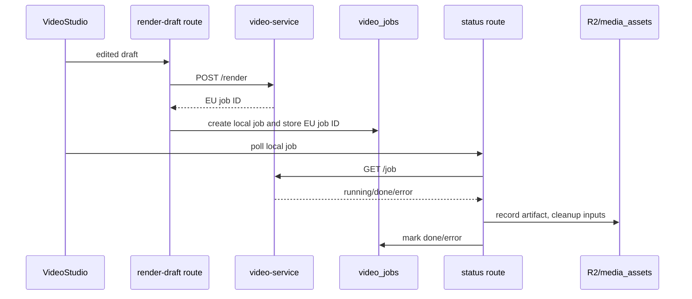

# Phase 1B — durable Quick Engine job lifecycle decision package

**Status:** DESIGN BASELINE — no source, database or deployment change authorised by this document
**Date:** 2026-09-06
**Scope:** preserve and make recoverable the existing Quick Engine draft → render → status/history path
**Prerequisite:** Phase 0B controlled staging access and deployment-state verification

## 1. Decision

Do **not** repair renderer restart loss by adding an ad-hoc retry, by storing renderer state only in a second in-memory map, or by copying Supabase service credentials into `video-service`.

The existing `video_jobs` row remains the business record for the current Quick Engine until a later, additive Media Core run model is introduced. A durable workflow executor may perform the work, but its own run ID is execution evidence, not a competing business source of truth. Trigger.dev is the leading existing executor candidate because this repository already has atomic database claim and durable-task patterns; it is not yet approved for video work until its deployed availability is verified.

## 2. Verified current lifecycle



| Finding | Exact evidence | Consequence |
|---|---|---|
| Renderer submission precedes local work-ticket creation. | `D:\\Worktrees\\media-video-phase0\\lobster-factory\\infra\\hetzner-phase1-core\\apps\\next-admin\\app\\api\\video\\render-draft\\route.ts:142-158,163-195` | A local database failure occurs after renderer compute has already been accepted. |
| The route itself records that failed ticket creation leaves renderer output without a job receipt; recovery relies on later reconciliation only when organization information is available. | `render-draft/route.ts:166-176` | A user can receive a failure while renderer/R2 work continues; the event is not a durable, retryable submission transaction. |
| Local ticket persistence is deliberate and tenant-bound. | `apps/next-admin/lib/content/video/job-store.ts:1-12,77-107` | Preserve `video_jobs` ownership and browser isolation; do not create a second client-visible job table. |
| Renderer job state is a process-local `_JOBS` dictionary and a daemon thread. | `apps/video-service/server.py:265-323` | A video-service restart loses its renderer job status. Subsequent `/job` returns 404 at `server.py:446-455`. |
| The status route classifies renderer 404 as a service-restart job error. | `apps/next-admin/lib/content/video/render-client.ts:169-189` | Existing UI cannot distinguish a recoverable renderer interruption from a permanent render failure. |
| Reconciliation can backfill an R2 asset, but it is a separate final safeguard, not renderer job recovery. | `apps/next-admin/lib/content/video/reconcile.ts:7-10,66-67`; `job-store.ts:7-12` | Reconciliation cannot restore an interrupted render attempt, its exact failure, or safe retry semantics. |
| Trigger.dev already implements atomic database claim before `tasks.trigger` for other durable work. | `lobster-factory/packages/workflows/src/trigger/dispatch-action-run.ts:13-16,97-102,155-182` | Reuse this execution pattern after runtime/deployment verification; do not build a new untested queue. |

## 3. Required target state

### 3.1 One business record, one execution record

`video_jobs` remains the source of truth for the existing Quick Engine request until Phase 2 introduces its additive, generic Media Core run model. It must be extended only after a migration rehearsal and RLS proof.

| Record | Owner | Purpose | Must not contain |
|---|---|---|---|
| `video_jobs` | Next-admin / service role | Tenant ownership, immutable request fingerprint, lifecycle state, renderer attempt ID, output artifact receipt and failure classification. | Provider secrets, raw private source media, browser-controlled ownership or duplicated Release state. |
| Trigger.dev run | Trigger.dev executor | Retry/attempt execution evidence and worker logs. | The sole business status or sole tenant authorization record. |
| renderer attempt | `video_jobs` metadata and renderer response | Renderer idempotency key, accepted-at timestamp, external job ID, attempt count and terminal observation. | An independent unlinked job table. |
| `media_assets` | Existing asset library | Completed artifact inventory. | In-flight render progress or Release approval state. |

### 3.2 State machine

The current `running | done | error` state is insufficient for an at-least-once durable executor. The additive migration must introduce a transition-safe state model or a versioned `lifecycle` object with these states:

```text
queued → claimed → submitting → submitted → rendering → finalizing → succeeded
                         └────────────────────────────────────────────→ failed
any non-terminal state ───────────────────────────────────────────────→ unknown
unknown → reconciling → succeeded | failed | retry_queued
```

A retry is allowed only when the immutable request fingerprint and idempotency key match. A new visual, script, audio, format set or provider choice creates a new job; it never silently reuses an old job ID.

### 3.3 Submission sequence

1. Next-admin validates tenant, assets and renderer capability before any external call.
2. It inserts a tenant-owned `video_jobs` row in `queued` state, including request fingerprint and generated idempotency key.
3. It requests a durable executor using the local job ID. The executor atomically claims the row.
4. The executor records `submitting` before calling the renderer. The renderer accepts the same idempotency key and returns the same renderer attempt identity on replay.
5. The executor records renderer acceptance before polling or finalization.
6. Finalization validates outputs, writes/updates `media_assets`, records the exact artifact IDs, and only then marks the job `succeeded`.
7. If a process dies, a recovery task claims stale non-terminal jobs by lease expiry, interrogates the renderer or R2 reconciliation evidence, then classifies it as succeeded, failed or retry-queued.

## 4. Non-negotiable implementation constraints

1. **No provider call before durable intent:** `createJob` and the state transition must succeed before compute can be charged.
2. **No best-effort critical writes:** recording renderer acceptance, terminal output and terminal failure must fail the run loudly; `console.warn` is reserved for non-authoritative telemetry.
3. **No double rendering:** retries reuse an idempotency key. If renderer idempotency cannot be proven, the recovery state becomes `unknown` and requires operator decision instead of automatic replay.
4. **Tenant immutable:** `organization_id` remains written at creation as enforced in `job-store.ts:77-104` and migration `0060_video_jobs_add_org.sql:40-66`.
5. **R2 does not create authority:** discovering an object may repair `media_assets`; it cannot invent a workflow success or publishable release.
6. **Renderer remains an adapter:** it receives a validated render request and returns attempt observations. It does not receive Supabase service credentials or directly author business-job state.

## 5. Required change packages

| Package | Files/data expected to change | Acceptance evidence | Rollback |
|---|---|---|---|
| 1B-1 — lifecycle contract | New versioned contract and fixtures under the existing AI LEGO contract system; source mapping document here. | Valid/invalid transition fixtures and transition graph test. | Disable new capability; legacy Quick Engine remains readable. |
| 1B-2 — additive schema | New migration extending video_jobs, event evidence, rehearsal script, RLS proof and lock-timeout policy. | Staging migration rehearsal, query plan, backup/restore proof and feature-flag rollback test. | Disable the new path and retain additive schema/evidence; destructive schema removal is a separate reviewed change. |
| 1B-3 — durable executor | New Trigger task or verified existing executor adapter, plus atomic claim and lease recovery. | Kill/restart simulation proves no double renderer submission and classified recovery. | Disable capability; leave records readable; never delete attempts. |
| 1B-4 — renderer protocol | Renderer idempotency/attempt query protocol with private R2 receipt, without service-role DB access. | Repeated request with same key produces one renderer attempt; restart, timeout and unknown state are observable. | Keep old renderer endpoint behind compatibility adapter until staging evidence passes. |
| 1B-5 — VideoStudio adapter | Existing routes move from direct renderer submit to durable job creation. | One disposable tenant completes draft → job → output → history after executor restart. | Feature state returns route to existing direct path while keeping new records intact. |

## 6. Hard gates before code

- Controlled staging access verifies the active renderer deployment, token presence and Trigger.dev availability without exposing secrets.
- A fresh backup reference and restore procedure exist before any `video_jobs` migration.
- Database specialist review confirms transition storage, index/lease queries, RLS and migration lock behaviour.
- The renderer can prove idempotent acceptance, or the design explicitly stops automatic retry after uncertain submission.
- A simulated executor restart and renderer restart are part of the acceptance suite.

## 7. Explicitly deferred

This package does not introduce Timeline, short drama, Whisper, Remotion Director formal mode, footage editing, Release records, WordPress/Postiz delivery or usage billing. Those capabilities consume the durable lifecycle after it is established; they do not bypass it.

## 8. Existing workflow reuse boundary

| Existing component | Verified fact | Reuse decision |
|---|---|---|
| `ops_action_runs` | It is an Ops action record with organization-facing RLS policies: `lobster-factory/packages/db/migrations/0011_ops_console_control_plane.sql:13-30`; `0016_ops_console_and_permission_catalog_rls_policies.sql:23-45`. | Do not reuse it as the Quick Engine business record. It has different visibility, action-catalog semantics and lifecycle vocabulary. |
| `video_jobs` | It is server-only with RLS and an explicit deny policy for browser roles: `0047_video_jobs.sql:17-45`; it records renderer linkage at `job-store.ts:38-51`. | Keep it as the current Quick Engine source of truth and extend it only through a reviewed additive migration. |
| Trigger dispatcher claim | It atomically transitions an Ops row before `tasks.trigger`: `packages/workflows/src/trigger/dispatch-action-run.ts:94-114,155-182`. | Reuse the claim/trigger/receipt algorithm in a video-specific adapter; do not point the existing Ops dispatcher at video jobs. |
| Existing Trigger mapping | The current dispatcher maps only three Ops action keys: `dispatch-action-run.ts:20-26`. | A media task requires its own capability registration and deployment review. |
| Trigger public endpoint | `https://trigger.aware-wave.com/` returned HTTP `302` to `/login` on 2026-09-06. | The public entrypoint is reachable. This is not evidence that the video task, worker environment, credential set or retry policy is deployed. |
