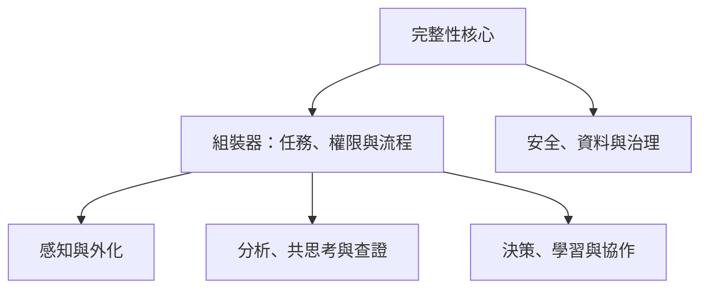

# 認知主權平台整合藍圖

## Cognitive Sovereignty Platform

副標：以藝術外化(之後加入)、認知工程與可檢查程序，支持人可靠地形成、檢驗、修正並實踐自己的判斷。

版本：0.6（LEGO 式模組平台、完整工作流、協作自治、資訊完整性與規範脈絡辨識）  
狀態：Pre-validation／產品定義階段

---

## 0. 這份整合做了什麼

本文件將兩個來源整合為同一個可實作的認知平台：

| 原有內容 | 在平台中的角色 | 不可替代的價值 |
| --- | --- | --- |
| Judgment Sovereignty Education Architecture／Structured Art-Based Reflective Development Framework | 理論核心、學習入口與反思方法 | 讓人看見判斷如何被情緒、關係、敘事與權力形塑 |
| Cognitive Engineering OS | 認知引擎、決策工作流與 AI 互動規格 | 將模糊經驗轉為可檢查的問題、判準、決策與更新 |

平台不只是「提供正確答案的 AI 工具」、單純的筆記、心理測驗、critical-thinking 課程或決策樹。

它是一套 **Judgment Architecture（判斷架構）**：

> 先讓人看見自己怎麼判斷，再協助他以可檢查的方式定義問題、評估證據、形成行動，並保留日後修正的能力。

---

## 1. 平台使命與定位

### 核心使命

在高度複雜、資訊不完整、演算法與 AI 持續介入的環境中，支持和幫助和引導當事人保有：

- 對自身判斷形成過程的可見性；
- 對證據、假設與不確定性的檢查能力；
- 不把思考責任外包給權威、群體或系統的能力；
- 在共同決策中理解授權、責任與重新開啟討論條件的能力。

### 一句定位

> 認知主權平台不只是幫助人找到答案，而且是工程化「人如何可靠地形成、檢驗與修正和建立自己的答案」。

### 價值宣言

> Restore judgment. Preserve agency. Stay corrigible.  
> 恢復判斷權、保留自主性、維持可修正性。

### 非目標

平台不應：

- 預設任何政治、文化、宗教、法律、倫理或道德結論；
- 將改變立場當成成熟，或將維持立場當成失敗；
- 把服從視為不成熟，也不把反抗視為自主；
- 以單一分數排名誰更「理性」或「自主」；
- 用 AI 取代使用者的最終判斷；
- 把判斷權誤解為免除法律、倫理、關係或組織責任。

### 必須納入的脈絡

平台**不排除**政治、文化、宗教、法律、倫理或道德；它們不是必須消除的「偏見」，而是每一個判斷中關於歷史、身份、權力、權利、義務、歸屬、正當性與後果的材料。它們可能是經過反思後的重要承諾，也可能混入習慣、壓力、恐懼、利益或尚未被看見的選項。

平台協助的不是把人變成沒有立場的人，而是形成**有意識、能說明、可承擔後果的立場**：

- 辨認哪些規範正在界定「正常、正確、允許、應當」；
- 追溯它們來自何種歷史、群體經驗、制度、權威或權力關係；
- 分開可查證的事實、需要確認的法律／程序條件、需要權衡的價值，以及個人真正願意承接的承諾；
- 檢查不同選擇對自己、他人與公共關係的權利、責任、風險與後果；
- 在知道責任與限制的前提下，決定要承接、協商、修訂、挑戰或暫時遵守什麼；法律義務不能被平台當成純粹的個人偏好。

所謂「解開」不是否定傳統、道德或信念，而是把它們從不可見的命令，轉成可理解、可討論、可負責選擇的條件。

---

## 2. 核心理論：判斷主權

### 暫定定義

**判斷主權**是指：個體在受到外部、內部與關係性影響時，仍能辨認判斷如何形成、檢查影響來源與證據條件、容納不確定性，並在必要時修正或重新形成判斷的能力。

它不是不受影響，也不是拒絕專家。它是：

> 我可以聽取專家、接受資料、授權制度；但我要知道自己為何相信、還不知道什麼，以及什麼證據會使我重新檢視。

### 六個能力構面

| 構面 | 平台要支持的提問與行為 |
| --- | --- |
| 影響辨識 | 哪些人、群體、情緒、身份、媒體或演算法正在影響我？ |
| 規範與脈絡辨識 | 哪些政治、文化、宗教、法律、倫理或道德框架，正在界定何為正常、正確、允許或有責任？它們的來源、權力關係與適用範圍是什麼？ |
| 可檢查性 | 我依據什麼？這個說法對我有什麼利益、代價或情感功能？ |
| 證據條件 | 什麼新證據會使我重新考慮？哪些資訊仍不足？ |
| 可修正性 | 結論是否能在新資訊下被重新開啟，而非陷入不可修正的確信？ |
| 負責任判斷 | 我的行動會造成什麼後果？判斷權如何和責任並存？ |

### 底層風險

平台所對抗的不是「影響」本身，而是 **不可見、不可檢查、不可修正的敘事接管**。

影響不等於接管。當外部敘事被直接感受成「我本來就這樣想」，而人無法辨認或重審其形成條件時，判斷主權便會被削弱。

價值與規範本身不等於被綁架；真正的風險是它們被包裝成天然、唯一且不可提問的答案，使人看不見其來源、功能、代價與替代可能。

---

## 3. LEGO 式平台總架構

平台不是一條固定流程，它由可替換、可單獨啟用、可依任務組合的認知積木構成；使用者或課程設計者只組裝當下真正需要的 2–5 塊，而不是被迫走完整套流程。

三個原有層級保留為**使用情境**，不再是綁死產品的功能分區。

| 使用情境 | 核心問題 | 可使用的積木組合 |
| --- | --- | --- |
| 個體判斷 | 我是怎麼形成這個判斷的？ | 外化、拆解、共思考、查證、決策、回顧 |
| 共同程序 | 不同判斷如何形成正當的共同決策？ | 分歧地圖、證據帳本、角色輪替、授權、異議保存、重開條件 |
| 制度與社群 | 制度如何維持秩序而不壓縮個體判斷？ | 治理規則、匿名研究、在地化、風險回報、制度回饋 |

### 3.1 不可拆的核心與可組裝的積木

| 類型 | 內容 | 設計原則 |
| --- | --- | --- |
| **完整性核心** | 最終判斷權、可檢查性、可修正性、資料最小化、非操控、責任邊界 | 永遠啟用；任何積木都不能覆寫。 |
| **組裝器** | 任務目的、使用者角色、AI 權限、輸入／輸出、順序與交還控制 | 讓人看得見並可改變本次組合。 |
| **能力積木** | 外化、分析、發散、查證、決策、回顧、協作等可替換能力 | 可以單獨使用，也可串成工作流。 |
| **共用紀錄** | 問題、主張、證據、假設、情緒訊號、判準、行動、結果與版本 | 積木只讀寫明確欄位，不能暗中改寫使用者立場。 |
| **安全與治理積木** | 同意、隱私、風險轉介、來源標記、申訴、版本與稽核 | 全程伴隨；高風險任務可提高限制。 |

### 3.2 積木目錄

| 代號 | 積木 | 解決的問題 | 主要輸出 | 初始優先級 |
| --- | --- | --- | --- | --- |
| SENSE | **Reflect Studio｜反思外化** | 我實際看見、感覺與在意什麼？ | 素材卡、關係圖、時間線、情緒訊號 | P0 |
| MAP | **Cognitive Engine｜認知拆解** | 事實、解釋、利益、結構與衝突如何分開？ | 六層地圖、假設與缺口 | P0 |
| THINK | **Co-Thinking Gym｜人機共思考** | 我如何發散、反證、收斂而不外包判斷？ | 思考卡、反例、判準與協作紀錄 | P0 |
| VERIFY | **Information Integrity｜資訊完整性與認知韌性** | 這則訊息可驗證什麼？它可能如何操弄我？ | 主張帳本、來源卡、脈絡缺口、操弄模式與下一步 | P1 |
| DECIDE | **Judgment Workbench｜判斷與行動** | 在不確定下，我要依何種判準行動？ | 選項、權衡、可逆試驗與停止條件 | P0 |
| LEARN | **Decision & Learning Loop｜回顧與校準** | 結果如何修正我與 AI 的判斷？ | 預測／結果比較、更新條件、遷移提示 | P0 |
| COLLAB | **Collective Procedure Lab｜共同程序** | 多人如何在保留異議下共同決定？ | 分歧地圖、授權、異議、閉合與重開紀錄 | P2 |
| GOVERN | **Governance & Research｜治理與研究** | 平台如何被質疑、修正與在地化？ | 稽核、研究同意、政策回饋與版本紀錄 | P1 |

`VERIFY` 不是真假裁判機，也不替任何人貼標籤。它只把「主張、來源、時間、支持／反證、脈絡與操弄手法」拆開，讓使用者自己形成可追溯的判斷。

### 3.3 每一塊積木都必須有介面合約

沒有合約的功能只是工具堆疊，不是 LEGO。每一個積木都必須公開以下內容：

| 合約欄位 | 必須說清楚的內容 |
| --- | --- |
| 輸入 | 它讀取哪些內容；哪些敏感資料絕不讀取。 |
| 輸出 | 它新增的是問題、證據、選項、建議或行動，不可假裝已替人下結論。 |
| AI 權限 | 能否搜尋、摘要、排序、模擬、提出建議；何時必須交還控制。 |
| 來源與不確定性 | 使用了哪些依據、遺漏了什麼、在哪些條件下不適用。 |
| 人的控制 | 使用者如何修改、略過、覆寫、刪除或改用其他積木。 |
| 資料與版本 | 資料保存期限、共用範圍、產出來源與積木版本。 |

### 3.4 組裝規則

1. **一個任務先有目的卡**：先選擇「自我理解、複雜決策、訊息判斷、創意發散、學習反思或團隊審議」，再推薦積木組合。  
2. **預設少而精**：首輪最多 5 塊；避免把反思、查證、決策與群體協作全部塞進同一回合。  
3. **人可看見順序**：系統必須顯示「現在為何用這一塊、下一塊會做什麼」，並允許重新排列、跳過或停止。  
4. **所有關鍵結論都要回到人的暫定立場**：積木可提供資訊與挑戰，不能直接把 AI 輸出寫成使用者的判斷。  
5. **每次組合都留下可回放紀錄**：日後能看見用了哪些積木、資料從哪來、何時改變想法、為何改變。  
6. **高風險任務自動增加護欄**：涉及健康、法律、金錢、急性心理危機或公共擴散時，加入來源要求、專業轉介、等待／覆核或群組程序積木。

### 3.5 第一批可用套件

| 套件 | 組合 | 適用場景 |
| --- | --- | --- |
| 個人複雜決策 | SENSE → MAP → THINK → DECIDE → LEARN | 關係、職涯、合作與個人選擇 |
| 可疑訊息判斷 | VERIFY → THINK → DECIDE → LEARN | 詐騙、健康、投資、公共資訊與日常轉傳 |
| 創意與策略衝刺 | SENSE／MAP → THINK → DECIDE | 研究、創作、產品與策略問題 |
| 課堂反思 | SENSE → THINK → LEARN | 學生的思考練習與 AI 素養 |
| 團隊審議 | MAP → VERIFY → COLLAB → DECIDE → LEARN | 團隊、社群與組織的共同問題 |

這種設計使平台可以隨著證據、文化與情境加入新積木，而不必推翻既有核心；也讓使用者不會被單一公司、模型、流程或價值觀綁定。

---

## 4. 平台工作流：從混亂經驗到可回顧的判斷

平台不是「建立 → 蒐集 → 彙整 → 分析 → 報表 → 核准」的文件系統。那種流程的目的是完成一份文件並取得權限；本平台的目的，是支持人形成、檢查、行動並修正自己的判斷。

核心工作流是：

> **建立任務 → 設定權限 → 蒐集／外化 → 彙整／拆解 → 分析／反證 → 查證（需要時） → 形成判斷 → 行動 → 回顧校準**

### 4.1 預設判斷工作流

| 步驟 | 積木 | 使用者動作 | 系統支持 | 產出 |
| --- | --- | --- | --- | --- |
| 1. 建立任務 | 組裝器 | 定義想釐清、選擇或解決的問題；標示風險、受影響者、相關法律／程序與暫定完成條件 | 建立任務容器，不直接給答案 | 任務目的與範圍 |
| 2. 設定權限 | 協作合約 | 決定 AI 可做什麼、人不委託什麼、何時交還控制 | 依任務調整 AI、資料與安全邊界 | 協作合約 |
| 3. 蒐集／外化 | SENSE | 放入事件、資料、感受、身體訊號、期待、恐懼、關係與規範脈絡 | 將材料轉為可看見、可移動的卡片、圖或時間線 | 原始素材與外化地圖 |
| 4. 彙整／拆解 | MAP | 區分事實、主張、解釋、假設、利益、結構、規範與資訊缺口 | 建立六層地圖與跨層脈絡檢查 | 問題地圖、假設與缺口 |
| 5. 分析／反證 | THINK | 建立替代解釋、反例、判準、風險與第二序後果 | 以發散、反方與探問模式挑戰目前立場 | 可比較選項與判準 |
| 6. 查證（需要時） | VERIFY | 檢查外部主張、來源、脈絡、操弄模式、法律適用與未知 | 整理支持／反證與適用範圍；不替人宣判真理 | 主張帳本與來源卡 |
| 7. 形成判斷 | DECIDE | 說明自己的暫定結論、依據、信心、價值權衡與改變條件 | 檢查判斷是否清楚、可逆、可被回看 | 可檢查判斷 |
| 8. 行動 | DECIDE | 選擇最小、可逆且可負責的下一步 | 建立預測、風險、停止條件與升級條件 | 行動計畫 |
| 9. 回顧校準 | LEARN | 比較預測與結果，辨認遺漏訊號並更新判斷 | 對照人與 AI 的假設、信心與表現 | 更新後的判斷與習慣 |

### 4.2 外化：先讓材料可見，再進入分析

**外化**是把腦中混在一起、尚未說清楚的材料，先放到外面讓自己看見。它不是立即分析，也不是請 AI 替使用者解釋動機或下結論。

外化的材料可以包括：事件、聽到的資訊、情緒、身體反應、恐懼、期待、人物關係、權力訊號、直覺與目前的故事。形式可以是文字卡、語音、關係圖、時間線、圖像或便條。

例如，「我想離職」不是分析結果；外化後可能同時看見主管反覆改需求、上班前的身體緊繃、收入中斷的恐懼、追求自主的期待，以及家人對穩定的期望。此時 AI 只幫忙整理與提問，詮釋權仍留在使用者手上。

> 腦中的混合經驗 → 外化成材料 → 看見模式 → 拆解與分析 → 形成自己的判斷

### 4.3 報表與核准的位置

**報表不是必經步驟。**它是任何階段都可產生的輸出：個人摘要、證據報告、決策理由、團隊提案、學習紀錄或研究資料。

**核准也不是個人流程的必經步驟。**只有團隊、課堂、組織或高風險任務，才加入治理支線：

> 建立 → 蒐集 → 彙整 → 分析 → 查證 → 提案／報表 → **共同審議 → 授權、退回或重開** → 行動 → 回顧

這裡使用「授權／共同決定」，而非單純「核准」。系統必須保留異議、理由、責任人與重新開啟條件，避免權威程序把使用者的判斷直接覆蓋掉。

### 4.4 所有積木共用同一個任務容器

每一步都讀寫同一個「案件／任務容器」，其中累積：

- 任務目的、風險與協作合約；
- 事件、主張、來源與證據；
- 情緒、關係與權力訊號；
- 政治、文化、宗教、法律、倫理與道德脈絡；適用法域、權利、義務與價值衝突；
- 假設、替代解釋、判準與不確定性；
- 暫定判斷、行動、預測、結果與版本。

積木不是各做各的功能；它們只是讀寫不同欄位，並共同協助使用者形成、檢驗與修正自己的判斷。

這條迴路同時實現兩個原則：

- **Diagnosis before intervention**：先診斷，再解決；
- **Correctability over correctness**：優先保有可修正性，而非追求一次到位的正確。

---

## 5. 認知工程引擎規格

### 5.1 六層複雜性地圖

任何重要問題都先被整理為六層，避免把症狀當成原因：

| 層級 | 核心問題 | 範例輸出 |
| --- | --- | --- |
| 事實 Fact | 到底發生了什麼？ | 可觀察事件、資料與來源 |
| 解釋 Interpretation | 同一事實有哪些理解？ | 目前敘事、替代敘事、推論鏈 |
| 利益 Interest | 每個角色真正想要或害怕什麼？ | 誘因、損失、隱性動機 |
| 結構 Structure | 規則、角色、權力、資源如何配置？ | 權責圖、資訊不對稱、制度限制 |
| 核心矛盾 Core Conflict | 哪個上游問題不解，其他都只是症狀？ | 核心衝突假設 |
| 介入 Intervention | 最小且槓桿最高的改變是什麼？ | 可逆試驗、介入方案、風險 |

### 5.1a 橫切鏡頭：規範、正當性與脈絡

政治、文化、宗教、法律、倫理與道德不是第七個最後才補上的層；它們橫切六層，避免平台把原本涉及權力、價值與責任的問題，錯當成純技術問題。

| 檢查面向 | 應問問題 | 產出 |
| --- | --- | --- |
| 權利、義務與正當性 | 誰有權決定？誰負什麼義務？什麼會被視為正當或不可接受？ | 權利／義務圖、正當性條件 |
| 來源、歷史與權力 | 這個規範從哪裡來？由誰定義、傳遞或受益？它回應了什麼真實經驗？ | 來源註記、權力與利益脈絡 |
| 主張種類 | 這是可查證的事實、需要確認的法律／程序條件，還是需由人權衡的價值？ | 驗證要求、法域與來源、價值權衡 |
| 個人定位 | 我是真心認同、暫時遵守、仍有保留，還是還沒有看見替代可能？ | 暫定立場、理由與重新檢查條件 |

重要區分如下：

- **事實主張**需要可追溯的證據與查證；
- **法律主張**需要標示適用法域、時效與來源，不能由 AI 憑常識宣告；
- **倫理或道德主張**需要說清楚依據的原則、彼此衝突的價值及誰承擔後果；
- **文化或宗教主張**需要承認傳統內部存在多種詮釋，並把當事人的理解放在平台替其定義之前。

### 5.2 判斷工作台的必要欄位

每一個判斷卡必須可呈現：

- 問題目前怎麼被定義，以及為何這樣定義；
- 已知事實、來源與可信度；
- 假設與其依據；
- 涉及的規範脈絡：適用法域、權利與義務、政治／文化／宗教／倫理價值，以及由誰承擔後果；
- 至少一個替代假設或反例；
- 判斷使用的判準與權衡；
- 仍存在的不確定性；
- 什麼證據或事件會改變結論；
- 下一個行動、預期效果、風險與停止條件；
- 決策者與受影響者；
- 修訂歷程與修訂理由。

### 5.3 停止條件

平台不只幫使用者分析，也要防止無限分析。每一個工作流程都需回答：

- 哪些未知資訊真的可能改變決策？
- 再蒐集資訊的價值是否大於延遲行動的成本？
- 目前的不確定性是否已足以採取可逆行動？
- 何時應退出、暫停或升級處理？

---

## 6. 人機共思考與協作自治協議：把 AI 變成認知訓練夥伴

### 6.1 產品立場：不只「不取代」，而要讓人變強

「AI 不取代人」只是底線，不是產品價值。

這個平台真正要建立的是一種 **Human–AI Cognitive Partnership**：每一輪對話都讓使用者做一個原本不會做、或做得不夠好的認知動作，例如提出假設、辨認情緒、發散觀點、對自己的論點進行反證、設定判準或校準信心。

平台不承諾抽象地「提升意識」。它把可培養的自我覺察定義為：

> 能辨認情緒、身體反應、身份威脅、慾望、恐懼、群體壓力與權力關係，如何進入自己的理解、選擇與行動。

因此，目標不是讓人更依賴 AI 才能思考，而是讓人逐漸把這些思考動作內化，在沒有 AI 時也能使用。

### 6.2 人機回合規則

平台的核心互動規則是：

> **人先做一個認知動作；AI 才提供下一層支架；人再重新形成自己的版本。**

除非使用者明確選擇「直接取得建議」或遇到安全風險，AI 不應一開始就完整回答。每輪至少留下其中一種使用者產出：

- 一個自己的觀察；
- 一個假設或替代解釋；
- 一個「我不知道」；
- 一個會改變判斷的證據條件；
- 一個自己的判準或行動選擇；
- 一段對剛才思考方式的反思。

這使平台從資訊消費介面，變成有回合、有阻力、可累積的認知練習場。

### 6.3 協作自治：先定義權限，再開始對話

AI 是否介入、介入到何種程度，不應由系統預設。每個重要的共思考回合，都先建立一份簡短的「協作合約」：

| 合約欄位 | 使用者要先回答 | 系統據此怎麼做 |
| --- | --- | --- |
| 任務與決策範圍 | 我現在要釐清、探索、比較，還是做決定？ | 選擇鏡像、發散、查證、挑戰或收斂模式，而非一律回答。 |
| 人不可委託的部分 | 哪些價值、風險、關係與最終選擇必須由我承擔？ | 不越界替使用者作價值判斷、承諾或高風險決定。 |
| AI 的角色與權限 | AI 可否找資料、提出選項、排序、模擬反方或給直接建議？ | 在被授權的範圍內工作；未授權時只提問、整理或標示缺口。 |
| 依據與脈絡 | 哪些來源、經驗、限制與利害關係必須納入？ | 標示資料缺口、脈絡遺失、可能偏誤與不適用範圍。 |
| 交還控制的條件 | 什麼情況下我要自己重新判斷、暫停、找人或改用其他方法？ | 在條件達成時停止推進結論，改為提醒、澄清或轉介。 |

這份合約的核心不是增加行政步驟，而是避免「AI 因為說得流暢，就默默取得判斷權」。人保有問題目的、價值排序、接受或拒絕建議的理由，以及最後行動的責任。

除非使用者明確要求直答，AI 應優先提供可檢查的資訊、反例、替代模型與不確定性，而非先給一個看似最佳的選項。當使用者要求建議時，AI 仍須顯示該建議的前提、適用條件與可能失敗模式；使用者可隨時縮小 AI 權限、要求交還控制或轉換模式。

### 6.4 AI 的七種角色

AI 不應永遠扮演同一種「聰明回答者」。使用者可以選擇模式，平台也可依目前步驟建議模式。

| AI 角色 | 適用時機 | AI 要做什麼 | 使用者必須完成什麼 |
| --- | --- | --- | --- |
| Mirror｜認知鏡子 | 想知道自己到底在說什麼 | 不加評價地整理事實、情緒、推論與未說出的假設 | 確認、改寫或否定鏡像內容 |
| Divergent Partner｜發散夥伴 | 腦力激盪卡住或選項太少 | 產生不同機制的假設、角度、類比與反向路徑 | 選出有價值的方向，說明為何 |
| Socratic Guide｜蘇格拉底引導者 | 問題模糊或自我矛盾 | 每次只問最能改變問題定義的一題 | 自己界定問題，不把定義交給 AI |
| Red Team｜反方教練 | 已有強烈立場或方案 | 提出最強反論、失敗模式、反例與邊界條件 | 回應反論：修正、維持或暫停結論 |
| Evidence Auditor｜證據稽核者 | 需要做事實判斷 | 區分已知、推論、猜測、價值偏好與缺口 | 決定哪些未知真的值得查 |
| Decision Coach｜決策教練 | 必須採取行動 | 協助建立判準、權衡、可逆試驗與停止條件 | 自己選擇並承擔行動 |
| Meta-Learning Coach｜後設學習教練 | 對話或行動結束後 | 指出思考策略、過早閉合、信心偏差與進步證據 | 寫下下一次要保留或改變的思考習慣 |

### 6.5 25 分鐘共思考循環

這是平台的基本訓練單位。它既可處理真實困境，也可用於學習、創作、策略與自我探索。

| 時段 | 回合 | AI 行為 | 使用者訓練到的能力 |
| --- | --- | --- | --- |
| 0–3 分鐘 | First Position｜先有自己的版本 | 靜默或只提供輸入框架，不給答案 | 從零生成、初始自覺 |
| 3–6 分鐘 | Mirror｜看見目前思考 | 回映事實、情緒、推論、假設與空白 | 區分「我感覺」與「我知道」 |
| 6–11 分鐘 | Diverge｜擴張可能性 | 產生 8–15 個真正不同的方向，不只同義改寫 | 發散思考、跳出單一路徑 |
| 11–15 分鐘 | Challenge｜讓觀點受壓 | 以反例、相反誘因、第二序後果與失敗模式挑戰 | 抗確認偏誤、容納矛盾 |
| 15–20 分鐘 | Frame & Decide｜建立判準 | 協助把選項放入判準、風險、證據與時間尺度 | 收斂、權衡、決策 |
| 20–23 分鐘 | Commit｜人做選擇 | 只檢查選擇是否清楚、可逆、可回顧 | 主體性與行動責任 |
| 23–25 分鐘 | Meta-Review｜看見自己如何思考 | 提出兩個思考強項與一個下次練習點 | 後設認知與可遷移能力 |

### 6.6 腦力激盪不是「AI 列一堆點子」

腦力激盪模組的目標是拓展使用者的思考空間，而非將內容產量外包給 AI。

每一輪發散都應包含至少四種來源，並標示它們屬於哪一種：

1. **Alternative hypotheses｜替代假設**：同一現象還可能由什麼機制造成？  
2. **Inversion｜反向思考**：如果要讓問題惡化，會怎麼做？其反面提示了什麼？  
3. **Perspective shift｜視角切換**：不同角色、時間尺度、文化位置或受影響者會怎麼看？  
4. **Constraint shift｜限制重設**：若資源減半、期限縮短、不能使用原方法，還有什麼路徑？  
5. **Analogy transfer｜類比遷移**：另一個看似無關領域如何處理相同結構？  
6. **Second-order effects｜第二序後果**：這個方案成功後，又會製造什麼新問題？

AI 的輸出必須是「可比較的思考卡」，每張卡包含：主張、機制、可能好處、風險、需要驗證的假設。使用者接著要：

- 自己新增至少兩張卡；
- 對每張卡標記「有共鳴／反感／不理解」以及原因；
- 選三張進入下一輪，而不是直接接受 AI 的排序。

### 6.7 自我覺察協議：把內在狀態帶回判斷

平台不做人格判定或心理診斷，但在重要判斷前可引導使用者檢查：

| 覺察面向 | 最小提問 |
| --- | --- |
| 情緒訊號 | 我現在最強的情緒是什麼？它正推我靠近或遠離什麼？ |
| 身體訊號 | 我在緊繃、急迫、麻木或過度興奮嗎？這會怎樣改變我的判斷速度？ |
| 身份訊號 | 如果我承認另一種可能，哪一個「我」會受到威脅？ |
| 關係／權力訊號 | 我是在說真心話，還是在回應某人的期待、權力或恐懼？ |
| 慾望／利益訊號 | 我希望哪個結果成立？這個希望可能造成什麼盲點？ |
| 敘事訊號 | 我正在重複哪個熟悉故事？它讓什麼變得看不見？ |
| 規範／傳承訊號 | 這個政治、文化、宗教、法律、倫理或道德要求從哪裡來？我是反思後認同、暫時遵守，還是因習慣、壓力或恐懼而未曾檢查？ |

AI 只負責標記可能的探索點，不能宣稱知道使用者「真正的動機」。詮釋權永遠留給使用者。AI 也必須分開呈現可查證事實、需確認的法律條件與需由人權衡的價值；遇到文化或宗教脈絡時，應承認其內部多樣性並詢問當事人的理解，而非自行定義。

### 6.8 三種可落地的練習

| 練習 | 頻率 | 流程 | 累積的能力 |
| --- | --- | --- | --- |
| 10 分鐘認知校準 | 每日 | 寫下一個信念／情緒／決定；AI 鏡像；補一個反例與改變條件 | 覺察、校準、可修正性 |
| 30 分鐘思考衝刺 | 每週 2–3 次 | 依 25 分鐘共思考循環完成一個真實問題 | 腦力激盪、結構化思考、決策 |
| 決策回顧 | 每個重要行動後 | 比對原本預測、實際結果、漏掉的訊號與下一版模型 | 從經驗中更新，而非事後合理化 |

### 6.9 介面必須強制保留人的思考空間

為避免平台退化成更漂亮的 ChatGPT，首版介面需要：

- **Think First 區**：使用者先寫下自己的版本，才可展開 AI 的完整回應；
- **協作合約面板**：開始重要任務前，明確設定 AI 的角色、可用資料、可提出的介入、不可委託的判斷與交還控制條件；
- **模式切換**：我想被鏡像、幫我發散、挑戰我、幫我查證、幫我收斂、只問我問題；
- **人機來源標記**：每張思考卡標示為「我的」「AI 提出」「共同發展」；
- **理由與信心軌跡**：保留人原始假設、權重、信心、AI 介入與改寫理由，讓結論可被回看與修正；
- **認知地圖**：將問題、假設、證據、情緒訊號、選項與判準放在同一畫面；
- **反方按鈕**：一鍵要求最強反例，而非只要求更多支持理由；
- **降級與交還控制**：當資料不足、脈絡不明、風險升高或超出 AI 適用範圍時，系統從建議降為提問、整理或轉介；
- **暫停與直答權**：使用者可以隨時跳過訓練，要求直接建議；系統不把這視為失敗；
- **回顧與遷移提示**：在不同問題出現相同慣性時，提示使用者比較自己過去的思考模式。

### 6.10 可衡量的成長，不做「智力分數」

平台可以追蹤「認知練習痕跡」，而不是宣稱測量一個人的聰明或成熟：

- 在 AI 介入前，使用者能否先提出自己的問題定義；
- 使用者自發產生的假設與替代方案數量、差異度；
- 是否能區分事實、推論、價值與未知；
- 是否提出可被反駁的改變條件；
- 初始信心與事後結果的校準程度；
- 能否清楚說明何時採納、覆寫或暫停 AI 的建議；
- 是否能辨認資料遺失、脈絡斷裂、模型偏誤或 AI 不適用的情況；
- 是否能從過去決策中辨認重複的情緒、身份或權力模式；
- 使用者是否逐步需要更少 AI 支架，仍能完成同類型思考。

這些是學習訊號，不是用來評分、排名或強迫比較的監控指標。

### 6.11 平台內建的共思考指令卡

這些不應只是一組提示詞，而是使用者可一鍵啟動的互動模式：

| 指令卡 | AI 的工作方式 |
| --- | --- |
| 「先幫我看見我在想什麼」 | 只鏡像、分層與追問；不提建議、不替我解釋。 |
| 「和我一起發散，但不要替我決定」 | 先要我給三個自己的方向，再補不同機制的思考卡。 |
| 「請當最強的反方」 | 針對我的最佳論點提出最有力的反例、盲點與失敗模式。 |
| 「幫我把直覺變成可檢查的判斷」 | 協助列出假設、證據、判準、不確定性與改變條件。 |
| 「幫我看這個選擇跟我有什麼關係」 | 以情緒、身份、關係、利益與敘事為探索面向，不做心理診斷。 |
| 「幫我拆開事實、法律與價值」 | 分開呈現可查證事實、需確認的法域與來源、價值原則、文化／宗教脈絡及未決權衡；不替我選立場。 |
| 「現在要求我自己下結論」 | 停止提供新答案，只用問題幫我形成自己的暫定決定。 |

### 6.12 AI 必須做到與不得做到

AI 必須：

- 對每項重要建議顯示其假設、證據、信心與限制；
- 主動提供合理的替代解釋，而非只強化使用者當前敘事；
- 區分「資料支持」「推論」「法律／程序條件」「價值選擇」「創意假設」，並標示需要查證或權衡之處；
- 允許使用者拒絕、覆寫或重寫建議，並保留理由；
- 使用探問與結構化提示，不用權威語氣偷渡結論；
- 在高風險情境提示人類專業支持與責任邊界。

AI 不得：

- 將分數或推薦偽裝成客觀真理；
- 在缺乏證據時假裝確定；
- 將使用者的脆弱外化內容用於說服、操控或個人化壓力；
- 以「系統說」取代使用者、群體或專業者的責任；
- 把特定政治、文化、宗教、倫理或道德框架偽裝成唯一中立或成熟的答案；
- 在未標示法域、時效與來源時，將法律主張當成確定結論；
- 因使用者不同意系統而懲罰、降權或貼標籤。

### 6.13 信任校準：信任必須可被證據調整

平台不要求使用者「信任 AI」，而是支持使用者根據可觀察的表現，持續調整信任範圍。信任不是喜歡系統、也不是因為它講得流暢；它必須與可靠性、可預測性、任務效用與脈絡適配度相連。

| 校準面向 | 系統必須呈現 | 使用者要練習的動作 |
| --- | --- | --- |
| 可靠性 | 在相近任務中的正確、遺漏、修正與失敗紀錄 | 不因單次精彩輸出就擴大信任。 |
| 可預測性 | 適用範圍、資料條件、常見失敗模式與超界提醒 | 先判斷目前情境是否仍在可用範圍內。 |
| 任務效用 | AI 實際幫助了哪個思考步驟，而非只顯得有效率 | 區分「省時間」與「真的改善判斷」。 |
| 脈絡完整性 | 哪些輸入、地方知識、關係訊號與時間條件沒有被看見 | 補入關鍵脈絡，或拒絕依據不完整的輸出下結論。 |
| 偏誤與依賴 | 可能重複的資料偏誤、框架限制與過度順從風險 | 主動要求反例、改變框架或改用自己的判斷。 |

每個重要判斷都應留下一條校準紀錄：我原本怎麼想、信心多少、AI 提供了什麼、我為何採納或拒絕、後來發生什麼。平台在結果出現後，協助比對預測與實況，而不是讓人事後把 AI 或自己說成一直正確。

### 6.14 練習與共同學習：能力靠反覆演練，不靠一次教學

提示詞教學或一次性導覽不足以建立成熟的人機協作。除了 6.8 的個人練習，平台還應提供：

- **情境演練**：以低風險案例練習在資料不足、意見衝突、時間壓力與 AI 出錯時如何重新定義問題與交還控制；
- **角色輪替**：同一個問題分別以提出者、反方、證據稽核者、決策者與回顧者的角度操作，避免使用者只依賴一種思考姿勢；
- **行動後回顧**：比較原本預測、實際結果、被忽略的脈絡與下一次要調整的協作條件；
- **共同實作空間**：在課堂、團隊或組織中，以匿名案例、同儕挑戰與少數意見保存建立共享的使用規範，而非由單一權威定義「正確使用 AI」。

平台應把 AI 協作視為一種可練習、可討論、可逐步內化的工作方式；不以一次性上手、單次產出或工具使用頻率當作能力證明。

### 6.15 雙軌能力：同時保留獨立思考與 AI 協作表現

平台不把「完全不用 AI」當成唯一的獨立，也不把「能用 AI 產出」誤認為能力。每個重要學習或決策任務，都要分別保留兩種證據：

| 能力軌 | 要能看見的證據 |
| --- | --- |
| 獨立思考能力 | 在 AI 介入前，能自行定義問題、提出假設、判準、反例與暫定立場。 |
| AI 協作能力 | 能選擇合適角色、設定權限、查驗輸出、維持責任並將 AI 用於更高階的探索與修正。 |

這兩條軌必須同時成長。平台要培養的是能在需要時與 AI 高品質協作、在沒有 AI 時仍能形成與檢驗自己判斷的人。

核心規則：

> The system must not demand belief. It must invite verification.  
> 系統不能要求被相信；系統必須允許被檢驗。

---

## 7. MVP：先做「個體判斷與認知肌力」

### MVP 目標

驗證平台是否能讓使用者比一般對話式 AI 或自由書寫，更清楚、主動而持續地：

1. 看見自己的判斷如何形成；
2. 區分事實、解釋、利益與結構；
3. 說出自己目前的假設與不確定性；
4. 說出什麼證據會改變自己的判斷；
5. 在 AI 協助下自行產生更多且更不同的觀點；
6. 辨認情緒、身份、關係與群體影響如何進入判斷；
7. 選出一個可逆、可回顧的下一步；
8. 在後續任務中以較少 AI 支架完成相同的思考動作；
9. 能設定、縮小或撤回 AI 的角色與權限，並說明原因；
10. 能分別呈現自己獨立形成的判斷與 AI 協作後的修訂版本。

### 首版使用者旅程

1. 使用者建立任務容器，輸入一個真實困境，例如「這段合作是否該繼續？」；同時標示目的、風險、受影響者與暫定完成條件。  
2. 建立協作合約：設定 AI 角色、可用資料、不可委託的判斷與交還控制條件。  
3. 進入反思外化：可選圖像／關係圖／時間線／文字卡，而非直接要求答案。  
4. 使用者先完成 First Position：自己的觀察、假設、信心或初步方向。  
5. AI 以 Mirror 模式協助描述外化材料，使用者確認、改寫或刪除。  
6. 進入 Diverge／Red Team 回合：人與 AI 共同發散、反證、補視角與脈絡缺口。  
7. 認知引擎建立六層地圖，判斷工作台建立判準、證據條件、不確定性與失敗模式。  
8. 使用者自己形成暫定結論；AI 只檢查是否清楚、可逆、可回顧，並標示超出適用範圍之處。  
9. 到期後回訪：什麼發生、什麼沒發生、原判斷及對 AI 的信任範圍如何更新。  
10. 形成一份個人可攜、可檢查、可刪除的判斷紀錄，以及可遷移的思考練習歷程。

### MVP 功能優先級

| 優先級 | 功能 | 為何先做 |
| --- | --- | --- |
| P0 | 積木組裝器、任務目的卡與三種預設套件 | 先驗證模組可組合、可理解，而不是急著做自由拖拉介面 |
| P0 | 文字／圖像式外化、Think First、六層地圖、判斷卡、回顧提醒 | 已直接支援核心機制假設 |
| P0 | 協作合約、AI 權限設定、交還控制與理由／信心軌跡 | 把人機協作從聊天改成可控、可追責的工作流程 |
| P0 | AI 七種共思考模式、發散卡、反方回合與人機來源標記 | 讓 AI 對話變成可重複的認知訓練 |
| P0 | 假設揭露、替代假設、證據條件與不確定性提示 | 避免平台退化成答案機器 |
| P1 | VERIFY 積木：主張拆解、來源卡、脈絡缺口與操弄模式 | 把資訊判斷納入平台，但不將 MVP 變成大型事實查核服務 |
| P1 | 可視化關係圖、來源與證據庫、版本比較 | 提高可見性與可檢查性 |
| P1 | 匿名研究同意、匯出與完整刪除 | 建立信任與研究基礎 |
| P2 | 小組審議、少數意見保存、授權與重開規則 | 共同程序層仍需獨立驗證 |
| P3 | 機構治理儀表板、跨文化在地化工具 | 需在原則與證據成熟後再擴張 |

---

## 8. 共同程序層：不要把個體工具誤當成治理答案

當平台進入團隊、課堂或組織時，新增的問題不是「誰比較會思考」，而是程序正當性：

- 誰能參與決策？
- 何時可以合理地結束討論？
- 專業權威在什麼範圍內有效？
- 授權能否被理解、檢查與撤回？
- 少數意見如何被保存，而不是被多數決抹除？
- 什麼條件可以重新開啟一項已結束的決定？

初期產品只能提供程序工具，不應宣稱已解決這些問題。建議功能包括：

- 共同問題定義與分歧地圖；
- 多種方案及其證據、風險、價值權衡的可視化；
- 決策閉合理由與異議紀錄；
- 明確的重開條件、檢討日期與責任人；
- 委任／授權範圍與回收機制；
- 將決策後果回寫到下一輪程序。

---

## 9. 不可妥協的 Core Integrity Specification

任何產品功能、提示詞、研究、訓練與商業模式都必須通過以下檢查：

1. **參與者保有最終判斷權**：系統協助，但不替代其對自身經驗與判斷的主體權。  
2. **不預設結論，但必須呈現規範脈絡**：不把特定信念、服從、反抗或和平選項設定為成熟答案；也不把政治、文化、宗教、法律、倫理或道德假裝成與判斷無關的背景。  
3. **所有影響皆可檢查**：包含家庭、文化、宗教、法律、機構、facilitator、研究者、演算法與平台本身。  
4. **不同主張種類不可混淆**：事實要查證；法律要標明法域、時效與來源；倫理與道德要說明原則、權衡與後果；文化與宗教要承認多元詮釋。  
5. **追求可修正性，不培養普遍懷疑**：目標是重新檢查的能力，而非不信任一切。  
6. **服從與抵抗都可為開放結果**：判斷品質取決於過程可否檢查，不取決於政治姿態。  
7. **判斷與後果必須分開**：平台保護判斷權，不提供免責權。  
8. **共同秩序是獨立設計問題**：個體自主不能直接替代公共程序。  
9. **平台本身必須可爭辯**：模型、提示、資料治理與評估方式要可被質疑、研究、修改或部分推翻。  
10. **AI 權限必須可見、可縮小、可撤回**：系統不因資料量、流暢度或預設設定而取得決策權。  
11. **信任必須可校準**：所有重要輸出都要能說明適用範圍、依據、限制與交還人類判斷的條件。  

---

## 10. 資料、倫理與安全

### 資料最小化

反思與外化資料可能涉及高度敏感的情緒、關係與身份資訊。平台應預設：

- 使用者擁有並可匯出、刪除自己的資料；
- 研究資料採明確、可撤回的知情同意；
- 個人反思資料不得用於廣告、操控式推薦或評分；
- 將個人原始素材、匿名研究資料與群組決策資料分開治理；
- 對 AI 訓練、人工審閱與資料保留提供清楚選項。

### 心理與教育邊界

藝術外化可帶出強烈情緒，但平台不是治療服務。需提供：

- 清楚的非治療定位與使用者安全提醒；
- 隨時暫停、跳過、刪除與不分享的權利；
- 對自傷、暴力、急性危機的安全轉介流程；
- facilitator 訓練、督導與升級標準；
- 不以脆弱揭露作為課程或組織績效要求。

---

## 11. 衡量方式：評估判斷過程，不評分信念內容

平台成效不應問「使用者最後是否相信正確答案」，而可研究：

| 可觀察過程指標 | 不應採用的指標 |
| --- | --- |
| 能否區分事實、解釋、法律條件與價值選擇 | 是否同意平台或 facilitator 的結論 |
| 能否說出自身假設與影響來源 | 是否改變立場 |
| 能否提出會改變判斷的證據條件 | 是否更服從或更反抗權威 |
| 能否提出替代解釋與不確定性 | 單一「自主分數」排名 |
| 能否回顧行動結果並更新模型 | 政治、文化、宗教或道德立場是否符合平台偏好 |
| 能否依可觀察表現調整對 AI 的信任範圍 | AI 使用次數、對話長度或產出速度 |
| 能否說明採納、覆寫或撤回 AI 權限的理由 | 是否盲目接受系統推薦 |
| 能否依任務目的選擇、調整或停用積木 | 使用的積木數量或流程長度 |
| 能否同時保留獨立版本與 AI 協作版本 | 把 AI 協作表現誤作純個人能力 |
| 能否在群體中保留異議並理解程序 | 群體一致性本身 |

研究上必須主動保留未改變、失敗、退出、負面結果與 facilitator drift，否則平台會違反其自我修正原則。

---

## 12. 分期發展

### 第一階段：Core Bricks + MVP

建立完整性核心、積木介面合約、三種預設套件與低風險原型；先驗證人是否理解、選擇並從積木組合中受益。

### 第二階段：Evidence + Transfer

加入 VERIFY 與來源／脈絡紀錄；比較藝術外化、純文字反思、一般 AI 問答與不同積木組合的差異，測試不同 facilitator、不同情境與失敗模式。

### 第三階段：Delivery + Institutional Pilots

優先進入高等教育、教師發展、反思學習、學生夥伴關係與負責任 AI 使用場域；研究制度如何扭曲或保留核心。

### 第四階段：Shared Procedure + Localisation

在不同文化與權威關係脈絡中重建實作方式，而不是把單一課程複製到所有地方。

### 第五階段：Governance + Decentralisation

建立可批評、可版本化、可在地改造的知識治理；沒有任何個人、公司或機構擁有最終真理裁決權。

---

## 13. 近期最重要的產品決策

在開始開發前，應先確定以下五件事：

1. **第一個場景**：個人複雜決策、教師／學生反思、團隊協作，三者只選一個作為 MVP 主線。  
2. **外化媒介**：首版以文字卡＋關係圖為主，或直接投入自由繪畫／圖像生成；兩者對安全、成本與驗證方式不同。  
3. **AI 邊界**：AI 可以提出多強的挑戰、是否可引用外部資料、什麼情況必須轉交人類。  
4. **資料承諾**：反思資料是否預設只在個人端可見；研究如何取得明確同意。  
5. **驗證假設**：首個 pilot 只驗證「外化與基本積木組合是否增加判斷形成的可見性」，不要同時承諾改善人生、組織或社會。
6. **首批積木與套件**：先固定哪三種任務套件進入 MVP，並明確列出哪些積木暫不開放自由組合。

---

## 14. 最終願景

平台的成熟不是讓所有人使用同一套介面，或依賴同一家公司來思考。

真正成功是：不同文化、教育者、研究者與組織，都能在共同完整性原則下，發展自己的方法；使用者能在不依賴平台權威的情況下，繼續形成、檢驗、修正並負責任地實踐自己的判斷。

> 教育不只應教人知道什麼；也應教人知道自己為什麼相信、如何驗證，以及什麼證據會讓自己重新檢視。

平台的深層倫理方向是：

> 在衝突跨越不可逆門檻以前，讓個人與制度仍有能力檢查、修正並重新取得自己的判斷。

對外可用的表述：

> Strengthening judgment sovereignty, institutional revisability, and legitimate collective decision-making before conflict becomes irreversible.
